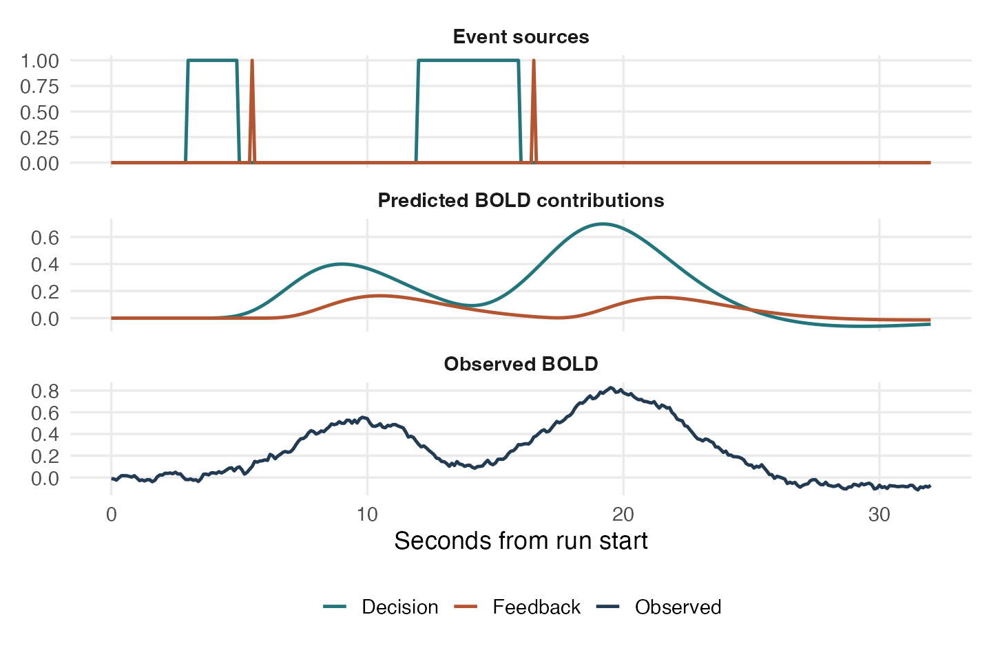

# Conceptual foundations {#sec-foundations}

## Start with the quantity you want to learn

A model of how RPE predicts activity around feedback, an estimate of when a waveform peaks, and a model of how seed activity predicts target activity are three different problems. The first treats recovered activity as a response. The second depends on temporal resolution and the lag family. The third places an estimated variable on the right-hand side, where measurement error can bias the slope. Specify the event, source duration, spatial unit, and scientific contrast before choosing settings.

| Scientific target | Analysis quantity | Main risk |
|---|---|---|
| Trial modulation at feedback onset | Within-person slope at a prespecified parcel and lag | Cue leakage, target gain, participant heterogeneity |
| Activity during deliberation | Duration-model height or integrated activity | RT changes the meaning of the readout |
| Change over an epoch | Planned window contrast or trajectory test | Correlated lags, selection of a maximum, limited time resolution |
| Task-dependent connectivity | Change in seed–target slope with an error-free modulator | Attenuation, shared error, source mixing |

## The forward model and its inverse

For one run and voxel, write the measured BOLD vector as

$$
y = H(h)a + Z\gamma + \varepsilon,
\qquad E(\varepsilon)=0,\quad \operatorname{Cov}(\varepsilon)=\Sigma.
$$

Here $a$ is activity on the acquisition grid, $H(h)$ convolves it with the HRF, and $Z$ contains nuisance terms. Each event can influence many BOLD samples. Two activity patterns with different timing can yield very similar BOLD predictions. A regularized inverse selects among these nearly equivalent patterns using a penalty. In a simplified nuisance-adjusted model,

$$
\widehat a
=\arg\min_a (y-Ha)^\top\Sigma^{-1}(y-Ha)+\lambda\|Pa\|^2.
$$

A larger penalty can suppress noise and broaden or attenuate activity. Smaller penalties can preserve sharper changes and amplify poorly identified directions. The data, forward model, observation mask, and penalty together determine what the estimate resolves. Conditional on fitted settings the inverse is a linear map $D$. With nuisance handling absorbed into the map, the average recovered signal is $DH a$. The matrix $DH$ describes **resolution**. Its off-diagonal entries describe mixing. Its diagonal entries and lobe integrals describe gain under different source definitions.

{#fig-forward fig-alt="Different latent decision and feedback events produce broad, overlapping predicted BOLD time courses."}

## Event alignment asks a source question

An event-aligned readout is a weighted average of the reconstructed activity around an event. A weight vector answers a question about timing and support. It does not isolate the event’s own contribution if the reconstructed signal contains spillover. The source model makes that contribution explicit. For example, a boxcar with duration equal to RT represents a sustained process. Its height and its integral are different estimands. Report the convention and units, especially when comparing across TRs.

Let $B$ denote the complete operator from the retained BOLD samples to corrected trial readouts, including centering if relevant. Let $F$ map the intended source coefficients $\theta$ into predicted BOLD. Then

$$
\widehat z = B y,
\qquad E(\widehat z\mid B,F) = K\theta,
\qquad K=BF,
\qquad \Omega=\operatorname{Cov}(\widehat z\mid B)=B\Sigma B^\top .
$$

$K$ and $\Omega$ answer different questions. $K$ describes gain and source mixing in the mean. $\Omega$ describes how measurement error propagates around that mean. A small SE does not tell you whether $K$ preserves the intended contrast. In `medusa`, `decon_epoch_regression()` applies the matched post-demixing resolution operator ($M_{\text{post}}$) to centered trial predictors so the regression design and corrected response share compatible coordinates. The same principle governs every transformed panel: identify the linear map and carry both the design and measurement covariance through it.

## What is independent?

- **Acquisitions within a run** may have serial noise. Retain acquisition indices through censoring. Treating a deleted volume as a shortened clock changes both event design and modeled covariance.
- **Readouts within a run** can share noise because neighboring events and lags use overlapping BOLD data. Run centering induces dependence of its own.
- **Voxels and parcels** can share error. A parcel average can reduce independent noise while leaving common error. A seed and target can show an association from shared motion, vascular signals, nuisance fits, or acquisition noise.
- **Participants** are ordinarily the independent sampling units for population claims. More trials help estimate each participant’s slope. They do not add independent people.

The book uses “activity” for a latent signal under the fitted neurovascular model. Its scale inherits the HRF normalization and input BOLD units. It has no direct calibration to neuronal firing rates.

Keep two kinds of uncertainty in view. Conditional propagation uses fitted HRFs, noise parameters, gains, penalties, and parcel weights as fixed. Sampling uncertainty in a population coefficient also reflects participant variation. For a likelihood or exact finite-sample claim, state the distributional and independence assumptions. Moment propagation itself requires a correct covariance and finite second moments. It does not require Gaussian errors. The [M-MOM SE chapter](medusa_standard_errors_mmom.qmd) explains how the conditional covariance enters a later model.

## Decide what to save

Save the event tables and acquisition masks, full subject fits, parcel map, lag grid, behavioral design, and version. Preserve operator summaries and participant identities when combining panels. A CSV can retain trial values and SEs while dropping the attributes used for cross-lag modeling and automatic shared-error correction. The fit objects are the reproducible record. The table is a convenient analysis view.
