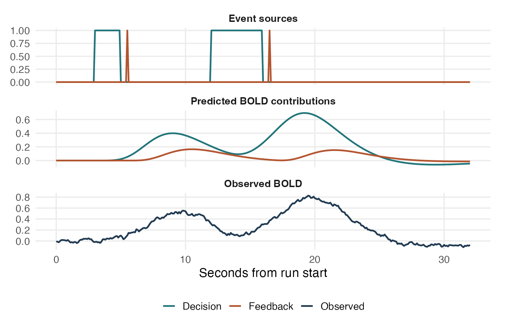

# Conceptual foundations {#sec-foundations}

Many task-fMRI studies aim to relate fast, trial-specific cognitive processes—such as reward prediction errors, choice conflict, or deliberation effort—to neural dynamics across brain regions and participants. Because the hemodynamic response blurs neural activity across 15–30 seconds and scanner observations carry serial and spatial noise, trial-level neural responses are not observed directly. Instead, they are estimated from noisy, overlapping BOLD time series and then entered into second-stage models across trials and participants.

A central insight from two-step latent-variable and multilevel measurement-error modeling (Croon, 2002; Fuller, 1987; Skrondal & Laake, 2001; Vig & Hallquist, 2026) guides the design of MEDuSA: **separating signal estimation from downstream structural inference works cleanly when the first stage places estimates on an unshrunk, additive-error scale and carries unit-specific error covariances into the second stage.** The four subsections below develop how MEDuSA implements this principle from a single run's forward model to population inference.

| Substantive goal | Target quantity | MEDuSA stage & approach |
|---|---|---|
| Test trial modulation at a planned parcel and lag | Population within-person slope (`Neural ~ Behavior`) | Steps 1–4 de-mixed parcel panel $\to$ Step 5 `mixed_by()` with participant random slopes and cohort precision weights |
| Separate firing rate from time-on-task during RT intervals | Sustained boxcar height (`"rate"`) or area (`"integral"`) | Step 3 duration-matched forward model (`source_model = "duration"`) |
| Characterize how an effect evolves across peri-event time | Full lag trajectory, window contrast, or peak timing | Step 5 `medusa_multilag_infer()` using cross-lag resolution and covariance matrices |
| Estimate trial-level seed–target coupling or PPI | Disattenuated neural slope (`Target ~ Seed * Task`) | Step 6 `decon_connectivity_repair()` via regularized modified method of moments (M-MOMS) |

## 1. Express BOLD through a linear neurovascular forward model

Consider a single fMRI run and voxel (or parcel) observed at $T$ acquisition times. Let $a \in \mathbb{R}^T$ denote latent neural activity on the acquisition grid, $H(h)$ denote causal Toeplitz convolution with the local hemodynamic response function $h$, $Z$ collect low-frequency drift and nuisance terms, and $\varepsilon$ denote zero-mean serial observation noise with covariance $\Sigma$:

$$
y = H(h)a + Z\gamma + \varepsilon,
\qquad \mathbb{E}(\varepsilon) = 0, \quad \operatorname{Cov}(\varepsilon) = \Sigma.
$$

{#fig-forward fig-alt="Different latent decision and feedback events produce broad, overlapping predicted BOLD time courses."}

As @fig-forward illustrates, each brief or sustained neural event influences BOLD across many subsequent volumes, so nearby events overlap substantially in the recorded signal. Step 1 (`estimate_crossrun_hrf()`) identifies $h$ out of sample from the participant's other runs and estimates $\Sigma$ on task-adjusted residuals. Step 2 (`deconvolve_crossrun_hrf()`) then reconstructs continuous activity on the acquisition grid via smoothness-penalized generalized least squares:

$$
\widehat{a} = \arg\min_a (y - Ha)^\top \Sigma^{-1}(y - Ha) + \lambda \|Pa\|^2.
$$

With nuisance projection absorbed into the whitened solve, the deconvolved series is a known linear transformation of the BOLD vector, $\widehat{a} = D y$. Larger values of $\lambda$ suppress high-frequency noise while modestly broadening peaks; smaller values preserve rapid transitions at the cost of higher variance.

## 2. Write the exact trial-readout measurement model

To move from continuous activity $\widehat{a}$ to event-locked trial quantities, suppose an investigator samples $\widehat{a}$ around target events using a local quadrature matrix $S$ (for instance, a triangle window centered at feedback onset). If the true event-related neural amplitudes are $\theta$ with forward BOLD design $F\theta$ ($y = F\theta + \varepsilon$ after nuisance removal), the raw trial readout $\widehat{z}_{\text{raw}} = S\widehat{a} = SD y$ can be written by adding and subtracting $\theta$:

$$
\begin{aligned}
\widehat{z}_{\text{raw}} &= SD(F\theta + \varepsilon) \\
&= K_{\text{raw}}\theta + SD\varepsilon \\
&= \theta - (I - K_{\text{raw}})\theta + SD\varepsilon,
\end{aligned}
$$

where $K_{\text{raw}} = SDF$ is the raw trial resolution matrix.

Notice the direct parallel to Empirical Bayes random-effect predictions in multilevel models (Vig & Hallquist, 2026): the estimation error $\widehat{z}_{\text{raw}} - \theta$ contains **two distinct components**. The first, $-(I - K_{\text{raw}})\theta$, is systematic regularization attenuation ($[K_{\text{raw}}]_{ii} < 1$) and spillover from neighboring cues or trials ($[K_{\text{raw}}]_{ij} \neq 0$), which depends on the signal itself. The second, $SD\varepsilon$, is conditionally mean-zero observation noise propagated through deconvolution and readout.

## 3. Invert event mixing to recover an additive-error scale

If raw readouts were passed directly into trial regressions, regularization shrinkage would attenuate amplitudes while spillover from preceding cues or rapid neighboring trials could confound slopes. In Step 3 (`decon_epoch_regression()`), MEDuSA subtracts non-target spillover and applies a regularized inverse of the target mixing matrix (mirroring the inverse-shrinkage step in REPAIR) to form the composite epoch operator $B$:

$$
\widehat{z} = B y \approx \theta + e,
\qquad \mathbb{E}(e \mid \theta) = 0,
\qquad \Omega = \operatorname{Cov}(e \mid B) = B \Sigma B^\top.
$$

Removing systematic mixing places `decon_demixed` ($\widehat{z}$) on a **classical additive measurement-error scale**: target amplitude plus zero-mean propagated error with known trial-by-trial covariance $\Omega$ (whose diagonal square roots are `se_demixed`). When a small ridge term is retained in $B$ to stabilize very rapid inter-stimulus intervals, Step 3 applies the matching post-demixing resolution map $M_{\text{post}}$ to centered within-run covariates so both sides of a trial regression share identical coordinates. Step 4 then extends this exact operator across voxels within each anatomical parcel using task-free noise innovations to account for spatial error correlation.

## 4. Match downstream inference to the structural role of the neural variable

Once trial readouts $\widehat{z}$ are expressed as latent signal plus additive error $e$ with known variance $s_i^2 = \Omega_{ii}$, how measurement error affects group inference depends on **which side of the structural equation $\widehat{z}$ occupies** (Skrondal & Laake, 2001; Vig & Hallquist, 2026):

1. **Neural activity as the outcome (`Neural ~ Behavior`, Step 5):** When error-free task or behavioral variables predict `decon_demixed`, additive zero-mean error $e_i$ enters the regression residual without biasing fixed-effect slope estimates. However, error precision varies across trials, runs, and participants. Step 5 (`mixed_by()` and `medusa_multilag_infer()`) pairs participant random slopes—treating **participants** as the independent unit of population replication—with composite inverse-variance weights $(\widehat{\tau}_{\text{eff}}^2 + s_i^2)^{-1}$ (`precision_weight_cohort`) and cross-lag covariance matrices so standard errors, simultaneous bands, and window contrasts remain calibrated.
2. **Neural activity as a predictor (`Target ~ Seed * Task` or `Behavior ~ Seed`, Step 6):** When a noisy parcel readout moves to the right-hand side as a predictor, trial error $u_i$ inflates the predictor variance $X^\top X$ (attenuating slopes toward zero) and any shared scanner or physiological noise $\operatorname{Cov}(u_i, v_i) \neq 0$ between seed and target shifts $X^\top Y$. Step 6 (`decon_connectivity_repair()`) applies regularized modified method of moments (**M-MOMS**, `medusa_fit_mmom()`) to subtract per-trial error covariance blocks $\Psi_i$ and task-free cross-parcel noise covariances before pooling participant slopes at the group level.

## Practical record-keeping across steps

Throughout the pipeline, latent "activity" is measured in input BOLD units scaled by the chosen HRF normalization convention (`normalize = "positive_lobe"` under `preset = "medusa"`), and conditional error propagation treats the learned Step 1–4 operators as fixed while Step 5–6 random-effects models capture between-participant variation. Retaining the full S3 fit objects (`hrf_fit`, `decon`, and per-participant `epochs` lists or `.rds`/Parquet panels) preserves both the trial table and the operator covariances used by multi-lag and connectivity analyses.
