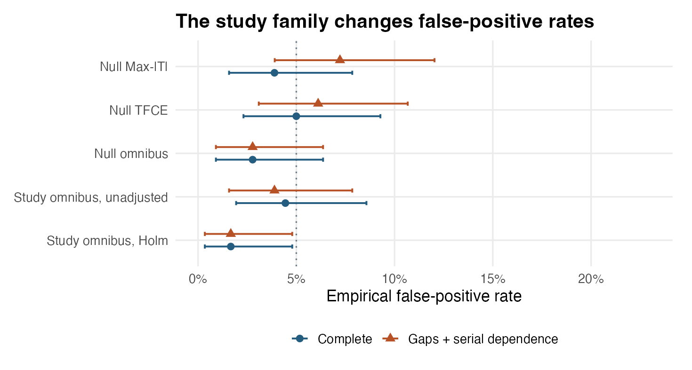
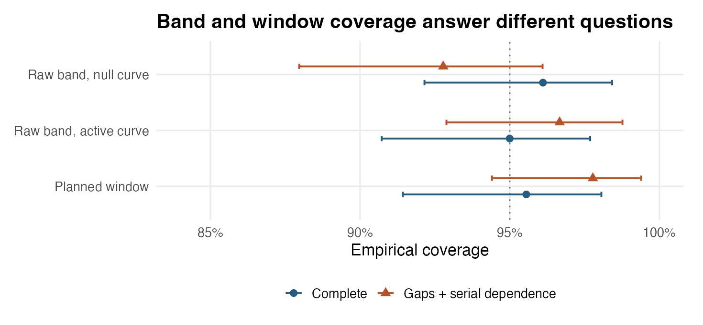

# Calibration of multi-lag trajectory inference

```{r setup, include=FALSE}
d <- read.csv("calibration_summary.csv")
draws <- read.csv("calibration_draws.csv")
pct <- function(x) sprintf("%.1f%%", 100 * x)
rate_of <- function(metric, scenario) {
  z <- d[d$metric == metric & d$scenario == scenario, "rate"]
  stopifnot(length(z) == 1)
  pct(z)
}
```

[Step 5](../medusa_step5_group_models/medusa_step5_group_models.qmd#sec-pr62) introduced `medusa_multilag_infer()` for joint peri-event trajectory estimation, simultaneous confidence bands, 1D TFCE, epoch omnibus testing, and planned window contrasts. This chapter evaluates the empirical Type I error and 95% confidence-band coverage of `medusa::medusa_multilag_infer()` across **180 independent synthetic cohorts per scenario**, separating two distinct error-rate targets:

1. **Within-trajectory familywise calibration:** Controlling false positives and simultaneous band coverage across all lags of a single prespecified `(parcel, term)` trajectory.
2. **Study-wide familywise calibration:** Controlling false discoveries when an analyst tests multiple parcels (here, one active parcel and two null parcels) simultaneously.

## Simulation Design

Each Monte Carlo replication simulates **20 participants**, **2 runs** per participant, **6 peri-event lags** (`0` to `5` s), **1 active parcel**, and **2 null parcels** (`Null A` and `Null B`):

- **Realistic heteroskedasticity and cross-lag/cross-parcel dependence:** Inter-trial intervals jitter between 3 and 9 seconds; Run 2 has $1.6\times$ the residual SD of Run 1; residuals share common cross-parcel noise and positive cross-lag autocorrelation; and true participant slopes vary randomly around the population trajectory in every parcel.
- **Two benchmark regimes (`180` replications each):**
  - **`Complete / independent trials`:** Complete lag support for all 20 participants and independent trial innovations within each run.
  - **`Gaps / serially dependent trials`:** Adds serial autocorrelation in both behavioral predictor and neural trial residuals, drops random subsets of trials within runs, and **censors the final edge lag entirely in 3 of the 20 participants**. Under `medusa_multilag_infer()`'s available-case cross-lag pooling, all 20 participants are retained at supported lags (`0–4` s) while the 17 uncensored participants inform lag `5` s.
- **Inference settings:** Each replication runs the panel pathway of `medusa_multilag_infer()` with `trajectory_mode = "none"`, `contrast_source = "unsmoothed"`, `799` studentized Wishart null draws per trajectory, and a planned `late_minus_early` contrast (`[3, 4] s` minus `[0, 1] s`).

Note what this benchmark isolates: it starts at the participant trial panel to test group pooling, available-case edge support, studentized Wishart null calibration, and study-wide Holm adjustment under known lag covariance and serial trial dependence. End-to-end HRF/deconvolution estimation is evaluated separately in the [14-study validation suite](../library/medusa_validation_suite.html).

## Calibration Scorecard

```{r scorecard, echo=FALSE}
labels <- c(
  null_maxT = "Null trajectory, any Max-|T| lag",
  null_tfce = "Null trajectory, any TFCE lag",
  null_omnibus = "Null trajectory, omnibus",
  null_band = "Null trajectory, raw band coverage",
  active_band = "Active trajectory, raw band coverage",
  raw_epoch_family = "Study family (2 null parcels), unadjusted omnibus",
  holm_epoch_family = "Study family (3 parcels), Holm-adjusted omnibus",
  window_coverage = "Active trajectory, planned window CI coverage"
)
cell <- function(metric, scenario) {
  z <- d[d$metric == metric & d$scenario == scenario, ]
  sprintf("%s<br><small>(%.1f–%.1f%%)</small>", pct(z$rate), 100 * z$low, 100 * z$high)
}
tab <- data.frame(
  Outcome = unname(labels),
  Target = c(rep("5%", 3), rep("95%", 2), "—", "5%", "95%"),
  Complete = vapply(names(labels), cell, character(1), scenario = "Complete / independent trials"),
  Stressed = vapply(names(labels), cell, character(1), scenario = "Gaps / serially dependent trials"),
  check.names = FALSE
)
knitr::kable(tab, row.names = FALSE, escape = FALSE)
```

Parentheses report exact Clopper–Pearson 95% binomial intervals for Monte Carlo uncertainty ($N = 180$ replications). Single-trajectory null metrics evaluate the prespecified `Null A` parcel in every replication; study-family metrics count rejecting *either* `Null A` or `Null B` when testing all three parcels (`Active`, `Null A`, `Null B`).

{#fig-rejection fig-alt="Within-trajectory null rejection rates cluster near the 5 percent target under both complete and gapped/serial designs, and Holm controls the multi-parcel family."}

### Key findings from the rejection and coverage benchmarks

1. **Calibrated within-trajectory Type I error (`Max-|T|`, `TFCE`, `Omnibus`):** Under studentized Wishart covariance draws, single-trajectory null false-positive rates sit squarely around the 5% target in the complete design (**`r rate_of("null_maxT", "Complete / independent trials")`** for `Max-|T|`, **`r rate_of("null_tfce", "Complete / independent trials")`** for `TFCE`, and **`r rate_of("null_omnibus", "Complete / independent trials")`** for `Omnibus`), and remain well controlled under serial trial dependence and edge-lag missingness (**`r rate_of("null_maxT", "Gaps / serially dependent trials")`**, **`r rate_of("null_tfce", "Gaps / serially dependent trials")`**, and **`r rate_of("null_omnibus", "Gaps / serially dependent trials")`**; all 95% Monte Carlo intervals contain 5%).
2. **Study-wide multiplicity control via Holm:** Applying Holm across the 3-parcel family (`Active`, `Null A`, `Null B`) holds familywise false-discovery rates to **`r rate_of("holm_epoch_family", "Complete / independent trials")`** and **`r rate_of("holm_epoch_family", "Gaps / serially dependent trials")`**—scaling cleanly to larger parcel parcellations where unadjusted epoch tests would accumulate false positives across dozens of regions.

{#fig-coverage fig-alt="Simultaneous 95 percent Max-T band coverage and planned window interval coverage cluster tightly around the 95 percent nominal line in both scenarios."}

3. **Simultaneous 95% confidence bands and window contrasts achieve nominal coverage:** Across all 6 lags simultaneously, the raw `Max-|T|` band covers the entire true curve in **`r rate_of("null_band", "Complete / independent trials")`** (null) and **`r rate_of("active_band", "Complete / independent trials")`** (active) of complete replications, and **`r rate_of("null_band", "Gaps / serially dependent trials")`** (null) and **`r rate_of("active_band", "Gaps / serially dependent trials")`** (active) under gapped/serial stress. The planned `late_minus_early` window contrast (`contrast_source = "unsmoothed"`) covers the true population difference in **`r rate_of("window_coverage", "Complete / independent trials")`** and **`r rate_of("window_coverage", "Gaps / serially dependent trials")`** of replications, with negligible mean bias (`r sprintf("%+.3f", mean(draws$window_error[startsWith(draws$scenario, "Complete")]))` and `r sprintf("%+.3f", mean(draws$window_error[startsWith(draws$scenario, "Gaps")]))` slope units).

## Practical Guidance Summary

| Inferential target | Recommended `medusa_multilag_infer()` quantity | Scope reminder |
|:---|:---|:---|
| Localizing individual active lags within one `(parcel, term)` profile | `p_maxT` and simultaneous band `conf.low.sim` / `conf.high.sim` | Controls FWER across lags of *one* trajectory; adjust across parcels/terms if searching multiple regions. |
| Detecting sustained same-sign deflections | `p_tfce` | Summarizes contiguous cluster support across thresholds; do not interpret the smallest `p_tfce` lag as exact latency onset. |
| Screening parcels/terms for any epoch-wide effect | One `omnibus_p` per `(parcel, term)` + `p.adjust(..., method = "holm")` or `"BY"` across the planned study family | Prevents study-wide false-positive inflation across parcellations. |
| Comparing early vs. late epoch phases | `$contrasts` with `contrast_source = "unsmoothed"` | Prespecify early and late lag windows before viewing group curves. |

## Reproduce the Calibration Study

```{bash}
#| eval: false
#| code-summary: "Show reproduction commands"
Rscript simulate.R
Rscript figures.R
quarto render medusa_pr62_calibration.qmd
```

[Calibration summary](calibration_summary.csv) · [Replicate draws](calibration_draws.csv) · [Simulation source](simulate.R) · [Figure source](figures.R)
