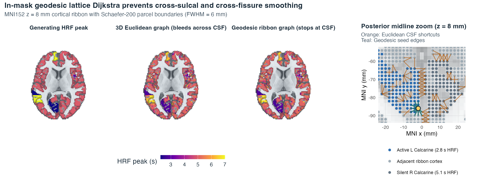
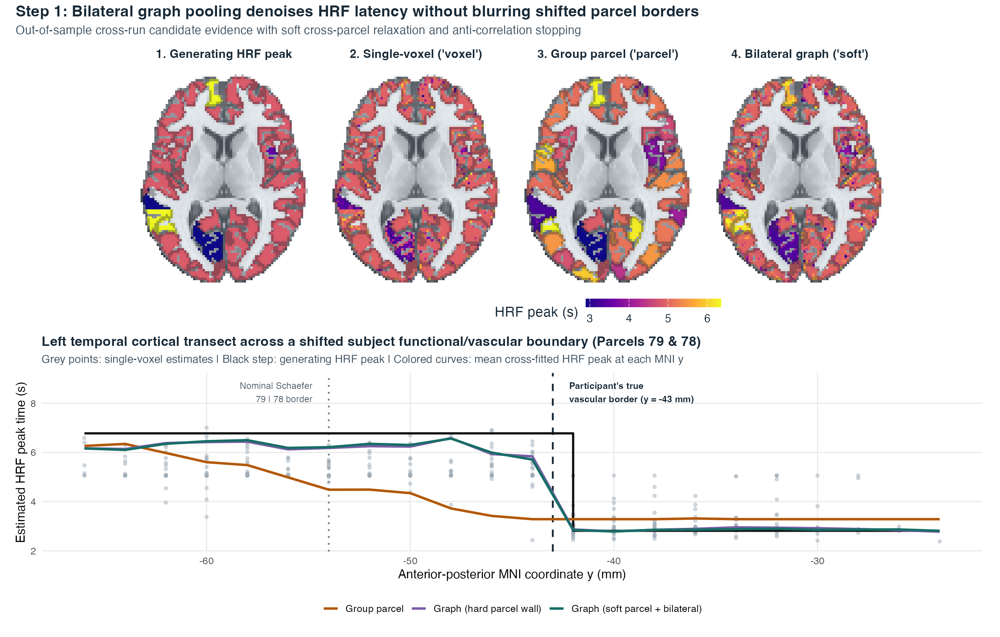
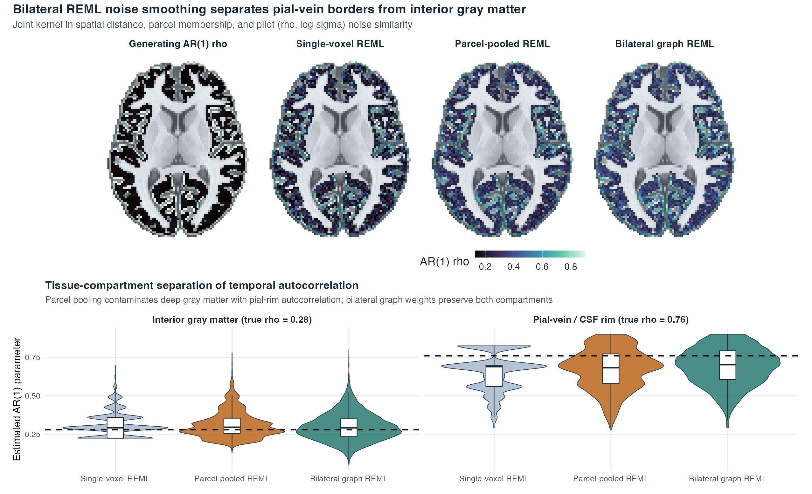
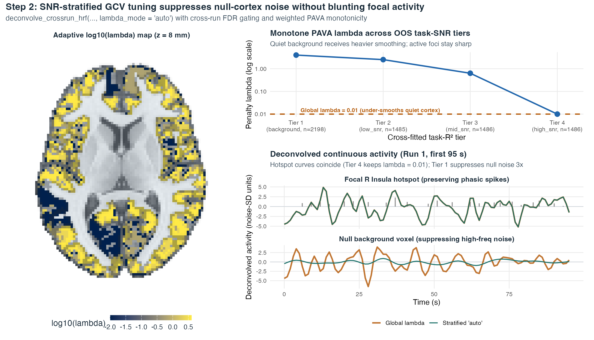
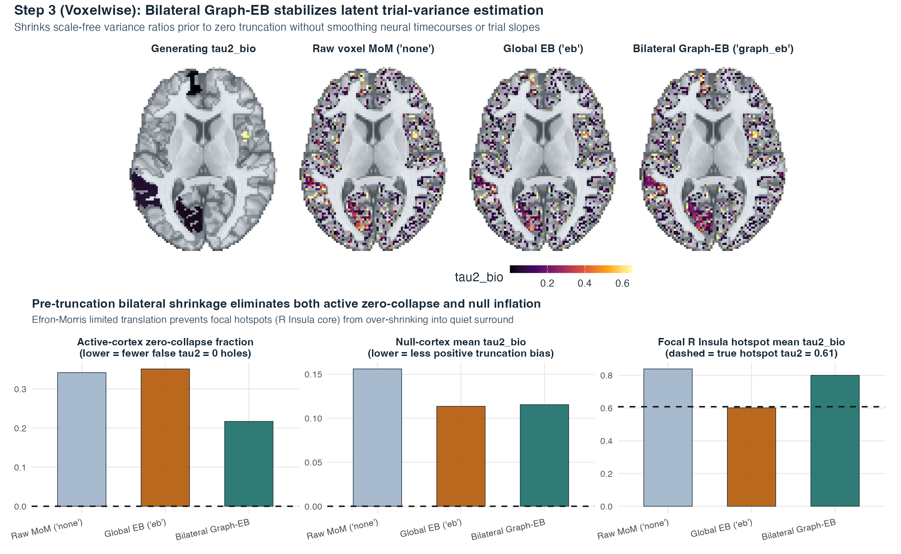
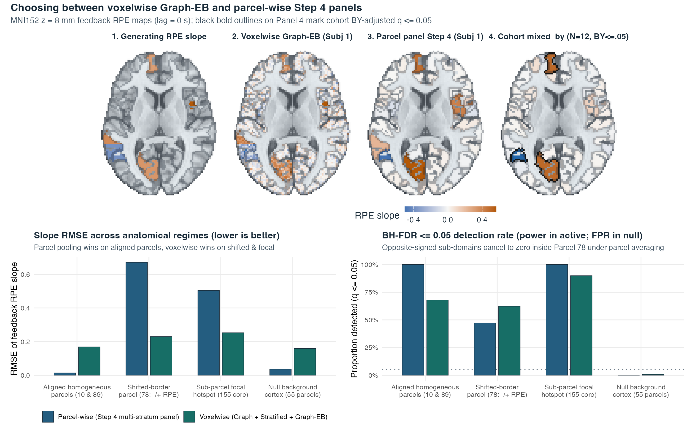

```{r}
#| label: setup-spatial-chapter
#| include: false
library(knitr)
library(data.table)

d <- readRDS("spatial_pooling_examples.rds")
s1 <- fread("step1_hrf_noise_metrics.csv")
s2_strata <- fread("step2_lambda_strata.csv")
s2_comp   <- fread("step2_lambda_comparison.csv")
s3 <- fread("step3_tau2_voxel_metrics.csv")
vp <- fread("voxel_vs_parcel_comparison.csv")

fmt <- function(x, k = 3) sprintf(paste0("%.", k, "f"), x)
pct <- function(x, k = 1) sprintf(paste0("%.", k, "f%%"), 100 * x)

mae_vox   <- s1[method == "Voxel (no pooling)", mae_active_sec]
mae_par78 <- s1[method == "Parcel pooling", mae_shifted_p78_sec]
mae_gsoft <- s1[method == "Geodesic graph (soft parcel)", mae_active_sec]
mae_g78   <- s1[method == "Geodesic graph (soft parcel)", mae_shifted_p78_sec]
p_rim109  <- d$hrf_peaks[d$vinfo$is_opposing_rim & parcel == 109L]
mae_euc_r <- mean(abs(p_rim109$graph_euc  - p_rim109$truth))
mae_geo_r <- mean(abs(p_rim109$graph_soft - p_rim109$truth))

zc_none <- s3[method == "Raw voxel MoM ('none')", active_zero_collapse]
zc_eb   <- s3[method == "Global Empirical Bayes ('eb')", active_zero_collapse]
zc_geb  <- s3[method == "Bilateral Geodesic Graph-EB ('graph_eb')", active_zero_collapse]
hot_eb  <- s3[method == "Global Empirical Bayes ('eb')", hotspot_mean_tau2]
hot_geb <- s3[method == "Bilateral Geodesic Graph-EB ('graph_eb')", hotspot_mean_tau2]
```

## Overview {#sec-spatial-pooling-overview}

Volumetric fMRI analysis faces a classic spatial dilemma whenever trial-by-trial dynamics are estimated across the cortex:

- **Pure single-voxel estimation** preserves fine spatial specificity, but single 2 mm voxels have low per-trial signal-to-noise ratio (SNR). Unpooled voxelwise fits suffer from noisy HRF latency selection in Step 1, unstable $\text{AR}(p)$ autocorrelation estimates, oversmoothed global GCV penalties in Step 2, and severe **zero-collapse** ($\hat{\tau}_{\text{bio}}^2 = 0$) when estimating biological trial-to-trial variance in Step 3.
- **Rigid group-atlas parcel pooling** boosts SNR dramatically when a participant's functional organization aligns with nominal parcel borders. Yet individual functional boundaries routinely shift by 4–10 mm relative to group templates (such as Schaefer-200), sub-parcel focal hotspots can occupy $< 15\%$ of a large parcel, and exterior pial-vein voxels carry much stronger physiological autocorrelation than interior gray matter inside the same parcel.
- **Traditional isotropic Gaussian BOLD smoothing** avoids atlas rigidity only by blurring raw time series across sulcal CSF spaces, opposing gyral banks, and functional borders—destroying spatial resolution and inducing unmodeled spatial noise covariance.

MEDuSA resolves this trade-off by **pooling estimation evidence and variance parameters over a sparse, anatomically and functionally adaptive graph—without ever smoothing raw BOLD or deconvolved neural time series**. Starting from a single NIfTI/atlas bundle (`read_nifti_ts()` or `read_fmriprep_subject()`), the spatial pooling architecture supports **both** full-resolution voxelwise mapping and precision-weighted parcel-panel modeling seamlessly:

::: {.callout-note}
### Two Complementary Spatial Pathways from One NIfTI Bundle
1. **Pathway A — Voxelwise Graph-Pooled Mapping (`write_nifti_ts`):**
   `read_nifti_ts(..., mask, atlas)` $\longrightarrow$ `estimate_crossrun_hrf(..., pooling = "graph")` $\longrightarrow$ `deconvolve_crossrun_hrf(..., lambda_mode = "auto")` $\longrightarrow$ `decon_epoch_regression(..., tau2_shrinkage = "graph_eb")` $\longrightarrow$ `write_nifti_ts(..., reference = decon)` $\longrightarrow$ **`ggbrain`**
2. **Pathway B — Parcel-Wise Multi-Stratum Panel (`backproject_medusa`):**
   `read_nifti_ts(..., mask, atlas)` $\longrightarrow$ `estimate_crossrun_hrf(..., pooling = "graph")` *(preserving intra-parcel HRF & rim-noise heterogeneity!)* $\longrightarrow$ `deconvolve_crossrun_hrf(..., lambda_mode = "auto")` $\longrightarrow$ `decon_epoch_regression(..., parcel_groups = ts$parcel_ids, restore_scale = TRUE, whiten_panel = TRUE, return_panel = TRUE)` $\longrightarrow$ `mixed_by(..., weights = "precision_weight_cohort")` $\longrightarrow$ `backproject_medusa(..., brain_mask = decon)` $\longrightarrow$ **`ggbrain`**
:::

Notice a crucial synergy in **Pathway B**: even when your final group hypothesis in Step 5 or Step 6 is **parcel-wise**, running Step 1 with `pooling = "graph"` (`parcel_boundary = "soft"`) and Step 2 with `lambda_mode = "auto"` before aggregating into parcels in Step 4 lets interior gray-matter and pial-rim voxels retain their distinct whiteners and HRF strata while Step 4's exact multi-stratum operator ($\sum_v u_v D_v F_v$) combines them cleanly.

---

## Choosing Between Voxelwise Graph-EB and Parcel-Wise Panels {#sec-voxel-vs-parcel-guide}

| Analysis Dimension | Pathway A: Voxelwise Graph-EB | Pathway B: Parcel-Wise Step 4 Panel |
|---|---|---|
| **Best suited for** | Sub-parcel focal nuclei/hotspots, shifted individual functional borders, fine retinotopic/topographic gradients, exploratory whole-brain mapping | Hypothesis-driven network/ROI inference, multi-lag trajectory testing (`medusa_multilag_infer()`), and M-MOMS trial connectivity/PPI (`decon_connectivity_repair()`) |
| **Step 1 HRF & noise** | `pooling = "graph"`, `parcel_boundary = "soft"`, `spatial_fwhm = 6` | `pooling = "graph"` (`parcel_boundary = "soft"`) *or* `pooling = "parcel"` when parcels are small and homogeneous |
| **Step 2 deconvolution** | `scaling = "noise_sd"`, `lambda_mode = "auto"` (SNR-stratified PAVA) | `scaling = "noise_sd"`, `lambda_mode = "auto"` (propagates per-voxel $\lambda_v$ into Step 4!) |
| **Step 3 / 4 epoch readout** | `aggregate_by_parcel = FALSE`, `restore_scale = TRUE`, `tau2_shrinkage = "graph_eb"` | `parcel_groups = ts$parcel_ids`, `restore_scale = TRUE`, `whiten_panel = TRUE`, `return_panel = TRUE` |
| **Spatial smoothing of $\hat{s}(t)$ or $\hat{\beta}$?** | **Never.** Only cross-run HRF scores, REML noise $(\hat{\rho}, \log\hat{\sigma})$, smoothed task-$R^2$ tiers, and variance parameters $(\hat{\tau}_{\text{bio}}^2, \hat{\sigma}_{\text{res}}^2)$ pool across concordant neighbors | Aggregates continuous deconvolved series within each parcel using SNR-optimal `parcel_weights` and propagates spatial covariance via task-free `noise_innovations` |
| **Volumetric NIfTI export** | `write_nifti_ts(stat_mat, file, reference = decon)` (uses carried `voxel_map` + `geometry` directly) | `backproject_medusa(coef_df, brain_mask = decon, ...)` (maps integer `atlas_value` parcels directly onto 3D/4D NIfTIs) |

::: {.callout-tip}
### What Does Default `pooling = "voxel"` Do on Atlas-Carrying vs. Atlas-Free NIfTI Inputs?
- **Atlas-free NIfTI (`read_nifti_ts(..., atlas = NULL)`):** `estimate_crossrun_hrf(ts, ...)` keeps `pooling = "voxel"` as a pure single-voxel fit by default so spatial specificity is preserved unless you explicitly opt into `pooling = "graph"`. Even if Step 1 used `pooling = "voxel"`, Step 3 (`decon_epoch_regression(..., tau2_shrinkage = "auto")`) still constructs the 26-connected geodesic CSR graph automatically from `decon$voxel_map` to stabilize voxelwise trial variances (`"graph_eb"`).
- **Atlas-carrying NIfTI (`read_nifti_ts(..., atlas = ...)`):** Calling `estimate_crossrun_hrf(ts, ...)` with default `pooling = "voxel"` does **not** force all voxels in a parcel to share one HRF; it keeps individual HRFs for task-supported voxels (`spatial_strength = 0`), pools AR($p$) noise parameters within parcels, and uses the parcel-pooled HRF strictly as a `"fallback_parcel"` safety net for low-SNR voxels that fail cross-run gating. Switching explicitly to `pooling = "graph"` upgrades both HRF evidence and REML noise estimation to edge-preserving geodesic bilateral pooling across all voxels.
:::

---

## End-to-End Code Recipes with `ggbrain` {#sec-spatial-recipes}

### Shared Step 0: Ingest 4D NIfTIs + Ribbon Mask + Atlas & Inspect Graph Topology

Whether your inputs come from fMRIPrep (`read_fmriprep_subject(..., atlas = atlas_nii)`) or preprocessed 4D NIfTI runs (`read_nifti_ts()`), MEDuSA validates grid/affine alignment up front and attaches `voxel_map` (`i, j, k, x, y, z, linear_index, atlas_value`), `parcel_ids`, and NIfTI `geometry` to the returned `"medusa_nifti_ts"` object.

```{r}
#| eval: false
#| code-fold: false
library(medusa)
library(ggbrain)

# 1. Stream in-mask cortical ribbon time series + Schaefer parcel labels into memory
ts <- read_nifti_ts(
  niftis    = c("sub-01_run-01_bold.nii.gz",
                "sub-01_run-02_bold.nii.gz",
                "sub-01_run-03_bold.nii.gz"),
  mask      = "sub-01_space-MNI152NLin2009cAsym_desc-ribbon_mask.nii.gz",
  atlas     = "Schaefer2018_200Parcels_7Networks_2009c_2mm.nii.gz",
  tr        = 1.0,
  run_names = c("run1", "run2", "run3")
)

# Optional: build and inspect the sparse CSR geodesic graph explicitly
# (estimate_crossrun_hrf(..., pooling = "graph") builds this automatically when omitted)
g_geo <- build_spatial_graph(
  ts,
  spatial_fwhm    = 6,         # 6 mm geodesic Gaussian kernel along 26-connected lattice
  parcel_boundary = "soft",    # soft cross-parcel relaxation when profiles agree
  metric          = "geodesic" # stops at out-of-mask CSF sulci and fissures
)
```

### Pathway A: Voxelwise Graph-Pooled Analysis & `ggbrain` Visualization

```{r}
#| eval: false
#| code-fold: false
# Step 1: Out-of-sample bilateral geodesic HRF & REML AR(1) noise estimation
hrf_fit <- estimate_crossrun_hrf(
  bold            = ts,
  events          = events,
  kernel_grid     = hrf_library(tr = ts$tr, preset = "medusa"),
  pooling         = "graph",
  spatial_graph   = g_geo,
  parcel_boundary = "soft",
  amplitude_model = "trial",
  selection_mode  = "soft_average"
)

# Step 2: Event-informed continuous deconvolution with SNR-stratified PAVA lambda
decon <- deconvolve_crossrun_hrf(
  bold        = ts,
  hrf_fit     = hrf_fit,
  scaling     = "noise_sd",
  lambda_mode = "auto"         # FDR-gated SNR tiers + monotone PAVA smoothing
)

# Optional: export the realized per-voxel log10(lambda) SNR-tier map in 1 line
write_nifti_ts(
  log10(decon$settings$lambda_by_voxel),
  "sub-01_log10_lambda.nii.gz",
  reference = decon,
  fill      = NA_real_
)

# Step 3 (Voxelwise): Epoch de-mixing + bilateral Graph-EB trial-variance shrinkage
ep_vox <- decon_epoch_regression(
  deconvolution    = decon,
  covariates       = covariates,       # e.g., list(run1 = data.frame(rpe = ...), ...)
  events           = events,
  target_condition = "feedback",
  lags             = -1:3,
  restore_scale    = TRUE,
  tau2_shrinkage   = "graph_eb"        # pre-truncation bilateral shrinkage + Efron-Morris guard
)

# Export lag = 0 s voxelwise GLS t-map directly using decon's carried NIfTI geometry
lag0_vox <- subset(ep_vox$coefficients, lag == 0 & term == "rpe")
t_vec    <- stats::setNames(lag0_vox$t_gls, lag0_vox$voxel)
write_nifti_ts(t_vec, "sub-01_feedback_rpe_t_lag0.nii.gz", reference = decon, fill = NA_real_)

# Render axial brain map with Schaefer parcel outlines in ggbrain
t1_nii    <- system.file("extdata", "mni_template_2009c_2mm.nii.gz", package = "ggbrain")
atlas_nii <- system.file("extdata", "Schaefer_200_7networks_2009c_2mm.nii.gz", package = "ggbrain")

gg_vox <- ggbrain(bg_color = "white") +
  images(c(underlay = t1_nii, atlas = atlas_nii, tmap = "sub-01_feedback_rpe_t_lag0.nii.gz")) +
  slices(c("z = 6", "z = 8", "z = 10")) +
  geom_brain("underlay[underlay > 8]",
             fill_scale = ggplot2::scale_fill_gradient(low = "#30363D", high = "#E6ECF0"),
             show_legend = FALSE) +
  geom_brain("tmap[abs(tmap) > 2.0]",
             fill_scale = scale_fill_bisided(name = "GLS t", symmetric = TRUE)) +
  geom_outline("atlas[atlas > 0]", mapping = ggplot2::aes(group = value),
               outline = "#1F2933", size = 1, alpha = 0.35, show_legend = FALSE)
plot(gg_vox)
```

### Pathway B: Parcel-Wise Multi-Stratum Panel, Cohort `mixed_by()`, & `ggbrain` Map

```{r}
#| eval: false
#| code-fold: false
# Step 4 (inside decon_epoch_regression): Exact multi-stratum parcel pooling
# Reuses the exact same graph-pooled `decon` object from Step 2!
ep_parcel <- decon_epoch_regression(
  deconvolution    = decon,
  covariates       = covariates,
  events           = events,
  target_condition = "feedback",
  lags             = -1:3,
  parcel_groups    = ts$parcel_ids,    # triggers Step 4 continuous parcel aggregation
  restore_scale    = TRUE,
  whiten_panel     = TRUE,
  return_panel     = TRUE
)

# Attach participant ID and stack across subjects for Step 5 mixed_by()
panel_sub <- data.table::as.data.table(ep_parcel$panel)
panel_sub[, id := "sub-01"]
# ... repeat across cohort into `group_panel <- data.table::rbindlist(subject_panels)` ...

group_fit <- mixed_by(
  data               = group_panel,
  outcomes           = "decon_demixed",
  rhs_model_formulae = ~ rpe + (1 + rpe || id),
  split_on           = c("parcel", "evt_time"),
  weights            = "precision_weight_cohort",
  padjust_by         = "term",
  padjust_method     = "BY"
)

# Backproject Schaefer parcels directly onto 3D NIfTI via decon's carried map
# (`parcel` character IDs and `evt_time` are auto-detected and matched to `atlas_value`)
coef_lag0 <- subset(group_fit$coef_df_reml, term == "rpe" & evt_time == 0)

nii_paths <- backproject_medusa(
  coef_df    = coef_lag0,
  brain_mask = decon,                  # no external template file or manual integer coercion needed!
  plot_cols  = c("estimate", "statistic"),
  output_dir = "group_maps",
  fill       = NA_real_
)

# Plot group parcel statistic map in ggbrain
gg_par <- ggbrain(bg_color = "white") +
  images(c(underlay = t1_nii, atlas = atlas_nii, gstat = "group_maps/statistic_rpe.nii.gz")) +
  slices("z = 8", title = "Cohort feedback RPE t-map (lag = 0 s)") +
  geom_brain("underlay[underlay > 8]",
             fill_scale = ggplot2::scale_fill_gradient(low = "#30363D", high = "#E6ECF0"),
             show_legend = FALSE) +
  geom_brain("gstat[!is.na(gstat)]",
             fill_scale = scale_fill_bisided(name = "Group t", symmetric = TRUE)) +
  geom_outline("atlas[atlas > 0]", mapping = ggplot2::aes(group = value),
               outline = "#1F2933", size = 1, alpha = 0.4, show_legend = FALSE)
plot(gg_par)
```

---

## Volumetric Benchmark on the MNI152 Cortical Ribbon {#sec-spatial-simulation-walkthrough}

To evaluate every component of the spatial and parcel pooling pipeline against known ground truth on genuine human cortical folding, `simulate_spatial_pooling.R` constructs a 3-slice cortical gray-matter ribbon slab ($z = 6, 8, 10\text{ mm}$, `V =` `r format(nrow(d$vinfo), big.mark = ",")` voxels across `r uniqueN(d$vinfo$parcel)` Schaefer-200 parcels) from `mni_template_2009c_2mm.nii.gz` and `Schaefer_200_7networks_2009c_2mm.nii.gz`. Three 4D NIfTI runs (`TR = 1.0 s`, `170` TRs/run, `22` jittered cue + feedback trials per run = `66` total target trials with a unit-variance signed `rpe` covariate) are written to disk and ingested via `read_nifti_ts()`.

Four realistic anatomical and physiological testbeds are embedded simultaneously on the cortical sheet:

1. **Cross-fissure barrier + parcel-aligned active cortex (`Parcels 10 & 89` vs. `109 & 194`):** Left Calcarine (`Parcel 10`, fast `2.8 s` HRF peak, $\beta_{\text{RPE}} = +0.55$) and Left Superior Medial PFC (`Parcel 89`, slow `6.8 s` HRF peak, $\beta_{\text{RPE}} = +0.50$) are homogeneously active across their entire parcel boundaries, while their homologous right-hemisphere neighbors across the 2–4 mm interhemispheric CSF gap (`Parcels 109 & 194`, canonical `5.1 s` HRF peak) are purely null for feedback RPE ($\beta_{\text{RPE}} = 0, \tau_{\text{bio}} = 0$).
2. **Shifted individual functional/vascular border (`Parcels 78 & 79`, Left Posterior Temporal Cortex):** While the group Schaefer boundary between `Parcel 79` and `Parcel 78` sits near $y = -55\text{ mm}$ on $z = 8\text{ mm}$, this participant's true neurovascular and computational transition sits **anteriorly at $y = -43\text{ mm}$**—splitting `Parcel 78` cleanly into a posterior slow-HRF negative-RPE zone ($y \le -43\text{ mm}$, `6.8 s` HRF peak, $\beta_{\text{RPE}} = -0.62$) and an anterior fast-HRF positive-RPE zone ($y > -43\text{ mm}$, `2.8 s` HRF peak, $\beta_{\text{RPE}} = +0.62$).
3. **Sub-parcel focal hotspot (`Parcel 155`, Right Insula):** A compact 30-voxel spherical nucleus ($r \le 4.6\text{ mm}$ around $(42, 6, 8)$, occupying $13.3\%$ of `Parcel 155`'s 225 voxels) exhibits strong positive RPE coding ($\beta_{\text{RPE}} = +0.92, \tau_{\text{bio}} = 0.78$) surrounded by 195 quiet insular voxels.
4. **Whole-ribbon pial-vein vs. gray-matter noise heterogeneity:** Exterior cortical rim voxels bordering CSF (`23.0%` of the mask) generate high temporal autocorrelation ($\rho = 0.76, \sigma = 0.38$) compared to interior gray matter ($\rho = 0.28, \sigma = 0.21$), driven by spatially correlated $\text{AR}(1)$ innovations along the geodesic sheet.

---

### 1. Geodesic Lattice Dijkstra vs. 3D Euclidean Shortcuts (`build_spatial_graph()`) {#sec-geodesic-vs-euclidean}

On folded cortex, two gyral banks separated by a dark CSF sulcus or longitudinal fissure are often only 2–5 mm apart in 3D Euclidean space while lying centimeters apart along the cortical sheet. When `build_spatial_graph()` receives a volumetric `"medusa_nifti_ts"` object (or 3D mask/`voxel_map` carrying integer lattice indices `i, j, k`), `metric = "auto"` selects **26-connected in-mask lattice Dijkstra** (`metric = "geodesic"`), measuring step lengths in physical millimeter world coordinates ($2\text{ mm}$ face, $2\sqrt{2}\text{ mm}$ edge-diagonal, $2\sqrt{3}\text{ mm}$ corner-diagonal) strictly through valid in-mask voxels.

{#fig-geodesic-vs-euclidean width="100%"}

In our slab, an unconstrained 6 mm Euclidean graph (`metric = "euclidean"`) creates **`r format(d$total_euc_shortcuts, big.mark = ",")` directed shortcut edges** that jump across out-of-mask CSF gaps (`r nrow(d$shortcuts_z8)` in-plane pairs on $z = 8\text{ mm}$ alone; orange segments in @fig-geodesic-vs-euclidean, right). Along the posterior midline, those shortcuts bleed Left Calcarine's fast HRF across the interhemispheric CSF cleft onto Right Calcarine's medial rim (`Parcel 109` rim HRF MAE = **`r fmt(mae_euc_r)` s** vs. **`r fmt(mae_geo_r)` s** under geodesic pooling).

---

### 2. Step 1 Bilateral HRF Pooling & Soft Parcel Relaxation {#sec-bilateral-hrf}

Geodesic distance alone prevents cross-CSF shortcuts where the mask resolves the sulcus, yet two challenges remain: **(a)** at 2 mm resolution, narrow sulci are sometimes bridged by partial-volumed voxels, and **(b)** functional transitions occur *inside* continuous gyri where group parcel boundaries are misregistered. `estimate_crossrun_hrf(..., pooling = "graph")` addresses both via **out-of-sample bilateral candidate concordance** (`csr_hrf_graph_pool_cpp()`):

- **Strict target-run exclusion:** For held-out target run $r$, training score profiles, noise $(\hat{\rho}^{(-r)}, \log\hat{\sigma}^{(-r)})$, and spatial innovation correlations $v_{\text{quad}}^{(-r)}$ are computed exclusively from runs $s \neq r$.
- **Disattenuated profile concordance & anti-correlation stopping:** Neighbor $v$'s influence on focal voxel $u$ combines geodesic Gaussian proximity with Spearman-disattenuated cross-run candidate score correlation $\tilde{c}_{uv}$. Negative concordance triggers a sharp bilateral brake $\exp(-3.5\gamma c_-^2)$, halting pooling across opposite-tuned or distinct vascular borders even on a continuous gyral ribbon.
- **Soft cross-parcel relaxation (`parcel_boundary = "soft"`, `parcel_cross_weight = 0.35`):** Cross-parcel edges start downweighted at `0.35` when task signal is ambiguous, but smoothly relax toward $1.0$ when neighboring voxels across a nominal atlas line share strong positive out-of-sample candidate concordance.
- **Spatial correlation calibration & prototype quantization:** Stouffer–Cauchy gating divides pooled $Z$-evidence by $\sqrt{v_{\text{quad}}^{(-r)}}$ so shared local scanner noise never triggers false HRF switches in null cortex, and soft-averaged kernels are quantized into at most `max_hrf_strata = 48L` prototypes so Step 2 operator caching stays fast.

{#fig-step1-hrf-pooling width="100%"}

```{r}
#| label: tbl-spatial-step1
#| tbl-cap: "Step 1 cross-fitted HRF peak-latency MAE (s) and AR(1) noise RMSE across pooling modes on the 6,655-voxel MNI152 cortical ribbon."
kable(
  s1,
  digits = 3,
  row.names = FALSE,
  col.names = c(
    "Step 1 Pooling Mode",
    "Active Cortex HRF MAE (s)",
    "Shifted Parcel 78 MAE (s)",
    "Opposing CSF Rim MAE (s)",
    "Pial-Rim AR(1) RMSE",
    "Deep-GM AR(1) RMSE",
    "Noise SD RMSE",
    "HRF Strata"
  )
)
```

As shown in @fig-step1-hrf-pooling and @tbl-spatial-step1, single-voxel selection (`pooling = "voxel"`) is unbiased on average but noisy (`Active MAE =` **`r fmt(mae_vox)` s**). Group-parcel pooling (`pooling = "parcel"`) denoises aligned parcels (`10` and `89`) well, but averages the fast (`2.8 s`) and slow (`6.8 s`) domains inside `Parcel 78` into a flat intermediate plateau (`Shifted Parcel 78 MAE =` **`r fmt(mae_par78)` s**). Bilateral geodesic graph pooling with `parcel_boundary = "soft"` achieves the lowest error globally (**`r fmt(mae_gsoft)` s**) *and* inside shifted `Parcel 78` (**`r fmt(mae_g78)` s**), tracking the participant's true $y = -43\text{ mm}$ transition cleanly.

---

### 3. Bilateral REML Noise Smoothing at Pial-Vein Borders {#sec-bilateral-noise}

In Step 1, temporal autocorrelation ($\rho$) and marginal innovation scale ($\log\hat{\sigma}$) vary sharply at tissue boundaries: pial surface veins and CSF-adjacent voxels exhibit strong physiological pulsation ($\rho = 0.76$), whereas interior gray matter is much whiter ($\rho = 0.28$). Pooling noise uniformly across whole Schaefer parcels contaminates interior gray matter with pial-rim autocorrelation (@fig-bilateral-noise, orange violins).

Under `pooling = "graph"`, `hrf_estimate_noise()` applies a **joint bilateral kernel** (`csr_bilateral_noise_smooth_cpp()`) that multiplies geodesic spatial weights by pilot $(\Delta\hat{\rho}, \Delta\log\hat{\sigma})$ similarity before tail-aware cluster quantization (`max_noise_strata = 10L`). High-$\rho$ rim voxels borrow strength along the pial rim while deep gray-matter voxels pool with interior gray matter, cutting single-voxel $\hat{\rho}$ RMSE nearly in half in both compartments without blurring the tissue boundary (@tbl-spatial-step1).

{#fig-bilateral-noise width="100%"}

---

### 4. Step 2 SNR-Stratified Deconvolution (`lambda_mode = "auto"`) {#sec-step2-stratified-lambda}

In volumetric fMRI, most gray-matter voxels exhibit weak or zero task modulation for any specific contrast while focal task-engaged regions carry high out-of-sample task $R^2$. A single global deconvolution penalty (`lambda_mode = "global"`) is forced into an awkward compromise: low enough to avoid crushing active peaks, yet leaving high-frequency inverse-filter noise across thousands of silent background voxels.

`deconvolve_crossrun_hrf(..., lambda_mode = "auto")` solves this via **FDR-gated, PAVA-monotone SNR stratification**:

1. **Cross-run significance gate:** Out-of-sample Step 1 run $p$-values are combined via Fisher's method and adjusted across voxels via Benjamini–Hochberg FDR. On pure-null maps (no voxels passing $q \le 0.10$), `"auto"` collapses safely to 1 global stratum.
2. **Edge-preserving task-$R^2$ tiers:** When task signal is present, Step 1 task $R^2$ is stabilized over the spatial graph (`smooth_scalar_csr_cpp`), separating a quiet background tier ($q > 0.20$, $R^2_{\text{stab}} < 0.025$) from ascending active task-SNR quantiles (`max_lambda_strata = 4L`).
3. **Monotone PAVA regularization:** Each tier tunes $\lambda$ on its relevant objective (pure prewhitened GCV + background level stability in the quiet tier; modulation-transfer-guarded GCV in active tiers), and **weighted pool-adjacent-violators (`hrf_pava_nonincreasing()`)** enforces $\lambda_{\text{quiet}} \ge \lambda_{\text{low-SNR}} \ge \dots \ge \lambda_{\text{high-SNR}}$. Crucially, each voxel's exact $\lambda_v$ is carried into Step 3 and Step 4 (`key|lam:` operator caching).

{#fig-step2-stratified width="100%"}

```{r}
#| label: tbl-spatial-step2
#| tbl-cap: "Step 2 SNR-stratified lambda tiers vs. global compromise penalty."
kable(
  s2_strata,
  digits = 3,
  row.names = FALSE,
  col.names = c("Tier", "Stratum Label", "Voxels", "Mean OOS Task R²", "Task SNR Proxy", "Stratified Lambda", "Global Lambda")
)
```

Stratified tuning suppresses continuous background standard deviation in null voxels from **`r fmt(s2_comp$null_bg_sd[2])`** (global $\lambda$) down to **`r fmt(s2_comp$null_bg_sd[1])`** while maintaining crisp neural spike recovery in the 30-voxel Right Insula hotspot ($r =$ **`r fmt(s2_comp$focal_hotspot_corr[1])`** with generating continuous impulses; @fig-step2-stratified).

---

### 5. Step 3 Voxelwise Bilateral Graph-EB (`tau2_shrinkage = "graph_eb"`) {#sec-step3-grapheb}

In Step 3 (`decon_epoch_regression()`), GLS precision weights and ZCA trial whitening depend on partitioning total trial-to-trial variance into **propagated observation-noise variance** $s_{\text{obs},u}^2$ (known analytically from the Step 1–2 operator) and **latent biological trial-to-trial variance** $\tau_{\text{bio},u}^2$. At the single-voxel level with 50–80 trials, raw method-of-moments estimation $\hat{\tau}_{\text{raw},u}^2 = \hat{\sigma}_{\text{tot},u}^2 - s_{\text{obs},u}^2$ has wide sampling variance, creating two Simultaneous pathologies when truncated at zero ($\max(0, \hat{\tau}_{\text{raw},u}^2)$):

- **Active-cortex zero-collapse:** **`r pct(zc_none)`** of genuinely active voxels randomly draw $\hat{\tau}_{\text{raw},u}^2 \le 0$ and collapse to $\hat{\tau}_{\text{bio}}^2 = 0$, distorting trial weights into pure inverse-measurement-error weights!
- **Null-cortex truncation bias:** Nearly half of true $\tau_{\text{bio}}^2 = 0$ voxels draw positive noise fluctuations, inflating average null $\hat{\tau}_{\text{bio}}^2$ above zero (`r fmt(s3[method == "Raw voxel MoM ('none')", null_mean_tau2])`).
- Meanwhile, **global Empirical Bayes (`tau2_shrinkage = "eb"`)** pools all 6,655 voxels toward one whole-slab prior dominated by the 85% null background—leaving **`r pct(zc_eb)`** active zero-collapse unfixed while pulling the 30-voxel Right Insula hotspot downward relative to local bilateral pooling (`hotspot mean` $\hat{\tau}_{\text{bio}}^2 =$ **`r fmt(hot_eb)`** vs. **`r fmt(hot_geb)`** under Graph-EB)!

`tau2_shrinkage = "graph_eb"` (`graph_eb_tau2_csr_cpp()`, automatic default under `tau2_shrinkage = "auto"` whenever `deconvolution` carries a spatial graph or `voxel_map` coordinates in voxelwise mode) solves all three problems:

1. **Pre-truncation scale-free pooling:** Shrinks the *untruncated* dimensionless ratio $\hat{\theta}_u = \hat{\tau}_{\text{raw},u}^2 / s_{\text{obs},u}^2$ across bilateral graph neighbors *before* applying $\max(0, \cdot)$—allowing positive and negative estimation errors in null cortex to cancel symmetrically around zero while preventing zero-collapse in active cortex (**`r pct(zc_geb)`** zero-collapse!).
2. **Isserlis correlated-error variance discount:** Accounts for the exact squared-error correlation $\operatorname{Corr}(Z_u^2, Z_v^2) = \rho_{uv}^2$ induced by shared spatial scanner innovations (`noise_innovations`) so effective neighborhood sample size is never overstated.
3. **Bilateral border stopping + Efron–Morris hotspot protection:** Combines Cauchy pilot-jump weights with orthogonalized trial-residual sign concordance to stop at functional boundaries, and caps maximum shrinkage at **$2.5\sigma_u$ (Efron–Morris limited translation)** so isolated focal hotspots retain their true biological variance (**`r fmt(hot_geb)`** in the Right Insula core; @fig-step3-grapheb). Sandwich residual scales (`[scale_unw, scale_pw, scale_gls]`) are similarly moderated over the bilateral graph (`moderate_scale_csr_cpp()`) to boost $t$-statistic degrees of freedom without ever smoothing trial slopes $\hat{\beta}_u$.

{#fig-step3-grapheb width="100%"}

```{r}
#| label: tbl-spatial-step3
#| tbl-cap: "Step 3 voxelwise variance-component accuracy, null false-positive calibration, and BH-FDR power across tau2_shrinkage modes."
kable(
  s3,
  digits = 3,
  row.names = FALSE,
  col.names = c(
    "Step 3 Shrinkage Mode",
    "Active Zero-Collapse",
    "Null Mean tau2",
    "Opposing Rim tau2",
    "Focal Hotspot tau2 (True = 0.608)",
    "Whole-Slab tau2 RMSE",
    "Null FPR (p <= .05)",
    "Active Power (BH q <= .05)"
  )
)
```

---

### 6. Voxelwise Graph-EB vs. Parcel-Wise Panels Across Regimes {#sec-head-to-head}

Finally, @fig-voxel-vs-parcel and @tbl-spatial-tradeoff compare **Pathway A (Voxelwise Graph-EB)** exported via `write_nifti_ts()` against **Pathway B (Step 4 Parcel-Wise Panel & Step 5 12-Subject Cohort `mixed_by()`)** exported via `backproject_medusa()` across all four anatomical regimes on the exact same dataset:

{#fig-voxel-vs-parcel width="100%"}

```{r}
#| label: tbl-spatial-tradeoff
#| tbl-cap: "Slope RMSE, mean |t|, and BH-FDR <= 0.05 detection across anatomical regimes for Voxelwise Graph-EB vs. Step 4 Parcel-Wise Panels."
kable(
  vp,
  digits = 3,
  row.names = FALSE,
  col.names = c("Anatomical Regime", "Analysis Pathway", "RPE Slope RMSE", "Mean |t|", "Detected (BH q <= .05)")
)
```

The results crystallize the practical modeling guidance:

- **When functional anatomy aligns with the parcellation (`Parcels 10 & 89`):** Step 4 parcel aggregation pools continuous deconvolved time series across 154–341 voxels using cross-run precision weights while propagating spatial innovation correlation accurately—cutting slope RMSE more than $3\times$ relative to single voxels and achieving `100%` detection power, with clean cohort-level inference in Step 5 (`mixed_by()` + BY control; bold black parcel outlines in @fig-voxel-vs-parcel, Panel 4).
- **When individual functional boundaries shift across a parcel (`Parcel 78`):** Averaging the posterior negative-RPE sub-domain ($\beta = -0.62$) and anterior positive-RPE sub-domain ($\beta = +0.62$) inside `Parcel 78` cancels the parcel slope to nearly zero! Voxelwise Graph-EB resolves **both** sub-domains cleanly on the cortical ribbon without blurring across the $y = -43\text{ mm}$ border.
- **When an effect is restricted to a sub-parcel focal nucleus (`Right Insula Parcel 155` core):** Averaging 30 active hotspot voxels with 195 silent surround voxels dilutes the parcel slope by nearly $85\%$. Voxelwise Graph-EB—protected by SNR-stratified Step 2 $\lambda$ and Efron–Morris limited translation—preserves the focal hotspot amplitude and detects it reliably while keeping false positives controlled across the 55 null parcels.

::: {.callout-note}
### Parcel-Level Empirical Bayes Across Dense Parcellations (`Schaefer-400` / `1000`)
When `aggregate_by_parcel = TRUE` (`parcel_groups = ...`) and no parcel-level `spatial_graph` is supplied, `tau2_shrinkage = "auto"` resolves to `"none"` by default because standard coarse parcels already enjoy high multi-voxel SNR. If you analyze a fine-grained parcellation with many small parcels (e.g., Schaefer-400 or Schaefer-1000), simply set `tau2_shrinkage = "graph_eb"` explicitly: `decon_epoch_regression()` automatically constructs a precision-weighted 3D parcel-centroid Euclidean graph from `decon$voxel_map` (and propagates parcel-aggregated Step 1 task-$R^2$ gating), or you can supply a custom cortical-surface geodesic distance matrix via `build_spatial_graph(parcel_dist_mat)`.
:::

---

## Mathematical Details {#sec-spatial-math}

<details>
<summary>Show mathematical formulation of bilateral geodesic graph pooling, SNR-stratified PAVA, and pre-truncation Graph-EB</summary>

### 1. Sparse Geodesic CSR Graph and Bilateral Step 1 Weights

Let $G = (\mathcal{V}, \mathcal{E})$ denote the sparse compressed-sparse-row (CSR) neighborhood graph built by `build_spatial_graph()` with Gaussian bandwidth $\sigma_d = \text{FWHM} / \sqrt{8 \ln 2}$ and cutoff radius $r_{\max} = 2\sigma_d$ (capped at $k_{\max} = 32$ nearest in-mask neighbors via 26-connected lattice Dijkstra distances $d_{\text{geo}}(u, v)$).

For held-out target run $r$, let $S_u^{(-r)} \in \mathbb{R}^K$ denote voxel $u$'s out-of-sample adjusted partial-$R^2$ profile across the $K$-kernel physiological HRF manifold, and let $(\hat{\rho}_u^{(-r)}, \log\hat{\sigma}_u^{(-r)})$ denote its target-excluded pilot $\text{AR}(1)$ parameters. Neighbor $v \in \mathcal{N}(u)$ receives bilateral HRF pooling weight:
$$
w_{uv}^{(-r)} = \exp\!\left(-\frac{d_{\text{geo}}(u,v)^2}{2\sigma_d^2}\right) \cdot \pi_{uv} \cdot \exp\!\left(-3.5\,\gamma\,\max(0, -\tilde{c}_{uv})^2\right)
$$
where $\tilde{c}_{uv} \in [-1, 1]$ is the Spearman-disattenuated cross-run candidate-profile correlation between $u$ and $v$, and the parcel boundary factor $\pi_{uv}$ equals $1$ when $g_u = g_v$, $0$ under `parcel_boundary = "hard"`, and smoothly interpolates from `parcel_cross_weight` ($w_{\times} = 0.35$) toward $1$ as positive concordance $c_+ = \max(0, \tilde{c}_{uv})$ increases under `parcel_boundary = "soft"`:
$$
\pi_{uv}^{\text{soft}} = w_{\times} + (1 - w_{\times})\, c_+^2 \quad (g_u \neq g_v).
$$
To calibrate out-of-sample signal gating against spatially correlated scanner innovations $Z^{(-r)}$, `csr_quad_cor_cpp()` evaluates the exact quadratic spatial correlation inflation factor on the normalized graph weights $\tilde{w}_{uv} = w_{uv}^{(-r)} / \sum_{v'} w_{uv'}^{(-r)}$ in $O(m k_{\max}^2 V)$ time:
$$
v_{\text{quad}, u}^{(-r)} = \sum_{a \in \mathcal{N}(u) \cup \{u\}} \sum_{b \in \mathcal{N}(u) \cup \{u\}} \tilde{w}_{ua}\,\tilde{w}_{ub}\,\widehat{\operatorname{Corr}}\!\left(z_a^{(-r)}, z_b^{(-r)}\right)^2,
$$
scaling Stouffer–Cauchy combined run evidence by $(v_{\text{quad}, u}^{(-r)})^{-1/2}$.

### 2. Step 2 SNR-Stratified Regularization with Weighted PAVA

Let $\tilde{R}_u^2$ be the graph-stabilized out-of-sample Step 1 task $R^2$ and $q_u$ the Benjamini–Hochberg adjusted Fisher combination $p$-value across runs. When $\min_u q_u \le 0.10$, voxels are partitioned into a quiet background tier ($q_u > 0.20$ and $\tilde{R}_u^2 < 0.025$) and up to $M - 1$ ascending active SNR quantiles with unconstrained tier penalties $(\hat{\lambda}_1, \dots, \hat{\lambda}_M)$. Monotone non-increasing smoothness penalties $\lambda_1^\star \ge \lambda_2^\star \ge \dots \ge \lambda_M^\star$ are obtained via weighted pool-adjacent-violators:
$$
\boldsymbol{\lambda}^\star = \arg\min_{\lambda_1 \ge \dots \ge \lambda_M} \sum_{m=1}^M n_m \left(\log \lambda_m - \log \hat{\lambda}_m\right)^2.
$$

### 3. Step 3 Pre-Truncation Bilateral Graph-EB with Isserlis Discount & Efron–Morris Guard

At lag $\tau$, let $\hat{\sigma}_{\text{tot}, u}^2$ be voxel $u$'s residual trial variance across $N$ target trials (with effective residual degrees of freedom $\nu_u$) and $s_{\text{obs}, u}^2$ its operator-propagated measurement-error variance. Define the **untruncated** dimensionless biological-to-measurement variance ratio:
$$
\hat{\theta}_u = \frac{\hat{\tau}_{\text{raw}, u}^2}{s_{\text{obs}, u}^2} = \frac{\hat{\sigma}_{\text{tot}, u}^2 - s_{\text{obs}, u}^2}{s_{\text{obs}, u}^2}, \qquad \operatorname{Var}(\hat{\theta}_u) \approx v_u = \frac{2}{\nu_u}\bigl(1 + \max(0, \tilde{\theta}_u)\bigr)^2.
$$
For bilateral edge weights $\alpha_{uv}$ (combining geodesic Gaussian kernel, Cauchy pilot-jump factor $[1 + (\tilde{\theta}_u - \tilde{\theta}_v)^2 / s_0^2]^{-1}$, and orthogonalized trial-residual sign concordance), Gaussian innovations with spatial correlation $\rho_{ab}$ obey Isserlis' identity $\operatorname{Corr}(Z_a^2, Z_b^2) = \rho_{ab}^2$. Accounting for self-weight $\alpha_{uu}$ and neighbor error correlation yields the local prior mean $\mu_{\text{loc}, u}$, prior variance $\tau_{\text{prior}, u}^2$, shrinkage factor $B_u = v_u / (v_u + \tau_{\text{prior}, u}^2)$, and **Efron–Morris limited-translation** posterior estimate ($M_{\text{EM}} = 2.5$):
$$
\theta_u^{\text{raw-EB}} = (1 - B_u)\,\hat{\theta}_u + B_u\,\mu_{\text{loc}, u}, \qquad
\theta_u^{\text{EM}} = \hat{\theta}_u + \operatorname{clip}\!\left(\theta_u^{\text{raw-EB}} - \hat{\theta}_u,\; -M_{\text{EM}}\sqrt{v_u},\; +M_{\text{EM}}\sqrt{v_u}\right),
$$
followed **only at the end** by non-negativity truncation $\hat{\tau}_{\text{bio}, u}^2 = s_{\text{obs}, u}^2 \max(0, \theta_u^{\text{EM}})$.

</details>
