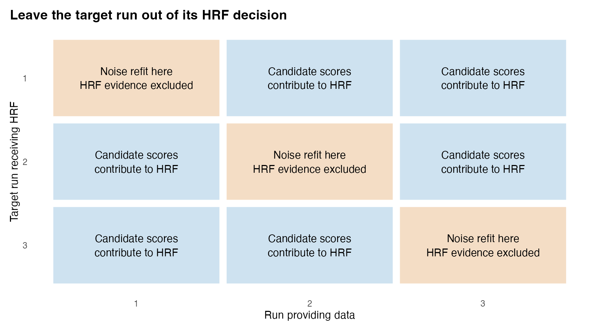
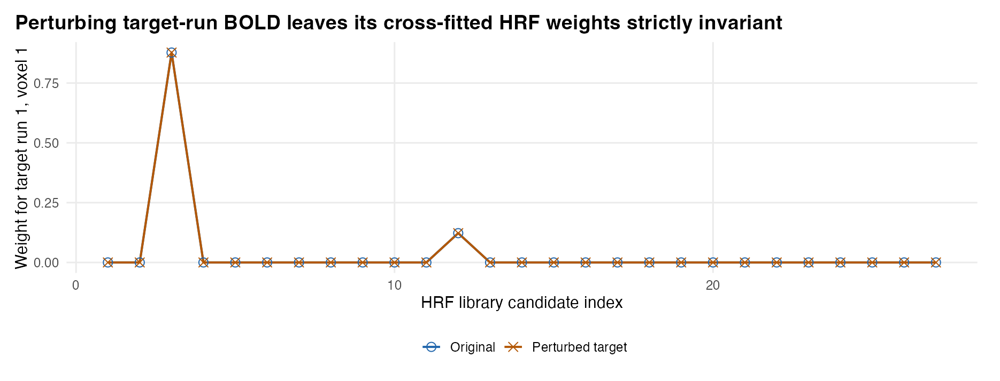

## Overview

Before MEDuSA can deconvolve a BOLD time series into latent neural activity, it must know two properties of the observation process: **(1) the hemodynamic response function (HRF)** that blurs and delays neural events into BOLD fluctuations, and **(2) the temporal autocorrelation structure** of the scanner and physiological noise. Assuming a single canonical HRF across the brain can shift inferred neural timing by several seconds in fast subcortical or slow association regions, while estimating the HRF on the same run that will later be deconvolved risks tuning the vascular filter to noise or circularly inflating trial effects.

Step 1 (`hrf_library()` + `estimate_crossrun_hrf()`) solves this identification problem through **leave-one-run-out cross-fitting** paired with **two-pass post-selection noise estimation**. For each target run $r$, MEDuSA scores a physiologically realistic HRF candidate library exclusively on the participant's *other* runs ($s \neq r$), pools shape evidence across voxels within functional parcels without averaging raw BOLD signals, and shrinks weak or inconsistent task regions back to a prespecified canonical fallback. Once each target run receives its frozen out-of-sample HRF, MEDuSA refits a stationary $\text{AR}(p)$ noise cascade on run $r$'s own task-projected residuals so Step 2 can whiten and invert run $r$ without circularity or HRF-mismatch bias.

::: {.callout-note}
### Position in the MEDuSA Pipeline
**Raw preprocessed BOLD + Event schedule** $\longrightarrow$ **Step 1 (`estimate_crossrun_hrf`)** $\longrightarrow$ `hrf_fit` S3 object $\longrightarrow$ **Step 2 (`deconvolve_crossrun_hrf`)**
:::

---

## Goals of Step 1

Step 1 has four specific estimation goals:

1. **Identify regional HRF timing, width, and undershoot out of sample:** Select or smoothly blend candidate HRF shapes for each target run using only training runs ($s \neq r$), preventing target-run overfitting.
2. **Prevent noise fitting in silent regions:** Require calibrated $F$-test task evidence and cross-run compatibility before departing from the canonical HRF; assign silent or erratic regions cleanly to `fallback_kernel`.
3. **Separate vascular shape from serial noise covariance:** Estimate run-specific $\text{AR}(p)$ autocorrelation parameters ($\rho, \psi_1, \dots, \psi_4$) *after* projecting out nuisance drift, free trial responses, and HRF derivatives under the selected HRF so unmodeled BOLD waves are never mistaken for $\text{AR}(1)$ persistence.
4. **Record an auditable forward specification:** Package the run clocks, `valid_rows` masks, nuisance designs, training manifests, candidate scores, composite HRF waveforms, and noise parameters into a single `crossrun_hrf` object so downstream steps never reconstruct timing or masks by guesswork.

**What Step 1 deliberately leaves to later steps:** Step 1 *never* sees your behavioral or computational trial covariates (such as reward prediction error or choice value), *never* modifies the BOLD matrices, and *does not* produce deconvolved activity or trial slopes. Its trial-amplitude designs exist solely as temporary nuisance/signal subspaces for scoring HRFs and isolating noise residuals.

---

## Inputs: What Step 1 Receives and Why

Every input to `estimate_crossrun_hrf()` is structured to preserve exact acquisition timing across runs and censoring gaps:

| Input | Structure | Why It Is Set Up That Way |
|---|---|---|
| `bold` | Named list of numeric matrices (`time × voxel`), one per run | Keeping runs separate (rather than concatenating them) defines the cross-fitting folds ($s \neq r$), accommodates unequal run lengths, and prevents AR filters or HRF tails from bleeding across run boundaries. Voxel columns must appear in identical order with matching column names across runs so evidence can be pooled per spatial unit. |
| `events` | Named list of `data.frame`s (`onset`, optional `duration`, `condition`) matching `names(bold)` | HRF shape cannot be identified blindly without anchor timestamps (shifting $h$ forward and neural timing backward yields identical BOLD). Supplying *all* modeled task events—without behavioral covariates—anchors vascular lag while keeping behavioral hypotheses blind. Zero-row `events[[r]]` (e.g., resting-state runs) are permitted and receive canonical fallback HRFs plus pure-nuisance noise fits. |
| `tr` & `time_offset` | Positive scalar TR (s); scalar or per-run start time (s) | Maps continuous event times (in seconds) onto discrete acquisition bins via fractional bracket interpolation or sub-bin boxcar occupancy, ensuring off-TR jitter is represented accurately. |
| `kernel_grid` | Numeric matrix (`L_hrf × K`) from `hrf_library()`, with column 1 as canonical fallback | Pre-discretizing normalized candidate waveforms onto the `tr` grid lets C++ evaluate all $K$ candidates in batched BLAS sweeps and guarantees a known reference shape (`fallback_kernel = 1L`) when task SNR is absent. |
| `valid_rows` | Optional named list of logical vectors (`length == nrow(bold[[r]])`) | **Never delete censored TRs before Step 1.** Deleting rows compresses the clock, corrupting causal HRF convolution tails after a scrub gap and pretending separated volumes are lag-1 neighbors. Logical `valid_rows` keeps the physical time grid intact while excluding bad frames from regression and likelihood scoring. |
| `nuisance` | Optional named list of numeric matrices (`nrow == nrow(bold[[r]])`) | Motion parameters, physiological regressors, or tissue comps supplied here are combined with an automatic run intercept and linear trend so slow scanner drift does not masquerade as broad HRFs or $\rho \to 1$ autocorrelation. |
| `spatial_groups` & `noise_groups` | Named character/factor vectors mapping `voxel_ids` to parcels / tissue classes | Separating `spatial_groups` (functional parcels sharing vascular timing) from optional `noise_groups` (e.g., tissue/ROI classes sharing serial autocorrelation) lets Step 1 pool low-SNR voxel evidence without averaging raw BOLD series that may carry opposite neural signs. |

---

## Outputs: What Step 1 Produces and Why It Is Set Up That Way

`estimate_crossrun_hrf()` returns an S3 object of class `"crossrun_hrf"`. Rather than collapsing everything into a single HRF vector per voxel, its components are separated according to their statistical roles in Steps 2–4:

| Output Component | Structure | Why It Is Set Up That Way |
|---|---|---|
| `selected_kernels` | Named list (by target run) of `L_hrf × voxel` matrices | **The actual HRF used in Step 2.** Storing a per-run, per-voxel matrix allows leave-one-run-out cross-fitting (each run gets the HRF learned on *other* runs) and represents continuous `soft_average` composite waveforms that do not correspond to any single column of `kernels`. |
| `kernel_weights` | Named list of `K × voxel` unit-sum weight matrices | Records the exact Boltzmann + Empirical-Bayes shrinkage weights over library candidates (`kernels %*% kernel_weights[[r]]`, re-normalized under `settings$kernel_normalize`), making soft composites auditable and reproducible. |
| `selections` | Named list of per-run `data.frame`s (`voxel`, `parcel`, `kernel_index`, `status`, `best_adjusted_partial_r2`, `selected_task_p`, `n_compatible_shapes`, `stability`) | Provides human-readable diagnostics *and* passes out-of-sample task SNR (`best_adjusted_partial_r2`, `selected_task_p`) to Step 2 so `lambda = NULL` tunes deconvolution smoothness only on genuinely task-active units. Note that under `soft_average`, `kernel_index` merely names the highest-weight library column—always inspect `selected_kernels` for the realized shape. |
| `noise` | Named list of per-run `data.frame`s (`voxel`, `group`, `rho`, `psi1`–`psi4`, `noise_sd`, `method`, `n_voxels`) | Stores **own-run** stationary $\text{AR}(p)$ cascade parameters `(1 - rho B)(1 - sum psi_j B^j)` separately from out-of-sample HRF shapes. Separating `noise` per run allows scanner autocorrelation to vary across runs while grouping voxels with identical `(selected_kernel, ar_vec)` into shared linear-operator strata in Steps 2–3. |
| `training_runs` & `signal_status` | Named list of training-run ID vectors; per-run sufficiency table | Explicitly documents cross-fitting provenance (verifying target run $r$ was excluded from its HRF decision, or recording contiguous sub-block cross-fitting when `length(bold) == 1L`). |
| `specification` & `settings` | Stored `events`, `nuisance`, `valid_rows`, `spatial_groups`, `tr`, `kernel_normalize` | Freezes the exact forward timing, masks, and normalization convention so `deconvolve_crossrun_hrf()` and `decon_epoch_regression()` automatically inherit identical clocks and masks without user book-keeping errors. |

---

## Recommended Settings

```{r}
#| eval: false
#| code-fold: false
library(medusa)

# 1. Build the 3D physiological HRF manifold (~44 candidates, positive-lobe normalized)
candidates <- hrf_library(tr = tr, preset = "medusa")

# 2. Cross-fit HRF shapes across runs and refit own-run AR(p) noise
hrf_fit <- estimate_crossrun_hrf(
  bold            = bold,
  events          = events,
  tr              = tr,
  kernel_grid     = candidates,
  nuisance        = nuisance,
  valid_rows      = valid_rows,
  spatial_groups  = parcel_ids,
  pooling         = "parcel",
  amplitude_model = "trial",
  noise_model     = "ar1",
  evidence        = "calibrated",
  selection_mode  = "soft_average",
  return_scores   = TRUE
)
```

| Argument | Recommended | Package Default | Why Recommended & When to Adjust |
|---|---|---|---|
| `hrf_library(..., preset)` | `"medusa"` | `"custom"` (3 delays × 3 dispersions) | `"medusa"` constructs a maximin-pruned ~44-candidate **3D physiological manifold** spanning fast/narrow/zero-undershoot subcortical HRFs (`peak_delay` down to $2.5\text{ s}$, `dispersion` down to $0.6$, `undershoot_ratio = Inf`) through slow cortical HRFs ($8.0\text{ s}$), normalized by `"positive_lobe"` ($\sum_t \max(h_t, 0) = 1$) so regional undershoot differences do not distort neural gain. Use `"canonical_27"` only when restricting strictly to fixed-undershoot cortical shapes. |
| `pooling` & `spatial_groups` | `pooling = "parcel"` with `parcel_ids` | `pooling = "voxel"`, `spatial_groups = NULL` | Pooling precision-weighted candidate $R^2$ evidence across voxels within anatomical/functional parcels dramatically stabilizes HRF selection at realistic single-voxel fSNR without averaging raw BOLD signals. If strong within-parcel vascular gradients are expected at 7T/high SNR, use `pooling = "voxel", spatial_strength = 0.02` for Empirical-Bayes shrinkage toward the parcel profile. |
| `selection_mode` | `"soft_average"` | `"hard"` | `"soft_average"` forms a Boltzmann-weighted composite HRF across compatible candidates, shrunk toward `fallback_kernel` by parcel departure confidence. Across sub-grid vascular delays and Windkessel–Balloon simulations, `"soft_average"` reduces HRF RMSE by 8–22% and neural latency bias by 20–35% relative to discrete `"hard"` grid snapping. |
| `amplitude_model` | `"trial"` (for cognitive modulation) or `"condition"` | `"condition"` | `"condition"` fits one amplitude per condition per run and is fast when events evoke a consistent mean response. Switch to `"trial"` whenever trial-by-trial effects can take both positive and negative signs around zero (e.g., signed prediction errors), where a condition mean cancels out! In multi-condition tasks, `"trial"` automatically compares per-condition trial designs to avoid collinearity. |
| `noise_model` & `evidence` | `"ar1"` & `"calibrated"` | `"ar1"` & `"calibrated"` | Keep both defaults. Note that `noise_model = "ar1"` actually fits a **stationary $\text{AR}(1) \times \text{AR}(q)$ cascade** (up to $\text{AR}(5)$ at fast multiband TRs) via pooled two-pass REML, not just a single-parameter $\text{AR}(1)$! `"calibrated"` enforces $F$-test task gates and cross-run compatibility. |

---

## How Step 1 Works in Detail

```{r}
#| include: false
sel <- read.csv("selections.csv")
noise_tbl <- read.csv("noise.csv")
acf_tbl <- read.csv("whitening_acf.csv")
ex <- readRDS("step1_examples.rds")
```

### 1. Candidate HRF Library and Positive-Lobe Normalization

Every candidate column $h_m$ in `hrf_library()` is evaluated on `seq(0, duration, by = tr)` as a difference of two gamma densities parameterized by peak delay, dispersion, and positive-to-undershoot ratio (`undershoot_ratio = Inf` omits the negative dip altogether for fast subcortical/thalamic responses), with the canonical $(6\text{ s}, 1.0, 6)$ curve placed in **column 1** as the default fallback.

Under `preset = "medusa"`, kernels use **positive-lobe normalization** ($\sum_{t: h_t > 0} h_t = 1$) rather than signed-sum normalization ($\sum_t h_t = 1$). Why? Under signed-sum normalization, a candidate with a deep post-stimulus undershoot has a smaller net sum and is therefore rescaled to a much taller positive peak—artificially shrinking its deconvolved neural amplitude relative to a zero-undershoot candidate! Normalizing by positive-lobe mass keeps unit-impulse neural height comparable across regions with different venous undershoot depths.

{#fig-step1-library width="100%" fig-alt="Three-panel plot of positive-lobe-normalized HRF candidates varying peak delay, dispersion, and undershoot ratio."}

Because observed BOLD convolves neural events with the local vascular filter, identical neural event trains produce shifted and broadened BOLD peaks in fast versus slow vascular territories (@fig-step1-forward). Step 1 learns that territory-specific filter before deconvolution begins.

{#fig-step1-forward width="100%" fig-alt="Top: stem plot of neural event impulses. Bottom: fast and slow BOLD time courses."}

### 2. Leave-One-Run-Out Cross-Fitting (and Single-Run Block Splitting)

For target run $r$ in a multi-run session ($R \ge 2$), candidate HRF scores are computed exclusively on runs $s \neq r$, while run $r$'s own data are used only after HRF selection to estimate run $r$'s noise covariance (@fig-step1-folds). Perturbing `bold$run1` arbitrarily leaves `hrf_fit$kernel_weights$run1` and `hrf_fit$selected_kernels$run1` unchanged to machine precision (`r format(ex$weight_difference, digits = 3)` in @fig-step1-target-check).

What if a participant has **only one task run** (`length(bold) == 1L`)? Rather than failing or fitting in-sample, `estimate_crossrun_hrf()` automatically partitions usable observations into contiguous temporal sub-blocks (3 blocks when $n_{\text{valid}} \ge 120$, 2 halves when $40 \le n_{\text{valid}} < 120$), scores candidates on each sub-block against the full causal event design (preserving HRF tails across block boundaries), tests cross-block shape compatibility, and returns a single continuous HRF for the intact run.

{#fig-step1-folds width="88%" fig-alt="3x3 grid illustrating leave-one-run-out HRF scoring versus own-run noise estimation."}

{#fig-step1-target-check width="92%" fig-alt="Overlapping candidate weight profiles for original and perturbed Run 1."}

### 3. Calibrated Evidence Scoring, Amplitude Models, and Spatial Pooling

Within each training run $s \neq r$, MEDuSA whitens the usable rows under a first-pass noise filter, projects out the nuisance subspace $Z_s$, and measures how much residual variance each candidate HRF explains via **degree-of-freedom-adjusted partial $R^2$**, accompanied by an effective-DF Satterthwaite $F$-test (`selected_task_p`).

Two design choices govern whether training runs detect genuine neural signal:

- **Condition-mean vs. trial-wise training designs (`amplitude_model`):** When trial responses fluctuate symmetrically around zero (such as a zero-mean reward prediction error), a single condition-mean regressor cancels positive and negative trials and misses the HRF completely (@fig-step1-signed). Setting `amplitude_model = "trial"` frees per-event amplitudes (evaluating one condition freed at a time in multi-condition schedules) so unsigned trial variance identifies the vascular shape—still without touching external behavioral predictors.
- **Parcel evidence pooling (`pooling = "parcel"`):** Pooling averages precision-weighted candidate score profiles across voxels in a parcel *after* squaring voxelwise $t$/$R^2$ evidence, so voxels with opposite-signed task effects reinforce rather than cancel one another (@fig-step1-evidence, @fig-step1-pooling). Regions without calibrated task support (`Null` in @fig-step1-evidence) fail the departure gate and fall back cleanly to `hrf_1`.

{#fig-step1-evidence width="100%" fig-alt="Heatmaps of out-of-sample adjusted partial R-squared across Fast, Slow, and Null parcels."}

{#fig-step1-signed width="95%" fig-alt="Comparison of generating HRF, condition-amplitude estimate, and free-trial-amplitude estimate."}

{#fig-step1-pooling width="95%" fig-alt="HRF peak times across voxel noise SDs for voxelwise versus parcel pooling."}

Under `selection_mode = "soft_average"`, compatible library candidates are combined via Boltzmann weights scaled by cross-run noise SE and shrunk toward column 1 by Empirical-Bayes departure confidence (@fig-step1-composites).

{#fig-step1-composites width="95%" fig-alt="Comparison of generating HRF, hard node, and soft composite curves."}

```{r}
#| label: tbl-step1-selections
#| tbl-cap: "Realized Run 1 selection summary for one representative voxel per parcel (`selections.csv`)."
sub_sel <- subset(sel, run == "run1" & voxel %in% c("v01", "v09", "v17"))
knitr::kable(
  sub_sel[, c("voxel", "parcel", "kernel", "status", "best_adjusted_partial_r2", "selected_task_p", "n_compatible_shapes", "stability")],
  digits = 3, row.names = FALSE
)
```

### 4. Two-Pass Post-Selection $\text{AR}(p)$ Noise Refitting

In fMRI, task-evoked BOLD responses are smooth low-frequency waves. If noise autocorrelation is estimated under a *misspecified* canonical HRF (for instance, a $6.0\text{ s}$ filter applied to a $4.5\text{ s}$ `Fast` region), unmodeled task-timing residuals leak into the error series and bias $\hat{\rho}$ upward toward the stationarity boundary!

To prevent HRF mismatch from corrupting the whitener, `estimate_crossrun_hrf()` performs a **post-selection two-pass REML noise refit** on each run $r$:

1. Using the cross-fitted HRF $\hat{h}^{(-r)}$, `hrf_build_noise_mean_design()` constructs a rich nuisance-and-task projection subspace containing run intercept/trend, user `nuisance`, DF-adaptive $<1/128\text{ Hz}$ DCT cosines, convolved free-trial columns, and 1st/2nd condition HRF Taylor derivatives (degrading gracefully when residual degrees of freedom are tight).
2. Within contiguous unmasked segments of `valid_rows[[r]]`, MEDuSA pools bias-corrected profile REML across group voxels to select $\hat{\rho} \in [-0.8, 0.9]$ and fits up to $q \le 4$ higher-order innovation-whitened Yule–Walker parameters $(\psi_1, \dots, \psi_q)$ representing $(1 - \rho B)(1 - \sum_{j=1}^q \psi_j B^j)\varepsilon_t = u_t$, followed by a second GLS pass so task projection itself uses the learned covariance.

In our `TR = 0.65 s` simulation with true $\text{AR}(3)$ parameters $(\rho = 0.65, \psi_1 = 0.20, \psi_2 = -0.30)$, refitting noise under the cross-fitted HRF recovers virtually identical cascade parameters across `Fast`, `Slow`, and `Null` parcels (@tbl-step1-noise) and flattens true error autocorrelation across all lags (@fig-step1-noise)—whereas a misspecified fixed canonical HRF distorts the `Fast` parcel's whitener. See the [Woolrich autocorrelation assessment](woolrich_review/woolrich_noise_assessment.qmd) for a side-by-side comparison against FILM-style Tukey tapers.

```{r}
#| label: tbl-step1-noise
#| tbl-cap: "Realized Run 1 AR(p) cascade estimates (`noise.csv`) compared against generating parameters (rho = 0.65, psi1 = 0.20, psi2 = -0.30, sd_vox[1] = 0.012)."
sub_n <- subset(noise_tbl, run == "run1" & voxel %in% c("v01", "v09", "v17"))
knitr::kable(
  sub_n[, c("voxel", "group", "rho", "psi1", "psi2", "noise_sd", "method", "n_voxels")],
  digits = 4, row.names = FALSE
)
```

{#fig-step1-noise width="100%" fig-alt="Error autocorrelation curves comparing unwhitened, fixed-canonical-HRF whitened, and MEDuSA post-selection refit whitened errors."}

---

## Diagnostic Checklist Before Proceeding to Step 2

1. **Verify target-run exclusion:** Check `hrf_fit$training_runs` to confirm every run's HRF was trained strictly on $s \neq r$ (or sub-block cross-fit if $R = 1$) and inspect `hrf_fit$signal_status` for dropped or zero-event runs.
2. **Inspect realized composite waveforms, not just `kernel_index`:** Plot `hrf_fit$selected_kernels` for key parcels to check physiological plausibility and fallback rates (`status == "fallback_prespecified"`).
3. **Audit `hrf_fit$noise`:** Check for widespread boundary hits (`rho == 0.90` or `-0.80`), which usually signal unmodeled drift, motion spikes, or unrecorded task events missing from `events` or `nuisance`.

<details>
<summary>Mathematical Details & Edge-Case Rules</summary>

- **Cross-fitted evidence pooling:** For candidate $m$ on training run $s \neq r$, whitened nuisance-orthogonalized BOLD $y_{s,\perp}$ is regressed onto whitened candidate design $X_{s,m,\perp}$ (rank $d_{s,m}$ over $n_s$ valid rows), yielding adjusted partial $R^2_{s,m} = 1 - (1 - R^2_{s,m})\frac{n_s - p_Z}{n_s - p_Z - d_{s,m}}$. Across training runs, scores are weighted by effective degrees of freedom and checked for sign/peak compatibility (`stability`).
- **Soft-average shrinkage:** Compatible candidates within `score_margin` receive Boltzmann weights $w_m \propto \exp(\Delta R^2_m / \tau_{\text{SE}})$ blended with column 1 (`(1 - \eta) e_1 + \eta w`), where Empirical-Bayes shrinkage $\eta \in [0, 1]$ approaches 0 as calibrated task $F$-statistics weaken toward the `evidence_alpha` threshold.
- **Exact gapped covariance:** When `valid_rows[[r]]` masks interior frames, AR estimation restricts lag products strictly within contiguous unmasked runs of frames, while Step 2's whitener $W_r$ inverts the exact stationary Toeplitz submatrix $\Sigma_{\text{AR}}[I_r, I_r]$ on retained timestamps $I_r$ so multi-TR scrub gaps decay correlation by $\gamma(|t_a - t_b|)$ rather than treating across-gap neighbors as 1 TR apart.

[Step 1 simulation script](simulate_step1.R) · [Figure script](figures_step1.R) · [Selection table](selections.csv) · [Noise table](noise.csv)

</details>
