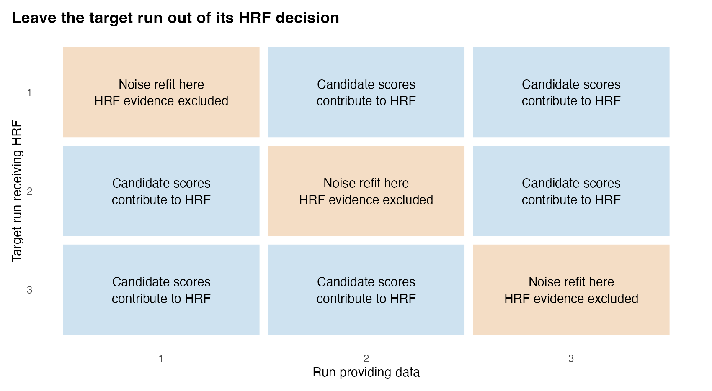

```{r}
#| include: false
sel <- read.csv("selections.csv")
noise_tbl <- read.csv("noise.csv")
acf_tbl <- read.csv("whitening_acf.csv")
resp_tbl <- read.csv("respiratory_fd_metrics.csv")
ex <- readRDS("step1_examples.rds")
```

## Overview

In task fMRI, neural events are observed through a regional **hemodynamic response function (HRF)** that delays and smooths activity over 15–30 seconds, superimposed on **serially correlated scanner and physiological noise**. Both properties vary across brain territories and scans: sensory and subcortical regions often peak 1–2 seconds earlier than association cortex, while CSF-adjacent cortex exhibits stronger temporal autocorrelation than deep gray matter.

Step 1 (`hrf_library()` + `estimate_crossrun_hrf()`) estimates both components before deconvolution begins. To keep vascular shape estimation independent of the noise in the run being deconvolved, Step 1 uses **leave-one-run-out cross-fitting**: for each target run $r$, it evaluates a physiological library of candidate HRFs using only the participant's *other* runs ($s \neq r$), pools shape evidence across parcels or local cortical neighborhoods, and forms a regularized composite HRF that shrinks smoothly back toward a canonical reference where task signal is weak. Holding that cross-fitted HRF fixed, Step 1 then estimates run $r$'s own stationary $\text{AR}(p)$ noise parameters on task-adjusted residuals.

```{r}
#| eval: false
#| code-fold: false
library(medusa)

candidates <- hrf_library(tr = tr, preset = "medusa")
hrf_fit <- estimate_crossrun_hrf(
  bold           = bold,
  events         = events,
  tr             = tr,
  kernel_grid    = candidates,
  spatial_groups = parcel_ids,
  pooling        = "parcel",
  selection_mode = "soft_average"
)
```

::: {.callout-note}
### Position in the MEDuSA Pipeline
[**Step 0 (`read_fmriprep_subject` / Task & Clock Setup)**](../medusa_step0_design_bids/medusa_step0_design_bids.qmd) $\longrightarrow$ **Step 1 (`estimate_crossrun_hrf`)** $\longrightarrow$ `hrf_fit` S3 object $\longrightarrow$ [**Step 2 (`deconvolve_crossrun_hrf`)**](../medusa_step2_deconvolution/medusa_step2_deconvolution.qmd)
:::

The walkthrough below develops Step 1 across four substeps—from defining a single HRF basis curve (`1.1`), to cross-run candidate scoring (`1.2`), spatial evidence pooling (`1.3`), and post-selection $\text{AR}(p)$ noise estimation (`1.4`)—highlighting the modeling choice at each stage.

---

## Goals, Inputs, and Outputs

### Goals of Step 1

1. **Estimate regional HRF timing, dispersion, and undershoot out of sample:** Learn each target run's vascular filter from training runs ($s \neq r$) so filter selection does not adapt to target-run noise.
2. **Stabilize shape selection in low-SNR regions:** Borrow evidence across parcels or geodesic gray-matter neighborhoods and shrink uncertain regions smoothly toward a canonical reference waveform.
3. **Separate hemodynamic shape from serial noise autocorrelation:** Fit run-specific $\text{AR}(p)$ cascade parameters ($\rho, \psi_1, \dots, \psi_4$) after projecting out task responses and nuisance drift under the learned HRF.
4. **Bundle forward timing and noise metadata for downstream steps:** Record run clocks, observation masks, composite HRFs, and noise parameters in a single `"crossrun_hrf"` object carried forward into Steps 2–4.

### Inputs: What Step 1 Receives and Why

| Input | Structure | Why It Is Set Up That Way |
|---|---|---|
| `bold` | Named list of numeric matrices (`time × voxel`), one per run, or a `"medusa_nifti_ts"` object from `read_nifti_ts()` / `read_fmriprep_subject()` | Keeping runs as separate list elements defines the leave-one-run-out folds ($s \neq r$), supports unequal run lengths, and prevents AR filters or HRF convolution tails from crossing run boundaries. |
| `events` | Named list of `data.frame`s (`onset`, optional `duration`, `condition`) matching `names(bold)` (or a combined BIDS event table) | Event timestamps anchor neurovascular delay without needing behavioral or computational trial predictors, keeping downstream hypothesis variables unseen during HRF estimation. |
| `tr` & `time_offset` | Positive scalar TR (s); scalar or per-run acquisition start time (s) | Maps continuous event times in seconds onto discrete acquisition bins with sub-TR fractional interpolation. |
| `kernel_grid` | Numeric matrix (`L_hrf × K`) from `hrf_library()`, with column 1 as canonical reference | Pre-discretizes normalized candidate HRF waveforms onto the acquisition `tr` grid for batched evaluation and provides column 1 as a well-defined canonical baseline (`fallback_kernel = 1L`). |
| `valid_rows` & `nuisance` | Optional per-run logical masks (`length == nrow(bold[[r]])`) and numeric nuisance matrices (or a `"medusa_confounds"` object from `read_fmriprep_confounds()`) | Marking censored frames with `valid_rows = FALSE` keeps every retained volume at its true physical timestamp while excluding high-motion frames from regression and likelihood scoring; `nuisance` removes motion and physiological drift alongside run intercepts and linear trends. |
| `pooling`, `spatial_groups`, & `spatial_graph` | `pooling = c("voxel", "parcel", "graph")`; optional parcel vector or `"medusa_spatial_graph"` from `build_spatial_graph()` | Specifies how out-of-sample HRF scores and REML noise parameters borrow strength across space—either within nominal parcels (`"parcel"`), across local 26-connected geodesic neighborhoods (`"graph"`), or at single voxels (`"voxel"`). |

### Outputs: What Step 1 Produces and Why It Is Set Up That Way

`estimate_crossrun_hrf()` returns an S3 object of class `"crossrun_hrf"` whose elements map directly to their roles in Steps 2–4:

| Output Component | Structure | Why It Is Set Up That Way |
|---|---|---|
| `selected_kernels` | Named list (by target run) of `L_hrf × voxel` matrices | **The realized HRFs used in Step 2.** Storing a waveform matrix per run and voxel accommodates leave-one-run-out folds and represents continuous `soft_average` blends directly. |
| `kernel_weights` | Named list of `K × voxel` unit-sum weight matrices | Records the candidate weights combining columns of `kernel_grid` into `selected_kernels`, making composite HRFs transparent and reproducible. |
| `selections` | Named list of per-run `data.frame`s (`voxel`, `parcel`, `kernel_index`, `status`, `best_adjusted_partial_r2`, `selected_task_p`, `n_compatible_shapes`, `stability`) | Summarizes out-of-sample task fit and compatibility diagnostics, and supplies out-of-sample task SNR metrics to Step 2 for automatic regularization tuning. |
| `noise` | Named list of per-run `data.frame`s (`voxel`, `group`, `rho`, `psi1`–`psi4`, `noise_sd`, `method`, `n_voxels`) | Stores own-run stationary $\text{AR}(p)$ cascade parameters separately per run so scanner autocorrelation can vary across scans while grouping matching `(HRF, AR)` units into shared linear-operator strata. |
| `training_runs` & `signal_status` | Named list of training-run ID vectors; per-run sufficiency summary | Documents cross-fitting provenance confirming which runs trained each target run's HRF. |
| `specification`, `spatial`, `voxel_map`, & `geometry` | Stored `events`, `nuisance`, `valid_rows`, `tr`, resolved spatial graph, and NIfTI header geometry | Carries timing, censoring masks, neighborhood topology, and volumetric NIfTI coordinates automatically into Steps 2–5. |

---

## Step-by-Step Walkthrough: Substeps and Choice Points

### 1.1 Construct a physiological HRF candidate library

Consider a single brief neural impulse at $t = 0$. In a vascular territory with impulse response $h$, that event evokes a delayed, smooth BOLD deflection (@fig-step1-forward). Rather than estimating unconstrained free FIR parameters on noisy runs, `hrf_library()` spans plausible neurovascular shapes using a low-dimensional family of two-gamma waveforms varied across **peak delay**, **width (dispersion)**, and **post-stimulus undershoot depth** (@fig-step1-library), placing the standard canonical shape $(6\text{ s}, 1.0, 6)$ in column 1.

{#fig-step1-library width="100%" fig-alt="Three-panel plot of positive-lobe-normalized HRF candidates varying peak delay, dispersion, and undershoot ratio."}

{#fig-step1-forward width="100%" fig-alt="Top: stem plot of neural event impulses. Bottom: fast and slow BOLD time courses."}

Because deconvolution recovers latent amplitudes relative to the scale of $h$, candidate waveforms require a shared normalization rule. Under `preset = "medusa"`, each candidate is normalized by its **positive-lobe sum** ($\sum_{t: h_t > 0} h_t = 1$). Compared with signed-sum normalization ($\sum_t h_t = 1$), positive-lobe normalization keeps the positive BOLD peak comparable between cortical waveforms with a venous undershoot and subcortical waveforms without one (`undershoot_ratio = Inf`), so regional undershoot differences do not rescale recovered neural amplitudes.

**Choice point — Candidate library (`preset`):** Use `hrf_library(tr, preset = "medusa")` (~44 evenly spaced 3D candidates spanning $2.5\text{--}8.0\text{ s}$ delays) as the standard choice across cortical and subcortical studies. Switch to `preset = "canonical_27"` when restricting strictly to cortical delays ($4.0\text{--}8.0\text{ s}$) with a fixed undershoot ratio, or pass a 1-column library (`candidates[, 1, drop = FALSE]`) when benchmarking against a fixed canonical HRF under matched downstream settings.

---

### 1.2 Score candidate HRFs out of sample across runs

Suppose a participant completes $R = 3$ task runs. If we selected the best-fitting HRF on Run 1 and immediately deconvolved Run 1 with that selected filter, random noise peaks in Run 1 would pull the filter toward themselves and inflate apparent trial effects. Instead, for each target run $r$, `estimate_crossrun_hrf()` scores the $K$ library candidates exclusively on training runs $s \neq r$ (@fig-step1-folds). Consequently, even strong synthetic perturbations added to `bold$run1` leave Run 1's learned HRF weights unchanged to machine precision (`r format(ex$weight_difference, digits = 3)`; @fig-step1-target-check).

{#fig-step1-folds width="88%" fig-alt="3x3 grid illustrating leave-one-run-out HRF scoring versus own-run noise estimation."}

{#fig-step1-target-check width="92%" fig-alt="Overlapping candidate weight profiles for original and perturbed Run 1."}

On each training run $s \neq r$, MEDuSA whitens usable observations under a first-pass noise filter, projects out nuisance drift, and convolves the event schedule with candidate $h_m$ to compute **degree-of-freedom-adjusted partial $R^2$** and an effective-DF $F$-test (`selected_task_p`; @fig-step1-evidence).

{#fig-step1-evidence width="100%" fig-alt="Heatmaps of out-of-sample adjusted partial R-squared across Fast, Slow, and Null parcels."}

To build that training regression design without touching external behavioral covariates, MEDuSA needs an assumption about how event amplitudes behave across trials:

- Under `amplitude_model = "condition"`, all events of a given condition share one mean amplitude per run. When events evoke a consistent positive (or negative) deflection, this 1-column-per-condition design has maximal degrees of freedom and fast runtime.
- Under `amplitude_model = "trial"`, each event receives its own free amplitude (evaluating one condition freed at a time in multi-condition designs to avoid collinearity). This allows regions whose responses fluctuate symmetrically around zero—such as signed prediction-error signals whose mean response is zero—to express strong unsigned trial variance and identify their true HRF (@fig-step1-signed).

{#fig-step1-signed width="95%" fig-alt="Comparison of generating HRF, condition-amplitude estimate, and free-trial-amplitude estimate."}

**Choice point — Training amplitude model (`amplitude_model`):** Choose `"condition"` when task events evoke a reliable main-effect activation (e.g., visual cues, motor presses, block transitions). Choose `"trial"` whenever key regions may encode zero-mean signed fluctuations around baseline without a strong condition-mean offset.

---

### 1.3 Pool spatial evidence and form a composite HRF

At the single-voxel level, BOLD noise makes discrete candidate selection jittery across neighboring voxels (@fig-step1-pooling). However, averaging raw BOLD time series across a parcel before scoring HRFs can cancel signals if sub-regions carry opposite task signs. Step 1 resolves this by **pooling squared candidate evidence** (precision-weighted adjusted partial $R^2$ profiles) rather than raw time series: voxels with positive and negative task effects both produce positive $R^2$ peaks at the same vascular delay and reinforce one another cleanly.

{#fig-step1-pooling width="95%" fig-alt="HRF peak times across voxel noise SDs for voxelwise versus parcel pooling."}

Once pooled candidate scores are combined across training runs, Step 1 converts them into a target-run HRF waveform using two calibrated safeguards:

1. **Task-evidence gating and Empirical-Bayes shrinkage:** Regions without calibrated task support across training runs (`Null` in @fig-step1-evidence and `v17` in @tbl-step1-selections) remain at the canonical reference (`fallback_prespecified`), while regions with moderate task support blend smoothly away from column 1 in proportion to departure confidence.
2. **Soft composite averaging (`selection_mode = "soft_average"`):** Instead of snapping discontinuously to a single grid column (`"hard"`), compatible candidates near the maximum receive smooth exponential weights scaled by cross-run score uncertainty (Boltzmann-style softmax weights)—interpolating vascular delays smoothly between discrete grid points (@fig-step1-composites).

{#fig-step1-composites width="95%" fig-alt="Comparison of generating HRF, hard node, and soft composite curves."}

```{r}
#| label: tbl-step1-selections
#| tbl-cap: "Realized Run 1 selection summary for one representative voxel per parcel (`selections.csv`)."
sub_sel <- subset(sel, run == "run1" & voxel %in% c("v01", "v09", "v17"))
sub_sel$task_p_fmt <- ifelse(
  sub_sel$selected_task_p < 1e-99,
  "< 1e-99",
  sprintf("%.3g", sub_sel$selected_task_p)
)
knitr::kable(
  sub_sel[, c("voxel", "parcel", "kernel", "status", "best_adjusted_partial_r2", "task_p_fmt", "n_compatible_shapes", "stability")],
  col.names = c("Voxel", "Parcel", "Top Node", "Status", "Best Adj. R2", "Task p", "Compat. Shapes", "Stability"),
  align = c("l", "l", "l", "l", "r", "r", "r", "l"),
  digits = 3, row.names = FALSE
)
```

**Choice point — Spatial pooling (`pooling`) and composite rule (`selection_mode`):** Pair `selection_mode = "soft_average"` with the spatial pooling mode matched to your representation:

- `pooling = "parcel"` (with `spatial_groups = parcel_ids`) pools uniformly within predefined ROIs or homogeneous parcels. By default (`min_parcel_voxels = 5L`), parcels with fewer than 5 voxels retain the canonical fallback waveform to avoid noisy small-parcel switches; lower `min_parcel_voxels` explicitly (e.g., `2L` or `3L`) when targeting tiny subcortical nuclei at standard $2\text{--}3\text{ mm}$ resolution.
- `pooling = "graph"` (with `parcel_boundary = "soft"`) on volumetric `"medusa_nifti_ts"` inputs builds a 26-connected in-mask geodesic lattice graph (`build_spatial_graph()`), pooling candidate profiles bilaterally across concordant gray-matter neighbors while stopping at sulcal CSF gaps and functional borders (see [Spatial Graph Pooling](../medusa_spatial_parcel_pooling/medusa_spatial_parcel_pooling.qmd#sec-bilateral-hrf)).
- `pooling = "voxel"` keeps single-voxel HRF fits for task-supported voxels (using parcel fallback on low-SNR voxels when an atlas is attached).

---

### 1.4 Refit run-specific $\text{AR}(p)$ noise covariance on task-adjusted residuals

With each target run's out-of-sample HRF $\hat{h}^{(-r)}$ fixed, the final substep estimates run $r$'s own serial noise structure. Why wait until after HRF selection to estimate noise? Evoked BOLD waves evolve slowly over time; if residuals were formed under a misspecified canonical HRF (for example, applying a $6.0\text{ s}$ kernel to a $4.5\text{ s}$ `Fast` region), unmodeled task-timing mismatch would leak into the residuals and bias estimated autocorrelation upward.

Using $\hat{h}^{(-r)}$, `estimate_crossrun_hrf()` projects out run intercept/trend, user `nuisance` columns, slow $<1/128\text{ Hz}$ cosine drift terms (discrete cosine transform, DCT), free-trial responses, and HRF Taylor derivatives, then performs a **two-pass pooled REML fit** within contiguous unmasked segments of `valid_rows[[r]]`. Under `noise_model = "ar1"`, this fits a stationary $\text{AR}(1) \times \text{AR}(q)$ cascade $(1 - \rho B)(1 - \sum_{j=1}^q \psi_j B^j)\varepsilon_t = u_t$ ($q \le 4$ selected adaptively for multiband sampling rates). As shown in @tbl-step1-noise and @fig-step1-noise, refitting under the cross-fitted HRF recovers the true $\text{AR}(3)$ cascade ($\rho = 0.65, \psi_1 = 0.20, \psi_2 = -0.30$) accurately across `Fast`, `Slow`, and `Null` parcels and whitens residual autocorrelation across all lags.

```{r}
#| label: tbl-step1-noise
#| tbl-cap: "Realized Run 1 AR(p) cascade estimates (`noise.csv`) compared against generating parameters (rho = 0.65, psi1 = 0.20, psi2 = -0.30, sd_vox[1] = 0.012)."
sub_n <- subset(noise_tbl, run == "run1" & voxel %in% c("v01", "v09", "v17"))
knitr::kable(
  sub_n[, c("voxel", "group", "rho", "psi1", "psi2", "noise_sd", "method", "n_voxels")],
  digits = 4, row.names = FALSE
)
```

{#fig-step1-noise width="100%" fig-alt="Error autocorrelation curves comparing unwhitened, fixed-canonical-HRF whitened, and MEDuSA post-selection refit whitened errors."}

**Choice point — Serial noise model (`noise_model`):** Keep `noise_model = "ar1"` with `evidence = "calibrated"`; at fast TRs it automatically accommodates higher-order oscillatory physiological autocorrelation through $\psi_1$–$\psi_4$ while collapsing cleanly to first-order $\text{AR}(1)$ at slower TRs.

---

## Recommended Settings

Putting all four substeps together on preprocessed NIfTI/fMRIPrep inputs:

```{r}
#| eval: false
#| code-fold: false
library(medusa)

# 0. Stream preprocessed 4D NIfTI runs + fMRIPrep confounds & BIDS events
#    (or call read_fmriprep_subject() to bundle BOLD, masks, confounds, and events in one call)
ts <- read_nifti_ts(
  niftis = c(run1 = "sub01_run1.nii.gz", run2 = "sub01_run2.nii.gz", run3 = "sub01_run3.nii.gz"),
  mask   = "sub01_mask.nii.gz",
  atlas  = "schaefer200.nii.gz",
  tr     = tr
)
conf <- read_fmriprep_confounds(
  c("sub01_run1_desc-confounds_timeseries.tsv",
    "sub01_run2_desc-confounds_timeseries.tsv",
    "sub01_run3_desc-confounds_timeseries.tsv"),
  bold                 = ts,
  strategy             = "24p",
  fd_threshold         = 0.3,
  motion_bandstop_bpm  = c(12, 20),   # optional respiratory notch for fast TRs (TR <= 1.0 s)
  motion_filter_target = "fd_only"
)

# 1. Build the 3D physiological HRF manifold (~44 candidates, positive-lobe normalized)
candidates <- hrf_library(tr = ts$tr, preset = "medusa")

# 2. Cross-fit HRF shapes across runs and refit own-run AR(p) noise
hrf_fit <- estimate_crossrun_hrf(
  bold            = ts,
  events          = events,
  kernel_grid     = candidates,
  nuisance        = conf,
  pooling         = "graph",          # or "parcel" for uniform ROI pooling
  parcel_boundary = "soft",
  amplitude_model = "trial",
  noise_model     = "ar1",
  evidence        = "calibrated",
  selection_mode  = "soft_average",
  return_scores   = TRUE
)
```

| Argument | Recommended | Package Default | Summary of Role & When to Adjust |
|---|---|---|---|
| `hrf_library(..., preset)` | `"medusa"` | `"custom"` (3 × 3 grid) | Spans fast subcortical through slow cortical shapes with positive-lobe normalization (`Substep 1.1`). Use `"canonical_27"` when restricting to fixed-undershoot cortical delays. |
| `amplitude_model` | `"trial"` (modulated tasks) or `"condition"` | `"condition"` | `"trial"` captures zero-mean signed modulation during HRF scoring (`Substep 1.2`); `"condition"` is faster when events share a consistent sign. |
| `pooling` & `spatial_groups` | `"graph"` (`parcel_boundary = "soft"`) for NIfTIs; `"parcel"` for homogeneous ROIs | `"voxel"`, `NULL` | `"graph"` pools HRF and REML noise bilaterally along the in-mask cortical ribbon while respecting sulci and functional borders (`Substep 1.3`); `"parcel"` pools uniformly within nominal parcels. |
| `selection_mode` | `"soft_average"` | `"hard"` | Blends compatible candidates smoothly and shrinks weak-SNR regions toward column 1 (`Substep 1.3`). |
| `noise_model` & `evidence` | `"ar1"` & `"calibrated"` | `"ar1"` & `"calibrated"` | Fits the two-pass post-selection $\text{AR}(1) \times \text{AR}(q)$ cascade (`Substep 1.4`) with calibrated $F$-test gating. |
| `motion_bandstop_bpm` (in `read_fmriprep_confounds`) | `c(12, 20)` (`"fd_only"`) when $\text{TR} \lesssim 1.0\text{ s}$ | `NULL` | Suppresses respiratory chest-wall pseudomotion in fast-TR FD censoring while keeping unfiltered `24p` nuisance regressors (`see below`). Leave `NULL` at slower TRs ($\text{TR} \ge 2.0\text{ s}$). |

---

## Practical Considerations, Special Regimes, and Diagnostics

### Single-run sessions and resting/baseline runs

When a participant has only a **single task run** (`length(bold) == 1L`), `estimate_crossrun_hrf()` automatically partitions usable observations into contiguous temporal sub-blocks (3 blocks when $n_{\text{valid}} \ge 120$, 2 halves when $40 \le n_{\text{valid}} < 120$), scores candidates on each sub-block against the full causal event design, checks cross-block compatibility, and returns a single continuous HRF for the intact run. Runs with zero task events (such as resting-state scans) are also accepted and receive the canonical reference HRF alongside pure-nuisance $\text{AR}(p)$ noise estimates.

### Respiratory motion filtering for fast-TR censoring {#sec-respiratory-fd-filter}

In fast-TR multiband acquisitions ($\text{TR} = 0.60\text{--}1.0\text{ s}$), volume realignment resolves normal breathing ($12\text{--}20\text{ breaths/min} \approx 0.20\text{--}0.33\text{ Hz}$): chest-wall motion perturbs the $B_0$ field along the phase-encoding axis and produces rhythmic $0.25\text{--}0.45\text{ mm}$ fluctuations in raw Power (2012) framewise displacement (FD) even when the head is still (Fair et al., 2020; Gratton et al., 2020). Censoring raw fast-TR FD at $0.30\text{ mm}$ can fragment `valid_rows` into short islands and reduce downstream trial retention, whereas simply raising `fd_threshold` to $0.60\text{ mm}$ misses genuine sub-millimeter head jerks.

`read_fmriprep_confounds()` (and `read_fmriprep_subject()`) addresses this cleanly by applying **zero-phase forward-backward frequency filtering** (which removes oscillatory respiratory frequencies without shifting movement timing) to the 6 rigid-body realignment parameters before computing FD:

- **Choice of filter:** `motion_bandstop_bpm = c(12, 20)` applies a narrowband band-stop (notch) filter that removes the breathing frequency band while preserving sharp step displacements on their original millimeter FD scale (pair with standard `fd_threshold = 0.30`). Alternatively, `motion_lowpass_hz = 0.20` applies a smooth low-pass filter (Butterworth; pair with a proportionally lower `fd_threshold = 0.15`–`0.20`, following Gratton et al., 2020).
- **Keeping nuisance regressors unfiltered (`motion_filter_target = "fd_only"`):** Because standard fMRIPrep BOLD volumes retain real respiratory $B_0$ signal fluctuations, `"fd_only"` filters motion only for FD censoring while keeping unfiltered `24p`/`36p` regressors in `$nuisance` so Steps 1–2 project respiratory $B_0$ variance out of BOLD. (At slower TRs near the Nyquist boundary or on `BrainGnomes` files that already carry `framewise_displacement_filtered`, `read_fmriprep_confounds()` adapts or reuses filtered FD automatically.)
- **Combining with non-aggressive ICA-AROMA:** When `fMRIPost-AROMA` or legacy ICA-AROMA mixing matrices are available, `read_fmriprep_subject(..., aroma = "nonaggressive", strategy = "csf_wm", motion_bandstop_bpm = c(12, 20), fd_threshold = 0.3)` computes respiratory-filtered FD on the physical 6-parameter motion estimates *before* AROMA partial regression so abrupt spin-history jerks are still masked via `valid_rows`, while avoiding 24/36-parameter collinearity with AROMA components; see [Step 0 §0.5](../medusa_step0_design_bids/medusa_step0_design_bids.qmd#sec-nonaggressive-aroma).

@fig-step1-respiratory-fd, @fig-step1-respiratory-impact, and @tbl-step1-respiratory-fd compare these options on the Step 1 multiband schedule ($\text{TR} = 0.65\text{ s}$, $\sim 16\text{ BPM}$ breathing plus two true head jerks of $0.47\text{ mm}$ and $1.18\text{ mm}$ in Run 1): both `motion_bandstop_bpm = c(12, 20)` and `motion_lowpass_hz = 0.20` with `motion_filter_target = "fd_only"` retain 98–99% of volumes and 100% of trials while censoring both true head jerks and recovering the true `0.035` observation noise SD.

{#fig-step1-respiratory-fd width="100%" fig-alt="Three-panel plot comparing unfiltered, low-pass, and notch-filtered FD, resulting valid_rows masks, and Step 2 deconvolved parcel activity."}

{#fig-step1-respiratory-impact width="100%" fig-alt="Four-panel dot-and-stem chart comparing retained volumes, estimated noise_sd, retained trials, and lag-0 RPE slope SE across five FD censoring regimes."}

```{r}
#| label: tbl-step1-respiratory-fd
#| tbl-cap: "End-to-end Steps 1–3 metrics across fast-TR (`TR = 0.65 s`) FD censoring regimes (generating observation noise SD = 0.0350; generating lag-0 RPE slope = 0.500)."
knitr::kable(
  resp_tbl[, c("regime", "pct_retained_trs", "median_segment_trs", "mean_fd_mm", "est_noise_sd", "pct_trials_retained", "median_trial_se", "rpe_beta_lag0", "rpe_se_lag0")],
  col.names = c("Censoring Regime", "Retained TRs (%)", "Med. Seg. (TRs)", "Mean FD (mm)", "Est. noise_sd", "Retained Trials (%)", "Med. Trial SE", "Lag-0 Beta", "Lag-0 SE"),
  digits = c(0, 1, 0, 3, 4, 1, 3, 3, 4),
  row.names = FALSE
)
```

### Diagnostic checklist and scope handoff to Step 2

Before passing `hrf_fit` to `deconvolve_crossrun_hrf()` ([Step 2](../medusa_step2_deconvolution/medusa_step2_deconvolution.qmd)):

1. **Check cross-fitting provenance:** Confirm `hrf_fit$training_runs` lists non-target runs $s \neq r$ and review `hrf_fit$signal_status`.
2. **Plot realized waveforms (`hrf_fit$selected_kernels`):** Under `soft_average`, `selections$kernel_index` identifies only the top-weight library column, whereas `selected_kernels` shows the actual composite HRF used in Step 2.
3. **Check `hrf_fit$noise` for stationarity boundary hits:** Widespread $\hat{\rho} = 0.90$ estimates typically point to unmodeled scanner drift, uncensored motion spikes, or omitted task events (see [Pair 1 in the Visual QC Gallery](../medusa_qc_gallery/medusa_qc_gallery.qmd#sec-qc-step01)).
4. **Scope boundary:** Step 1 estimates the forward neurovascular filter and serial noise structure without modifying `bold` or evaluating behavioral trial hypotheses; continuous latent signal reconstruction begins in Step 2.

<details>
<summary>Mathematical Details & Reproduction</summary>

- **Cross-fitted evidence pooling:** For candidate $m$ on training run $s \neq r$, whitened nuisance-orthogonalized BOLD $y_{s,\perp}$ is regressed onto whitened candidate design $X_{s,m,\perp}$ (rank $d_{s,m}$ over $m_s$ valid frames), yielding adjusted partial $R^2_{s,m} = 1 - (1 - R^2_{s,m})\frac{m_s - p_Z}{m_s - p_Z - d_{s,m}}$. Across training runs, scores are weighted by effective degrees of freedom and checked for sign/peak compatibility (`stability`).
- **Soft-average shrinkage:** Compatible candidates within `score_margin` receive Boltzmann weights $w_m \propto \exp(\Delta R^2_m / \tau_{\text{SE}})$ blended with column 1 (`(1 - \eta) e_1 + \eta w`), where Empirical-Bayes shrinkage $\eta \in [0, 1]$ approaches 0 as calibrated task $F$-statistics weaken toward the `evidence_alpha` threshold.
- **Exact gapped covariance:** When `valid_rows[[r]]` masks interior frames, AR estimation restricts lag products strictly within contiguous unmasked runs of frames, while Step 2's whitener $W_r$ inverts the exact stationary Toeplitz submatrix $\Sigma_{\text{AR}}[I_r, I_r]$ on retained timestamps $I_r$ so multi-TR scrub gaps decay correlation by $\gamma(|t_a - t_b|)$.
- **Zero-phase respiratory IIR filtering:** For sampling rate $f_s = 1/\text{TR}$ and stopband $[f_1, f_2] = \text{BPM}/60$ ($f_0 = (f_1 + f_2)/2$, $\Delta f = f_2 - f_1$, $Q = f_0/\Delta f$, $\omega_0 = 2\pi f_0/f_s$, $\alpha = \sin\omega_0/(2Q)$), `read_fmriprep_confounds()` designs the RBJ biquad notch transfer function $H(z) = \frac{1 - 2\cos\omega_0 z^{-1} + z^{-2}}{(1 + \alpha) - 2\cos\omega_0 z^{-1} + (1 - \alpha)z^{-2}}$ (or bilinear-warped Butterworth poles for `motion_lowpass_hz`) and applies forward-backward Direct Form II Transposed filtering (`filtfilt`) with steady-state initial conditions and reflection padding to all 6 realignment parameters before computing Power (2012) FD.

[Step 1 simulation script](simulate_step1.R) · [Figure script](figures_step1.R) · [Selection table](selections.csv) · [Noise table](noise.csv) · [Respiratory FD table](respiratory_fd_metrics.csv)

</details>
