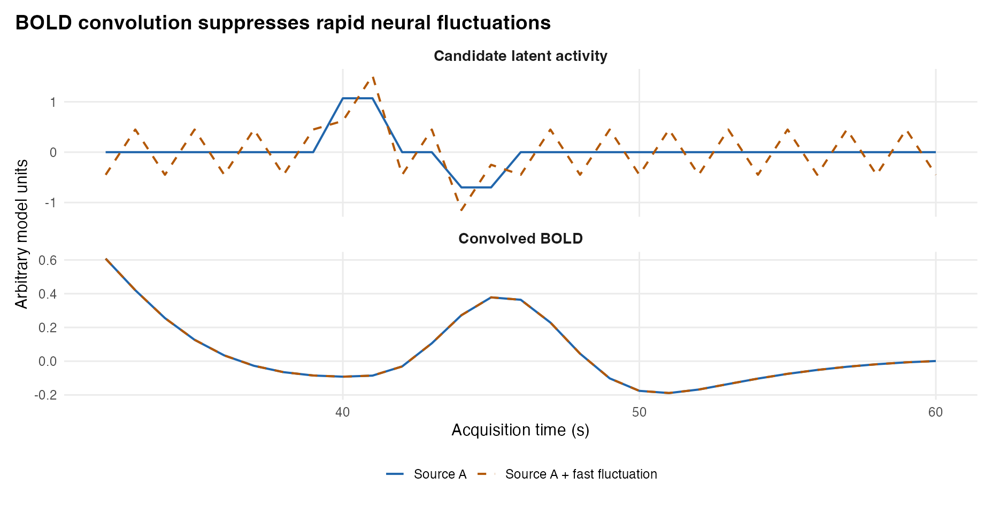
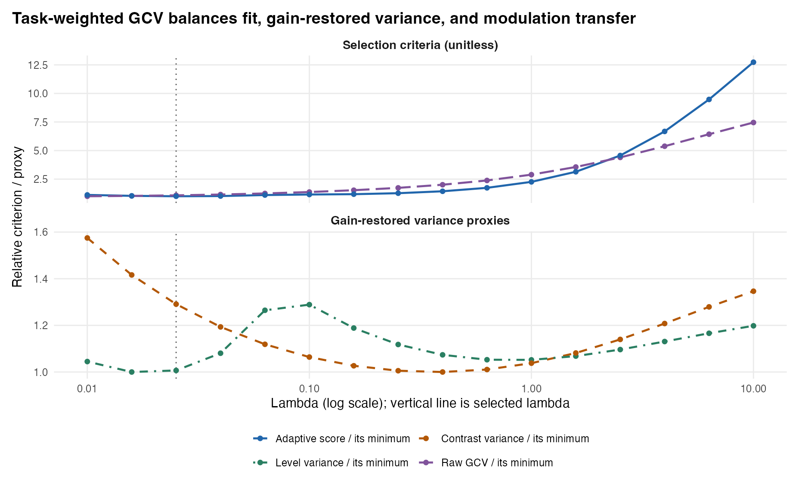
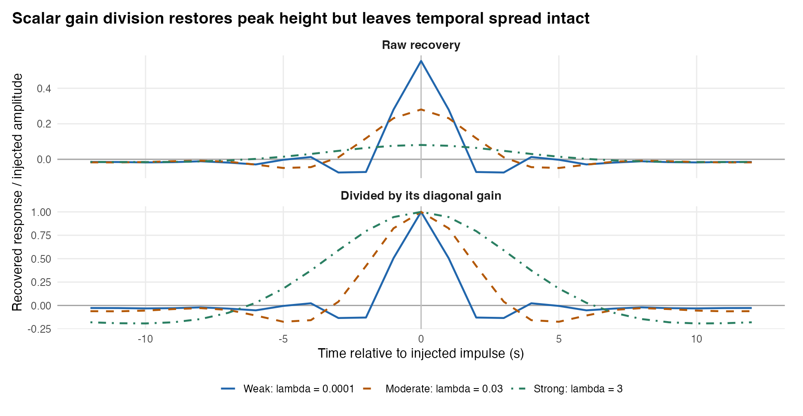

## Overview

Once Step 1 has learned each run's out-of-sample HRF and serial noise structure, Step 2 (`deconvolve_crossrun_hrf()`) reconstructs a **continuous latent neural activity time series** $\hat{s}(t)$ on the original acquisition grid for every run and voxel. Because hemodynamic convolution acts as a sluggish low-pass filter, directly inverting $H(h)$ amplifies high-frequency scanner noise violently; conversely, over-penalizing smoothness blurs rapid cognitive transitions and shrinks trial peaks.

What makes MEDuSA's Step 2 fundamentally stronger than traditional **blind deconvolution** (`deconvolve_nlreg()`, `deconvolve_reglin()`)—while remaining far more flexible than a rigid parametric GLM—is its **hybrid event-informed continuous architecture**. The deconvolved signal $\hat{s}(t)$ itself is estimated *continuously and unconstrained* across the entire run (never clamped to zero outside events or restricted to fixed trial boxcars). Simultaneously, MEDuSA uses an **auxiliary event-informed GLS regression model** under the hood to separate evoked task BOLD from background noise—anchoring pure observation-noise scaling (`scaling = "noise_sd"`), protecting genuine neural bursts during adaptive artifact downweighting (`rwls = "auto"`), tuning smoothness on task-active regions (`lambda = NULL`), and exporting the exact linear inverse operator needed by Step 3 to de-mix overlapping epochs and propagate standard errors.

::: {.callout-note}
### Position in the MEDuSA Pipeline
**`bold` + Step 1 `hrf_fit`** $\longrightarrow$ **Step 2 (`deconvolve_crossrun_hrf`)** $\longrightarrow$ `decon` S3 object (`activity` + operator metadata + `scaling` + `noise_innovations` + `frame_weights`) $\longrightarrow$ **Step 3 (`decon_epoch_regression`)**
:::

---

## Goals of Step 2

Step 2 addresses five tightly linked goals:

1. **Estimate continuous, unconstrained latent neural dynamics:** Recover a continuous time-by-voxel activity matrix $\hat{s}_r$ on the full $n_r$-sample acquisition grid via AR($p$)-whitened, smoothness-penalized generalized least squares (GLS).
2. **Place voxels and runs on an uncontaminated noise-SD reference scale:** Isolate marginal observation-noise standard deviation ($\hat{\sigma}_{\text{marg}}$) from task-evoked BOLD variance via event-informed GLS residuals (`scaling = "noise_sd"`), avoiding the signal-induced compression of whole-run `zscore` scaling.
3. **Suppress sub-scrubbing scanner glitches without clipping heavy neural responses:** Downweight transient motion or RF artifacts orthogonal to the task-HRF subspace (`rwls = "auto"`) while protecting genuine high-amplitude neural bursts and HRF latency shifts.
4. **Tune regularization (`lambda`) for downstream trial inference rather than raw BOLD prediction:** Balance prewhitened generalized cross-validation (GCV) against gain-restored trial variance and modulation transfer across task-supported voxels.
5. **Preserve the complete linear operator state for Step 3–6 handoffs:** Retain the exact HRF/noise strata, scaling divisors, task-free whitened `noise_innovations`, and `frame_weights` so downstream epoch de-mixing, parcel SEs, and connectivity models propagate exact covariances.

**What Step 2 deliberately leaves to Step 3:** Continuous regularized deconvolution *cannot* simultaneously achieve low noise and zero event cross-talk—every finite $\lambda > 0$ leaves known amplitude shrinkage ($R_{ii} < 1$) and local temporal spread ($R_{ij} \neq 0$) in `decon$activity`. Step 2 leaves raw `activity` un-inflated and hands the exact linear operator to `decon_epoch_regression()` (Step 3) to de-mix overlapping events and restore amplitude gain at the trial-epoch level.

---

## How Event-Informed Regression Works—and Why It Improves Over Blind Deconvolution {#sec-event-informed-vs-blind}

A recurring question for fMRI researchers is: *Why does MEDuSA use event timestamps during deconvolution instead of performing purely blind deconvolution, and if it uses event timestamps, why isn't it just an ordinary task GLM?* Understanding this distinction is the key to understanding Step 2.

### Why Blind Deconvolution Struggles on Event-Related fMRI

Blind deconvolution algorithms—such as Bush & Cisler's (2011) nonlinear sigmoid encoding (`deconvolve_nlreg()` / `algorithm = "bush2011"`) or blind linear ridge/spline deconvolution (`deconvolve_reglin()`)—receive only a raw BOLD vector $y$ and a fixed canonical kernel $h$, with **no knowledge of when task events occurred**. That blindness creates four compounding distortions:

1. **Shift-shape unidentifiability and latency inversion:** Convolving a delayed neural spike with a fast HRF produces the exact same BOLD peak as convolving an early neural spike with a slow HRF. Without cross-run event regression (Step 1), blind deconvolution locks onto a single assumed HRF, shifting inferred neural onset times backward or forward whenever regional vasculature differs from canonical.
2. **Task-contaminated amplitude scaling (`zscore`) and nonlinear ceiling compression:** Because blind methods cannot separate evoked BOLD signal from background noise, they standardize each voxel by its **total whole-run BOLD SD** (`zscore`). In strongly task-responsive voxels, evoked BOLD variance inflates the denominator $\text{SD}(y)$, *shrinking* recovered neural slopes relative to noisier or weaker voxels! Worse, Bush's nonlinear algorithm passes latent encoding through a logistic sigmoid $\hat{e}_t = (1 + e^{-x_t})^{-1} \in (0, 1)$, compressing heavy-tailed neural bursts against an artificial upper ceiling and destroying linear superposition.
3. **Oversmoothed GCV and unguarded outlier trade-offs:** Blind GCV averages prediction error across *all* brain voxels—including silent white-matter/null voxels where optimal $\lambda = \infty$—dragging the global penalty toward oversmoothing. Meanwhile, any attempt at blind outlier downweighting treats a genuine $4\times$ neural prediction-error burst and a scanner spike identically because both produce large BOLD excursions.
4. **No task-free noise innovations or linear operator covariance:** Blind outputs provide only a point-estimate time series, leaving downstream trial regressions with no analytical per-trial `se_demixed`, no cross-trial resolution matrix, and task-contaminated spatial noise correlations.

### How MEDuSA's Hybrid Event-Informed Architecture Works

MEDuSA separates **what is constrained** from **what is informed by events**:

- **The latent activity trajectory $\hat{s}_r$ itself is continuous and unconstrained.** Given scaled, centered usable observations $\tilde{y}_{r,o}$, the Step 2 solver minimizes the penalized prewhitened GLS objective over $\mathbb{R}^{n_r}$:
  $$
  \hat{s}_r = \arg\min_{s \in \mathbb{R}^{n_r}} \left\| W_r \bigl(\tilde{y}_{r,o} - M_{r,o} H_r s\bigr) \right\|_2^2 + \lambda s^\top P s
  $$
  Notice that **event timestamps do not appear inside the penalty $P$ or constrain $s$**. Spontaneous inter-trial fluctuations, sustained deliberation plateaus, and unmodeled temporal profiles are free to emerge anywhere on the acquisition grid.
- **Event-informed GLS regression (`hrf_build_noise_mean_design()`) anchors the four calibration quantities surrounding that continuous solve:**

  1. **Uncontaminated marginal noise scaling (`scaling = "noise_sd"`):** Before inverting $H_r$, `hrf_estimate_gls_noise_sd()` builds an event-informed design matrix $X_{\text{ev}}$ containing run intercept/trend, user `nuisance`, $<1/128\text{ Hz}$ DCT drift cosines, **free per-trial convolved event columns** under $\hat{h}^{(-r)}$, and **1st/2nd condition HRF Taylor derivatives** (absorbing trial-to-trial latency jitter). Projecting $X_{\text{ev}}$ out in unit-marginal AR($p$)-whitened space ($e = (I - Q Q^\top) W_{\text{unit}} y$), dividing by GLS leverage $\sqrt{1 - h_{tt}}$, and Winsorizing at $3 s_{\text{MAD}}$ isolates pure observation noise $\hat{\sigma}_{\text{marg}}$—completely invariant to how strongly a voxel responds to the task—and saves the orthonormalized **task-free `noise_innovations`** for Step 4 parcel SEs and Step 6 connectivity!
  2. **Task-envelope-guarded adaptive glitch weighting (`rwls = "auto"`):** Real fMRI runs contain sub-scrubbing motion micro-jerks and RF spikes ($\text{FD} \approx 0.2\text{--}0.4\text{ mm}$) that ring through a linear inverse filter. `hrf_estimate_rwls_weights()` evaluates cross-voxel residual energy orthogonal to the `[trial HRF, dHRF/dt]` subspace and **expands frame tolerance proportionally to the convolved task-design envelope**. If a run passes a Winsorized-SVD Liu–Tang–Zhang (2009) spatial null gate ($p < 0.01/m$), MEDuSA downweights genuine non-task scanner glitches—routing isolated impulses to **rank-$k$ Woodbury Sparse Bayesian Learning** ($\Sigma_{\text{AR}} + \operatorname{diag}(\delta^2)$, preventing AR($p$) whitening smearing!) and sustained physiological bursts to innovation-space rWLS—while keeping $w_t = 1.0$ on heavy neural bursts!
  3. **Task-SNR-weighted, gain-calibrated GCV (`lambda = NULL`):** `hrf_tune_decon_lambda()` restricts tuning to voxels with positive out-of-sample task $R^2$ from Step 1 (`selections`), pooling across all usable runs in an order-invariant pass and trading prewhitened GCV fit against Stage-3 gain-restored trial level/contrast variance and modulation transfer.
  4. **Exact linear operator handoff (`D_r`):** Because $\hat{s}_r = D_r \tilde{y}_{r,o}$ remains strictly linear conditional on its weights, Step 3 (`decon_epoch_regression()`) can pass the event schedule forward through $D_r H_r$ to de-mix overlapping cues/targets and propagate exact per-trial SEs.

| Method Family | HRF & Noise Model | Scaling Reference | Glitch vs. Burst Handling | Latent Output & Downstream SEs |
|---|---|---|---|---|
| **Blind Nonlinear (`deconvolve_nlreg` / Bush 2011)** | Fixed canonical HRF; unwhitened OLS | Whole-run `zscore` (task-contaminated) | Logistic sigmoid squashes bursts & glitches into $(0,1)$ | Bounded nonlinear encoding; **no** linear operator or trial SEs |
| **Blind Linear (`deconvolve_reglin`)** | Fixed HRF; optional scalar AR(1) | Whole-run `zscore` or raw $\Delta^2$ | Unweighted (glitches ring) or blind GCV oversmoothing across null voxels | Continuous linear series, but no cross-run HRF, task-free innovations, or epoch de-mixing handoff |
| **Standard Parametric GLM / LSS** | Assumed HRF/basis; fixed event boxcars | Residual error | Rigid trial basis; zero activity assumed outside modeled events | Scalar trial betas only; **no** continuous lag-flexible time series |
| **MEDuSA Event-Informed Continuous GLS (`deconvolve_crossrun_hrf`)** | Cross-fitted 3D HRF + 2-pass REML $\text{AR}(p)$ | Event-projected GLS marginal `noise_sd` | `rwls = "auto"` downweights non-task glitches while task envelope protects neural bursts | Unconstrained continuous $\hat{s}(t)$ **plus** exact operator $D_r$, `noise_innovations`, and propagated trial covariance |

```{r}
#| include: false
d2 <- readRDS("step2_examples.rds")
bve <- d2$blind_vs_event
```

### Live Demonstration: Event-Informed Continuous GLS vs. Blind Deconvolution

To see all four mechanisms in action on the same dataset, our simulation (`simulate_step2.R`) generates 8 voxels with identical true marginal observation noise ($\sigma = 0.035$), varying task gains (`1.0` in `v01–v03`, `0.5` in `v04–v06`, `0.0` in null voxels `v07–v08`), a genuine **heavy-tailed neural burst** (`3.8` units) at $t = 65\text{ s}$, and an isolated **non-task scanner glitch** (`+0.55` BOLD units) at $t = 124\text{ s}$.

First, compare the scaling denominators in @tbl-step2-blind-scale: blind `zscore` inflates the divisor to **0.415** in high-gain voxels versus **0.216** in moderate-gain voxels and **0.055** in null voxels—compressing strong task regions by nearly $2\times$ relative to moderate regions! Event-informed `noise_sd` recovers **0.031–0.038** uniformly across all eight voxels regardless of task amplitude.

```{r}
#| label: tbl-step2-blind-scale
#| tbl-cap: "Reference scale divisors across high-gain, moderate-gain, and null voxels (true observation-noise SD = 0.035 in every voxel)."
knitr::kable(bve$scale_table, digits = 3, row.names = FALSE,
  col.names = c("Voxel", "Task Regime", "True Noise SD", "Blind Whole-Run SD (zscore)", "Event-Informed GLS Noise SD"))
```

Second, compare the recovered continuous trajectories and learned frame weights in @fig-step2-event-vs-blind and @tbl-step2-blind-metrics:

- **At the $65\text{ s}$ neural burst (Panel A):** Event-informed GLS preserves peak recovery (`0.746`) and overall correlation (`0.835`), whereas blind linear GCV oversmooths because null voxels pull $\lambda$ upward (`0.676` peak recovery) and Bush's nonlinear sigmoid distorts relative amplitudes (correlation `0.699`).
- **At the $124\text{ s}$ non-task scanner glitch (Panels B & C):** `rwls = "auto"` keeps frame weight $w_t = 1.00$ across the $65\text{ s}$ neural burst (protected by the task envelope) while dropping $w_t$ sharply on the $124\text{ s}$ inter-trial glitch, cutting spurious inverse ringing in half (`0.200` vs. `0.391` unweighted and `0.659` Bush sigmoid)!

{#fig-step2-event-vs-blind width="100%" fig-alt="Three-panel comparison of event-informed continuous GLS versus blind linear and nonlinear deconvolution."}

```{r}
#| label: tbl-step2-blind-metrics
#| tbl-cap: "Continuous waveform recovery on physical input units (`blind_vs_event_metrics.csv`)."
knitr::kable(bve$summary_metrics, digits = 3, row.names = FALSE,
  col.names = c("Deconvolution Method", "Correlation w/ Truth", "Physical RMSE", "Burst Peak Ratio (65 s)", "Max Glitch Ringing (124 s)"))
```

---

## Inputs: What Step 2 Receives and Why

| Input | Structure | Why It Is Set Up That Way |
|---|---|---|
| `bold` | Named list of `time × voxel` numeric matrices matching `hrf_fit$run_ids` | Must contain the exact same run names, acquisition lengths `n_r`, and voxel columns supplied to Step 1 so cross-fitted HRFs, `valid_rows` masks, and noise parameters align 1-to-1 with observations. |
| `hrf_fit` | `"crossrun_hrf"` S3 object from `estimate_crossrun_hrf()` | Bundles out-of-sample `selected_kernels`, own-run `noise` cascades, `selections` task-SNR metrics, `events`, `nuisance`, and `valid_rows` so Step 2 never re-estimates HRFs in-sample or loses timing metadata. |
| `lambda` & `lambda_grid` | `NULL` (auto-tuned) or positive scalar; numeric candidate vector | Controls the smoothness-vs-variance trade-off. Passing `lambda = NULL` activates multi-run task-weighted GCV over `lambda_grid = 10^seq(-2, 1, length.out = 16)`. |
| `scaling` | `"noise_sd"` (recommended), `"zscore"`, `"demean"`, `"psc"`, or `"none"` | Determines how each run/voxel is centered and standardized *before* applying the shared penalty $\lambda$ (so $\lambda$ carries consistent meaning across runs and voxels of differing gain). |
| `penalty` | `"sobolev"` (recommended), `"diff2"`, `"diff1"`, `"matern1"`, or `"ridge"` | Selects the symmetric positive semi-definite roughness matrix $P$ governing how high-frequency vs. baseline energy is penalized. |
| `rwls` | `"auto"` (default), `"woodbury"`, `"innovation"`, or `"none"` | Controls neural-safe transient artifact downweighting on sub-scrubbing glitches that survived binary `valid_rows` censoring. |
| `nuisance_mode` & `observation_mask` | `"ignore"` or `"joint"`; `"fit"` or `"all"` | Explicit switches governing whether Step 1's `nuisance` regressors are jointly projected inside the inverse (`"ignore"` when BOLD was already drift-cleaned; `"joint"` when drift remains in `bold`) and whether `valid_rows` masks bad frames out of the observation fit (`"fit"`). |

---

## Outputs: What Step 2 Produces and Why It Is Set Up That Way

`deconvolve_crossrun_hrf()` returns an S3 list of class `"crossrun_decon"`. Crucially, **pass this entire object—not just `decon$activity`—into Step 3 (`decon_epoch_regression()`)**:

| Output Component | Structure | Why It Is Set Up That Way |
|---|---|---|
| `activity` | Named list of `n_time × n_voxels` matrices (with `tr`, `time_offset`, `observation_mask` attributes) | Preserves the **full original acquisition grid** even when interior frames were censored (`valid_rows = FALSE`), so event lag clocks never shift and continuous visual diagnostics remain aligned to run seconds. Invalid/zero-variance voxels receive `NA` columns rather than crashing the batch. |
| `scaling` | Named list of per-run `data.frame`s (`voxel`, `center`, `scale`, `noise_sd`, `status`) | Records both the applied pre-deconvolution divisor (`scale`) and the estimated marginal observation-noise SD (`noise_sd`). Separating `scale` from `noise_sd` allows Step 3 to multiply `activity` back into physical BOLD units (`restore_scale = TRUE`) while still propagating exact observation-noise SEs! |
| `noise_innovations` | Named list of `n_valid_rows × n_voxels` unit-norm task-free whitened residual matrices | Extracted from `hrf_estimate_gls_noise_sd()` after projecting out free-trial task responses and HRF derivatives. Allows Step 4 to compute uncontaminated within-parcel spatial noise variance and Step 6 to estimate cross-parcel shared-error correlations (`shared_noise_loading`). |
| `frame_weights` | Named list of length-`n_valid_rows` numeric vectors in $(0, 1]$ (with `attr(, "weight_space")`) | Records the realized `rwls` weights per run (`1` everywhere when clean). Passing `frame_weights` forward ensures `diagnose_crossrun_recovery()` and `decon_epoch_regression()` reconstruct the *exact* weighted inverse operator $D_r(w_r)$ and Woodbury/innovation noise covariance! |
| `hrf_fit` & `settings` | Embedded `crossrun_hrf` object + resolved inverse settings (including `lambda` and `lambda_tuning`) | Avoids storing gigabytes of dense $n_r \times m_r$ inverse matrices in RAM: because voxels are grouped into `(HRF, AR)` strata, Step 3 can rebuild each unique stratum operator $D_r$ on the fly in milliseconds using `hrf_fit`, `settings`, and `frame_weights`. |

---

## Recommended Settings

```{r}
#| eval: false
#| code-fold: false
decon <- deconvolve_crossrun_hrf(
  bold             = bold,
  hrf_fit          = hrf_fit,
  lambda           = NULL,
  scaling          = "noise_sd",
  penalty          = "sobolev",
  rwls             = "auto",
  nuisance_mode    = "ignore",   # use "joint" if bold was NOT detrended/cleaned upstream
  observation_mask = "fit",
  tail_padding     = 0L,
  backend          = "cpp"
)

# Always audit conditional gain and cross-talk on your study's event schedule:
recovery <- diagnose_crossrun_recovery(decon, lags = 0)
```

| Argument | Recommended | Package Default | Why Recommended & When to Adjust |
|---|---|---|---|
| `scaling` | `"noise_sd"` | `"zscore"` | **Critical override:** The API defaults to `"zscore"` for backward compatibility, which divides by total BOLD SD (mixing task signal into the denominator). Always specify `scaling = "noise_sd"` so every voxel/run is standardized by pure marginal observation-noise SD ($\hat{\sigma}_{\text{marg}}$), then set `restore_scale = TRUE` in Step 3 when pooling runs. |
| `penalty` | `"sobolev"` | `"diff2"` | `"diff2"` ($D_2^\top D_2$) leaves linear ramps unpenalized, allowing boundary drift or slow baseline swings under weak $\lambda$. `"sobolev"` ($0.10 D_1^\top D_1 + 0.90 D_2^\top D_2$) penalizes both slope and curvature, yielding cleaner baselines and sharper event transitions. |
| `lambda` | `NULL` (auto-tuned) | `NULL` | Pools task-weighted, gain-calibrated GCV across all usable runs and active voxels. Override with a fixed scalar (e.g., sensitivity check at `0.5 * lambda` and `2 * lambda`) only when comparing alternative HRF libraries under strictly matched regularization. |
| `rwls` | `"auto"` | `"auto"` | Automatically stays inactive ($w_t = 1$) on clean Gaussian runs via the LTZ spatial null gate, while engaging Woodbury SBL on isolated glitches and innovation rWLS on multi-TR physiological bursts. Set `"none"` only if reproducing unweighted algebra. |
| `nuisance_mode` | `"ignore"` on pre-cleaned BOLD; `"joint"` on raw BOLD | `"ignore"` (`"joint"` for legacy fits) | Note that `nuisance` passed to Step 1 is **not** projected out during Step 2 when `nuisance_mode = "ignore"`. If `bold` still contains scanner drift or motion terms that were only passed via `nuisance`, set `nuisance_mode = "joint"`! |
| `observation_mask` & `tail_padding` | `"fit"` & `0L` | `"fit"` & `0L` | `"fit"` excludes censored `valid_rows == FALSE` volumes from the GLS data term while keeping the full latent time grid. Keep `tail_padding = 0L` so artificial zero BOLD samples are never appended after run end. |

---

## Core Deconvolution Mechanisms & Sensitivity Checks

### 1. Why Regularization Is Unavoidable—and How Penalties Shape $\hat{s}(t)$

Because the HRF smooths over 15–30 seconds, adding a rapid $+1/-1$ oscillation to neural activity changes predicted BOLD almost imperceptibly (@fig-step2-ambiguity). An unpenalized or weakly penalized inverse (`lambda = 0.0001`) explodes high-frequency noise, whereas heavy regularization (`lambda = 3`) over-smooths and shrinks peaks (@fig-step2-lambda).

{#fig-step2-ambiguity width="95%" fig-alt="Two latent sources differing by a fast oscillation and their nearly identical convolved BOLD series."}

{#fig-step2-lambda width="95%" fig-alt="Three-panel comparison of weak, moderate, and strong lambda regularization."}

Comparing all five quadratic penalties (`ridge`, `diff1`, `diff2`, `matern1`, `sobolev`) under automatic tuning (@fig-step2-penalties, @tbl-step2-penalties) shows why `sobolev` and `matern1` provide a stable middle ground: pure `diff2` leaves global linear trends unpenalized (`RMSE = 0.390` vs. `0.264` for `sobolev`), while pure `ridge` pulls every sample independently toward zero without sharing smoothness across adjacent TRs.

{#fig-step2-penalties width="95%" fig-alt="Five-panel comparison of deconvolved series across penalty geometries."}

```{r}
#| label: tbl-step2-penalties
#| tbl-cap: "Continuous waveform recovery on Run 1 Voxel 1 across the five penalty families (`penalty_metrics.csv`)."
knitr::kable(d2$metrics, digits = 3, row.names = FALSE,
  col.names = c("Penalty", "Selected Lambda", "Correlation w/ Truth", "Latent RMSE", "Convolved BOLD RMSE"))
```

### 2. Adaptive Multi-Run GCV Tuning (`lambda = NULL`)

Standard observation-space GCV minimizes BOLD prediction error, which favors stronger smoothing than optimal for estimating sharp trial contrasts. MEDuSA's `hrf_tune_decon_lambda()` (@fig-step2-tuning) evaluates each grid candidate across active voxels/runs and combines prewhitened GCV with Stage-3 **gain-restored level variance (`var_level`)**, **1-TR contrast variance (`var_contrast`)**, and **modulation transfer (`mtf_rel`)** weighted by Step 1's task SNR.

{#fig-step2-tuning width="95%" fig-alt="Tuning curves across lambda_grid showing raw GCV, adaptive criterion, level variance, and contrast variance."}

### 3. Resolution, Leakage, and `diagnose_crossrun_recovery()`

Even with known HRF and optimal $\lambda$, the resolution matrix $R = D H$ is **not** the identity matrix. Dividing a single point readout by its diagonal gain $R_{tt}$ restores isolated peak height to 1, but *simultaneously amplifies off-peak side lobes and noise* (@fig-step2-resolution) and leaves directed event-to-event cross-talk across closely spaced trials (@fig-step2-leakage). `diagnose_crossrun_recovery(decon)` quantifies both self-gain (`mean_gain = 0.549` in Run 1, `0.637` in Run 2) and neighbor leakage (`mean_abs_excess_leakage ≈ 0.021–0.024`) on your exact event schedule before Step 3 performs matrix de-mixing.

{#fig-step2-resolution width="95%" fig-alt="Impulse response curves before and after scalar diagonal gain normalization."}

{#fig-step2-leakage width="82%" fig-alt="15x15 heatmap of off-diagonal event cross-talk."}

### 4. Nuisance Handling, Observation Masks, Scaling, and Boundaries

Finally, @fig-step2-mask-nuisance, @fig-step2-scaling, and @fig-step2-sensitivity illustrate four operational rules to verify in every dataset:

1. **Nuisance consistency (@fig-step2-mask-nuisance, top):** When low-frequency drift remains in `bold`, `nuisance_mode = "ignore"` lets that drift pass directly into `activity`; use `nuisance_mode = "joint"` unless `bold` was already detrended upstream.
2. **Observation masks (@fig-step2-mask-nuisance, bottom):** Setting `valid_rows = FALSE` across an artifact window (`70–80 s`) with `observation_mask = "fit"` bridges the gap smoothly using the penalty and surrounding causal BOLD support without letting the spike corrupt neighboring trials—though interpolated values *inside* a long gap are prior-driven, not observed data (Step 3 will automatically gate poorly supported trial-lags to `NA`).
3. **Scaling restoration (@fig-step2-scaling):** Multiplying `scales$noise_sd$activity` or `scales$zscore$activity` by `scaling[[r]]$scale` reproduces `demean` activity to `< 1e-8` (`r format(max(d2$restore_err), digits = 3)` in `verification.txt`), while `noise_sd` tracks true $\sigma$ cleanly across heterogeneous voxels.
4. **Run-end boundaries and HRF delay sensitivity (@fig-step2-sensitivity):** Appending artificial zero BOLD observations (`tail_padding = 33L`) pulls valid late-run activity downward, while a $+2\text{ s}$ HRF delay error shifts inferred neural peaks ~2 s earlier—underscoring why Step 1's cross-run HRF learning and `tail_padding = 0L` are essential.

{#fig-step2-mask-nuisance width="95%" fig-alt="Two-panel plot showing drift leakage under nuisance_mode = ignore and artifact containment under observation_mask = fit."}

{#fig-step2-scaling width="92%" fig-alt="Dot plot comparing zscore SD, estimated GLS noise SD, and generating noise SD across voxels."}

{#fig-step2-sensitivity width="95%" fig-alt="Two-panel plot showing late-run distortion from zero tail padding and peak timing shift from HRF delay error."}

<details>
<summary>Mathematical Reference: Weighted GLS Operator & Woodbury SBL</summary>

Let $I_r \subset \{1, \dots, n_r\}$ index the $m_r$ valid rows (`valid_rows[[r]] == TRUE`), $M_{r,o}$ select rows $I_r$, $H_r \in \mathbb{R}^{n_r \times n_r}$ be the causal Toeplitz HRF convolution matrix for stratum kernel $h$, and $Z_{r,o}$ be the active nuisance basis (`[1, trend, nuisance]` under `nuisance_mode = "joint"`, empty under `"ignore"`).

- **Exact gapped whitening & nuisance projection:** $W_r = L_r^{-1}$ is the inverse Cholesky factor of the exact stationary $\text{AR}(p)$ correlation submatrix $\Sigma_{\text{AR}}[I_r, I_r]$. Under `rwls_space = "woodbury"` with transient variances $\delta_t^2 = (1 - w_t)/w_t$ on flagged frames $S$, MEDuSA whitens against $\Sigma_{\text{AR}}[I_r, I_r] + \operatorname{diag}(\delta^2)$ via a rank-$|S|$ Sherman–Morrison–Woodbury update in $O(m_r |S|)$ operations, preventing high-$\rho$ AR filters from smearing an isolated glitch into adjacent clean frames. Orthogonalizing $Q_Z = \operatorname{orth}(W_r Z_{r,o})$ projects out nuisance terms jointly via $\tilde{W}_r = (I - Q_Z Q_Z^\top) W_r$.
- **Linear inverse operator:** With $A_r = \tilde{W}_r M_{r,o} H_r$ and penalty $P_{\lambda} = \lambda P + \epsilon_{\text{ridge}} I_{n_r}$, the frozen inverse operator is
  $$
  D_r = \bigl(A_r^\top A_r + P_{\lambda}\bigr)^{-1} A_r^\top \tilde{W}_r \in \mathbb{R}^{n_r \times m_r},
  $$
  evaluated across voxel batches via Cholesky solves in C++ (`backend = "cpp"`, agreeing with `backend = "r"` to `r format(d2$backend_err, digits = 3)`).

[Step 2 simulation script](simulate_step2.R) · [Figure script](figures_step2.R) · [Verification output](verification.txt)

</details>
