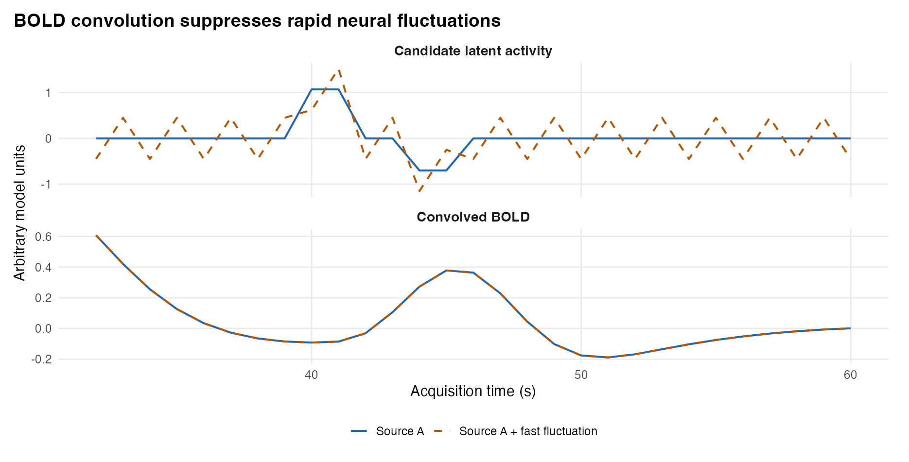
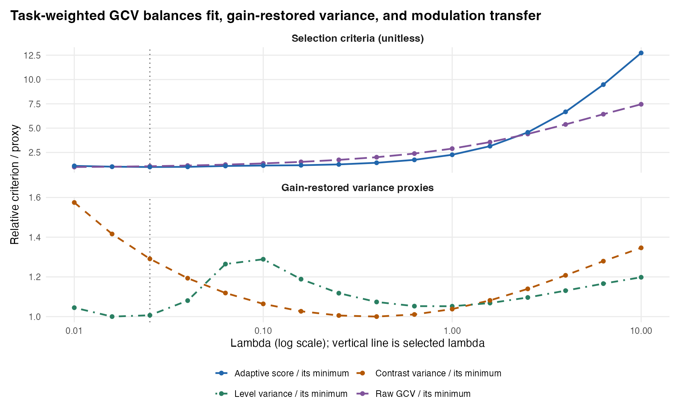
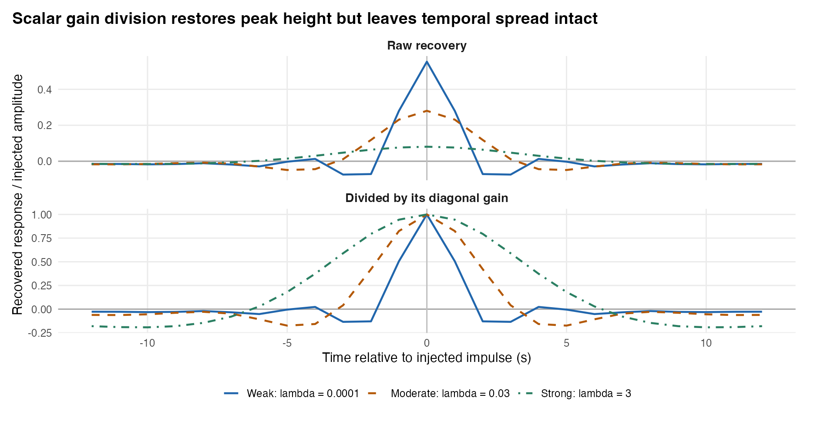

```{r}
#| include: false
d2 <- readRDS("step2_examples.rds")
bve <- d2$blind_vs_event
```

## Overview

Given each run's cross-fitted HRF and serial noise model from Step 1, Step 2 (`deconvolve_crossrun_hrf()`) reconstructs a **continuous latent neural activity time series** $\widehat{a}_r(t)$ on the original acquisition grid for every run and voxel. Because hemodynamic convolution smooths rapid neural fluctuations over 15–30 seconds, Step 2 solves a smoothness-penalized, $\text{AR}(p)$-whitened generalized least squares (GLS) inverse problem that recovers continuous neural dynamics while controlling high-frequency noise amplification.

The defining feature of MEDuSA's Step 2 is its **event-informed continuous architecture**: the latent time series $\widehat{a}_r(t)$ itself is estimated continuously and unconstrained across the entire run, while an auxiliary event-informed GLS regression model calibrates the three quantities that govern inversion quality—(1) task-free observation-noise scaling (`scaling = "noise_sd"`), (2) neural-safe downweighting of transient scanner glitches (`rwls = "auto"`), and (3) SNR-stratified cross-run smoothing (`lambda_mode = "auto"`).

```{r}
#| eval: false
#| code-fold: false
library(medusa)

decon <- deconvolve_crossrun_hrf(
  bold          = bold,
  hrf_fit       = hrf_fit,
  scaling       = "noise_sd",
  penalty       = "sobolev",
  lambda_mode   = "auto",
  rwls          = "auto",
  nuisance_mode = "preproject",
  noise_pcs     = "auto"
)
```

::: {.callout-note}
### Position in the MEDuSA Pipeline
**`bold` + Step 1 `hrf_fit`** $\longrightarrow$ **Step 2 (`deconvolve_crossrun_hrf`)** $\longrightarrow$ `decon` S3 object (`activity` + operator metadata + `scaling` + `noise_innovations` + `frame_weights`) $\longrightarrow$ **Step 3 (`decon_epoch_regression`)**
:::

The five substeps below develop this estimator from the basic continuous GLS inverse (`2.1`), through observation-noise standardization (`2.2`), adaptive glitch weighting (`2.3`), and SNR-stratified smoothing (`2.4`), culminating in a direct comparison between event-informed continuous GLS and blind deconvolution (`2.5`).

---

## Goals, Inputs, and Outputs

### Goals of Step 2

1. **Recover continuous, unconstrained latent neural time courses:** Estimate a `time × voxel` activity matrix $\widehat{a}_r$ on the intact acquisition grid via prewhitened penalized GLS.
2. **Standardize voxels and runs by pure observation noise:** Estimate marginal observation-noise SD ($\hat{\sigma}_{\text{marg}}$) from task-projected GLS residuals (`scaling = "noise_sd"`) so strong task activation does not compress recovered amplitudes.
3. **Downweight transient non-task glitches safely:** Attenuate isolated sub-scrubbing motion or RF spikes (`rwls = "auto"`) while leaving genuine high-amplitude neural bursts unclipped.
4. **Adapt regularization (`lambda`) to regional task SNR:** Tune smoothness automatically across runs while grouping voxels from quiet background cortex up to strong task foci so noisier regions receive stronger smoothing (`lambda_mode = "auto"`).
5. **Carry exact linear operator metadata into Steps 3–6:** Package `activity` together with `scaling`, task-free `noise_innovations`, `frame_weights`, and `(HRF, AR, lambda)` stratum keys so downstream steps de-mix overlapping epochs and propagate analytical standard errors.

### Inputs: What Step 2 Receives and Why

| Input | Structure | Why It Is Set Up That Way |
|---|---|---|
| `bold` | Named list of `time × voxel` numeric matrices (or `"medusa_nifti_ts"` object) matching `hrf_fit` | Aligns each run's observations 1-to-1 with its cross-fitted HRFs, `valid_rows` masks, and $\text{AR}(p)$ noise parameters from Step 1. |
| `hrf_fit` | `"crossrun_hrf"` S3 object from `estimate_crossrun_hrf()` | Supplies out-of-sample `selected_kernels`, own-run `noise` cascades, out-of-sample task-SNR summaries (`selections`), `events`, `nuisance`, and `valid_rows`. |
| `scaling` | `"noise_sd"` (recommended), `"zscore"`, `"demean"`, `"psc"`, or `"none"` | Standardizes each run and voxel *before* applying the roughness penalty so a shared $\lambda$ carries a consistent bias–variance meaning across units of differing gain. |
| `penalty` | `"sobolev"` (recommended), `"diff2"`, `"diff1"`, `"matern1"`, or `"ridge"` | Defines the symmetric positive semi-definite roughness matrix $P$ governing how rapid fluctuations and baseline drift are penalized. |
| `lambda`, `lambda_mode`, & `lambda_grid` | `NULL` (auto-tuned), scalar, or length-$V$ vector; `lambda_mode = c("auto", "global", "stratified")` | Controls smoothing strength, tuned automatically across runs over `lambda_grid = 10^seq(-2, 1, length.out = 16)` either globally or across monotone task-SNR tiers. |
| `rwls`, `nuisance_mode`, `highpass`, & `noise_pcs` | `rwls = "auto"`; `nuisance_mode = c("preproject", "ignore", "joint")`; `highpass = 128`; `noise_pcs = "auto"` | Govern transient glitch weighting (`rwls`), clock-aligned pre-orthogonalization of `< 1/128 Hz` DCT drift, `nuisance` confounds, and cross-validated background noise-pool PCs (`noise_pcs = "auto"`) prior to $|H(\omega)|^{-1}$ inversion, and exclusion of `valid_rows == FALSE` frames (`observation_mask = "fit"`). |

### Outputs: What Step 2 Produces and Why It Is Set Up That Way

`deconvolve_crossrun_hrf()` returns an S3 `"crossrun_decon"` object designed to be passed intact into Step 3 (`decon_epoch_regression()`):

| Output Component | Structure | Why It Is Set Up That Way |
|---|---|---|
| `activity` | Named list of `n_time × n_voxels` matrices (with `tr`, `time_offset`, and `observation_mask` attributes) | Retains the full acquisition grid—even across interior censored frames—so event timestamps and continuous diagnostics stay aligned to run seconds. |
| `scaling` | Named list of per-run `data.frame`s (`voxel`, `center`, `scale`, `noise_sd`, `lambda`, `status`) | Records the pre-deconvolution divisor (`scale`), marginal observation-noise SD (`noise_sd`), and per-voxel penalty (`lambda`), enabling Step 3 to restore physical BOLD units (`restore_scale = TRUE`) and propagate exact SEs. |
| `noise_innovations`, `bold_obs`, & `whitened_sketch` | Named lists of task-free whitened residuals and uncensored BOLD ($\le 16{,}384$ voxels) or compact $m_r \times 64$ subspace sketches ($> 16{,}384$ voxels) | Captures spatial and dynamic error structure without retaining full 4D BOLD arrays in memory, enabling bold-free Adaptive-POET + covariance-regression shared-error estimation in Steps 3–6. |
| `frame_weights` | Named list of length-`n_valid_rows` vectors in $(0, 1]$ | Preserves any adaptive `rwls` glitch weights so Step 3 reconstructs the exact weighted inverse operator and error covariance. |
| `hrf_fit`, `settings`, `voxel_map`, & `geometry` | Embedded `crossrun_hrf` + tuning tables (`lambda_strata`, `lambda_tuning`) + NIfTI metadata | Allows Steps 3–4 to rebuild stratum operators $D_r$ on the fly without storing gigabytes of dense $T_r \times m_r$ matrices in memory, and supports direct NIfTI export via `write_nifti_ts()`. |

---

## Step-by-Step Walkthrough: Substeps and Choice Points

### 2.1 Formulate the continuous prewhitened GLS deconvolution objective

Start with a single run $r$ and voxel whose centered, standardized usable BOLD observations $\tilde{y}_{r,o}$ follow the forward convolution model $\tilde{y}_{r,o} = M_{r,o} H_r a_r + \varepsilon_{r,o}$, where $H_r$ convolves latent neural activity $a_r \in \mathbb{R}^{T_r}$ with Step 1's HRF, $M_{r,o}$ selects the $m_r$ unmasked frames (`valid_rows[[r]] == TRUE`), and $W_r$ whitens the $\text{AR}(p)$ error covariance.

Because $H_r$ acts as a low-pass filter, high-frequency oscillations in $a_r$ leave convolved BOLD almost unchanged (@fig-step2-ambiguity). Inverting $H_r$ with virtually no penalty (`lambda = 0.0001`) therefore amplifies high-frequency noise dramatically, whereas an overly large penalty (`lambda = 3`) smooths away phasic peaks (@fig-step2-lambda).

{#fig-step2-ambiguity width="95%" fig-alt="Two latent sources differing by a fast oscillation and their nearly identical convolved BOLD series."}

{#fig-step2-lambda width="95%" fig-alt="Three-panel comparison of weak, moderate, and strong lambda regularization."}

Step 2 estimates $\widehat{a}_r$ by minimizing a penalized prewhitened generalized least squares (GLS) objective across the full $T_r$-sample acquisition grid:

$$
\widehat{a}_r = \arg\min_{a \in \mathbb{R}^{T_r}} \left\| \tilde{W}_r \bigl(\tilde{y}_{r,o} - M_{r,o} H_r a\bigr) \right\|_2^2 + \lambda \, a^\top P a
\quad\Longrightarrow\quad
\widehat{a}_r = D_r \tilde{y}_{r,o},
\qquad
D_r = \bigl(A_r^\top A_r + \lambda P\bigr)^{-1} A_r^\top \tilde{W}_r,
$$

where:

- $\tilde{y}_{r,o} \in \mathbb{R}^{m_r}$ is the centered, standardized BOLD vector restricted to the $m_r$ unmasked acquisition frames $I_r$ (`valid_rows[[r]] == TRUE`),
- $M_{r,o} \in \mathbb{R}^{m_r \times T_r}$ selects those $m_r$ observed rows from the full $T_r$-sample clock,
- $H_r \in \mathbb{R}^{T_r \times T_r}$ is the causal Toeplitz convolution matrix for Step 1's cross-fitted HRF,
- $\tilde{W}_r$ combines exact $\text{AR}(p)$ prewhitening $W_r$ on the retained timestamps $I_r$ with nuisance orthogonalization (described below), and $A_r = \tilde{W}_r M_{r,o} H_r$ is the prewhitened forward operator,
- $P \in \mathbb{R}^{T_r \times T_r}$ is a symmetric positive semi-definite roughness penalty matrix, and $\lambda > 0$ tunes the bias–variance trade-off between high-frequency noise suppression and phasic sharpness, and
- $D_r \in \mathbb{R}^{T_r \times m_r}$ is the resulting **exact linear inverse operator**, carried forward into Steps 3–4 so downstream uncertainty propagation requires no resampling.

Notice that **no event timestamps appear inside $P$ or restrict $a$**: spontaneous inter-trial fluctuations, sustained deliberation plateaus, and brief phasic bursts can occur anywhere on the acquisition clock.

{#fig-step2-penalties width="95%" fig-alt="Five-panel comparison of deconvolved series across penalty geometries."}

```{r}
#| label: tbl-step2-penalties
#| tbl-cap: "Continuous waveform recovery on Run 1 Voxel 1 across the five penalty families (`penalty_metrics.csv`)."
knitr::kable(d2$metrics, digits = 3, row.names = FALSE,
  col.names = c("Penalty", "Selected Lambda", "Correlation w/ Truth", "Latent RMSE", "Convolved BOLD RMSE"))
```

**Choice point — Roughness penalty (`penalty`) and nuisance projection (`nuisance_mode`):**

- **Penalty geometry (`penalty = "sobolev"`):** MEDuSA's recommended discrete Sobolev penalty combines a mild first-difference slope penalty ($D_1 a$, penalizing changes $a_{t+1} - a_t$) with a dominant second-difference curvature penalty ($D_2 a$, penalizing acceleration $a_{t+1} - 2a_t + a_{t-1}$):
  $$
  P_{\text{sobolev}} = 0.10\, D_1^\top D_1 + 0.90\, D_2^\top D_2.
  $$
  Why combine both terms? Pure second-difference smoothing (`"diff2"`) leaves constant shifts *and* global linear ramps completely unpenalized ($D_2 a = 0$ for any line $a_t = c_0 + c_1 t$), allowing slow baseline tilts to drift through the inverse, whereas pure `"ridge"` ($P = I$) shrinks every timepoint toward zero independently without sharing smoothness across neighboring TRs. Combining $0.10 D_1^\top D_1 + 0.90 D_2^\top D_2$ gently anchors slow ramps while preserving crisp phasic event peaks (@fig-step2-penalties, @tbl-step2-penalties).
- **Clock-aligned drift, confound, and noise-pool pre-projection (`nuisance_mode = "preproject"` & `noise_pcs = "auto"`):** Because the Sobolev penalty vanishes on constant/ultra-slow modes while $H(0) = 1$, leaving `< 1/128 Hz` scanner drift or motion confounds unprojected (`nuisance_mode = "ignore"` on raw BOLD) lets slow drift pass directly into $\widehat{a}_r(t)$ even though Step 1's `noise_sd` excluded drift variance—inflating trial variance without matching `se_demixed`. Conversely, solving for nuisance coefficients *jointly* inside $(A_r^\top A_r + \lambda P)^{-1}$ (`nuisance_mode = "joint"`) can amplify collinear slow neural modes.
  - **`nuisance_mode = "preproject"`** (automatic default whenever `nuisance`, `highpass = 128`, or `noise_pcs` are active) removes the full nuisance basis $Z_{r,o} = [1,\, \text{linear trend},\, \text{DCT}(< 1/128\text{ Hz}),\, \text{nuisance},\, \text{noise\_pcs}]$ on `valid_rows` *before* continuous deconvolution via the orthogonal projector $Q_{Z}^\perp = I - Q_Z Q_Z^\top$, and carries that exact projection into Step 3 (`decon_epoch_regression()`), `diagnose_crossrun_recovery()`, and Step 4's POET + covariance-regression engine.
  - Simultaneously, `noise_pcs = "auto"` removes cross-validated background physiological PCs ([Step 1 §1.5](../medusa_step1_hrf_noise/medusa_step1_hrf_noise.qmd#sec-noise-pool-pcs)) *before* $|H(f)|^{-1}$ can amplify `0.14–0.30 Hz` respiratory and aliased cardiac harmonics. Use `"ignore"` only when BOLD and events were already matched-projected upstream.

{#fig-step2-mask-nuisance width="95%" fig-alt="Two-panel plot showing drift removal under nuisance_mode = joint and artifact containment under observation_mask = fit."}

---

### 2.2 Standardize runs using event-informed marginal noise scaling

Before solving the penalized GLS objective across thousands of voxels, each run and voxel is centered and divided by a reference scale so $\lambda$ acts comparably everywhere. A common convention in blind deconvolution is whole-run z-scoring (`scaling = "zscore"`), which divides by total temporal $\text{SD}(y)$. However, in a strongly task-responsive voxel, $\text{SD}(y)$ combines background noise *and* task-evoked BOLD variance—inflating the denominator and compressing recovered neural slopes relative to quieter voxels.

To separate observation noise from task signal without constraining $\widehat{a}_r$, `scaling = "noise_sd"` fits an **auxiliary event-informed GLS regression** containing run drift, user nuisance columns, free per-trial convolved event regressors under Step 1's HRF, and 1st/2nd HRF Taylor derivatives (absorbing trial-to-trial latency jitter). From the outlier-trimmed, leverage-adjusted residuals of this projection (Winsorized GLS residuals), MEDuSA extracts two quantities:

1. **Uncontaminated marginal observation-noise SD ($\hat{\sigma}_{\text{marg}}$):** Tracks true background noise uniformly across high-gain, moderate-gain, and null voxels (@fig-step2-scaling and @tbl-step2-blind-scale).
2. **Task-free whitened `noise_innovations`:** Orthonormalized residual series carried forward to measure pure spatial noise correlations in Steps 4 and 6.

{#fig-step2-scaling width="92%" fig-alt="Dot plot comparing zscore SD, estimated GLS noise SD, and generating noise SD across voxels."}

```{r}
#| label: tbl-step2-blind-scale
#| tbl-cap: "Reference scale divisors across high-gain, moderate-gain, and null voxels (true observation-noise SD = 0.035 in every voxel)."
knitr::kable(bve$scale_table, digits = 3, row.names = FALSE,
  col.names = c("Voxel", "Task Regime", "True Noise SD", "Blind Whole-Run SD (zscore)", "Event-Informed GLS Noise SD"))
```

**Choice point — Pre-deconvolution scaling (`scaling`):** Specify `scaling = "noise_sd"` (and pair with `restore_scale = TRUE` in Step 3 when combining runs onto physical BOLD units). Reserve `"zscore"` or `"demean"` for sensitivity comparisons against legacy workflows.

---

### 2.3 Guard against transient scanner glitches without clipping neural bursts

Even after binary motion censoring (`valid_rows`), fMRI runs occasionally contain sub-threshold micro-movements or RF spikes ($\text{FD} \approx 0.2\text{--}0.3\text{ mm}$) that cause oscillatory ringing in an unweighted linear inverse. At the same time, naive robust weighting risks mistaking an unusually large, genuine neural response (such as a surprise prediction-error burst) for an artifact.

Under `rwls = "auto"`, Step 2 separates non-task glitches from real neural bursts in three transparent steps:

1. **Task-orthogonal residual screening:** Ranks the most task-informative voxels (up to `4,096` voxels by Step 1 `selected_adjusted_partial_r2`), projects residuals orthogonal to the modeled `[trial HRF, dHRF/dt]` task subspace, and widens per-frame tolerance proportionally to the convolved task envelope so genuine large neural responses keep full weight ($w_t = 1$).
2. **Spatial $\chi^2$ calibration on clean Gaussian runs:** Evaluates cross-voxel framewise tail energy against the spatially correlated null distribution (via the Liu–Tang–Zhang, 2009 moment approximation, the same spatial quadratic-form calibration used in Step 4). On clean Gaussian runs, all frame weights stay identically at $w_t = 1$ so standard unweighted GLS is preserved without unnecessary variance loss.
3. **Observation-space spike variance vs. innovation-space bursts:** Why not simply multiply whitened frame $t$ by $\sqrt{w_t}$ when a single-volume RF spike hits a high-$\rho$ $\text{AR}(p)$ run? Because prewhitening filters $(1 - \rho B)$ difference adjacent frames, an isolated 1-TR spike at time $t$ leaks into $t + 1, t + 2, \dots$ *before* innovation weighting sees it. Instead, for isolated 1–2 TR spikes on flagged frames $S$, MEDuSA adds transient observation-noise variance directly *before* prewhitening:
   $$
   \operatorname{Cov}(\varepsilon_{r,o}) = \sigma_{\text{obs}}^2 \Bigl(\Sigma_{\text{AR}}[I_r, I_r] + \operatorname{diag}(\delta^2)\Bigr),
   \qquad
   \delta_t^2 = \begin{cases} (1 - w_t)/w_t, & t \in S, \\ 0, & t \notin S, \end{cases}
   $$
   inverting this rank-$|S|$ perturbation via the Sherman–Morrison–Woodbury identity in $O(m_r |S|)$ operations (Woodbury Sparse Bayesian Learning, SBL). Multi-TR physiological bursts receive smooth innovation-space downweighting, while heavy task-evoked neural bursts retain $w_t = 1$.

**Choice point — Glitch downweighting (`rwls`):** Leave `rwls = "auto"` enabled for empirical data; set `rwls = "none"` only when testing exact unweighted operator identities in synthetic benchmarks.

---

### 2.4 Tune smoothing strength (`lambda`) across task-SNR strata

Choosing $\lambda$ by ordinary observation-space generalized cross-validation (GCV) alone—which minimizes
$$
\operatorname{GCV}(\lambda) = \frac{\frac{1}{m_r}\bigl\|(I - S_\lambda)\tilde{W}_r \tilde{y}_{r,o}\bigr\|_2^2}{\bigl(1 - \frac{1}{m_r}\operatorname{tr}(S_\lambda)\bigr)^2},
\qquad
S_\lambda = A_r (A_r^\top A_r + \lambda P)^{-1} A_r^\top,
$$
where $S_\lambda$ is the prewhitened smoother ("hat") matrix—targets raw BOLD curve fitting rather than downstream trial estimation. Furthermore, averaging GCV across thousands of task-silent background voxels pulls a single global $\lambda$ toward oversmoothing active cortex.

When `lambda = NULL`, Step 2 combines prewhitened GCV across usable runs with Stage-3 gain-restored trial level/contrast variance proxies weighted by Step 1's out-of-sample task SNR (@fig-step2-tuning). On volumetric maps where focal active regions coexist with quiet background cortex, `lambda_mode = "auto"` stratifies voxels by out-of-sample task SNR and enforces monotone ordering:

1. **Cross-run false-discovery gate:** Combines Step 1 per-run task $p$-values across runs (Fisher combination + Benjamini–Hochberg FDR); if no voxels pass $q \le 0.10$ (e.g., pure-null maps), `"auto"` collapses safely to one global penalty.
2. **Monotone task-SNR tiers (weighted PAVA):** When focal signal is present, voxels are grouped into a quiet background tier ($q > 0.20$, graph-stabilized $R^2 < 0.025$) and ascending active task-$R^2$ quantiles (`max_lambda_strata = 4L`). A monotone ordering constraint (weighted pool-adjacent-violators, PAVA) then ensures smoothing never increases as task SNR grows:
   $$
   \lambda_{\text{quiet}} \;\ge\; \lambda_{\text{low-SNR}} \;\ge\; \dots \;\ge\; \lambda_{\text{high-SNR}}
   $$
   (see [Spatial Graph Pooling](../medusa_spatial_parcel_pooling/medusa_spatial_parcel_pooling.qmd#sec-step2-stratified-lambda)).

{#fig-step2-tuning width="95%" fig-alt="Tuning curves across lambda_grid showing raw GCV, adaptive criterion, level variance, and contrast variance."}

**Choice point — Smoothing mode (`lambda` & `lambda_mode`):** Keep `lambda = NULL` and `lambda_mode = "auto"` as the standard choice. Use `lambda_mode = "global"` (or a fixed scalar `lambda`) only when holding an identical roughness penalty constant across every voxel in a comparison.

---

### 2.5 Why event-informed calibration improves over blind deconvolution {#sec-event-informed-vs-blind}

Stepping back across Substeps `2.1`–`2.4` clarifies how MEDuSA relates to both **blind deconvolution** (`deconvolve_nlreg()` / Bush & Cisler, 2013; `deconvolve_reglin()`) and **standard task GLMs**:

| Method Family | HRF & Noise Model | Scaling Reference | Glitch vs. Burst Handling | Latent Output & Downstream SEs |
|---|---|---|---|---|
| **Blind Nonlinear (`deconvolve_nlreg` / Bush & Cisler, 2013)** | Fixed canonical HRF; unwhitened OLS | Whole-run `zscore` (mixes task variance into divisor) | Logistic sigmoid squashes all excursions into $(0,1)$ | Bounded nonlinear encoding; no linear operator or analytical trial SEs |
| **Blind Linear (`deconvolve_reglin`)** | Fixed HRF; optional scalar AR(1) | Whole-run `zscore` or raw $\Delta^2$ | Unweighted (glitches ring) or GCV oversmoothed by null voxels | Continuous linear series without cross-run HRF, task-free innovations, or epoch de-mixing |
| **Standard Parametric GLM / LSS** | Assumed HRF/basis; fixed event boxcars | Residual error | Fixed trial basis; zero neural activity assumed outside events | Scalar trial betas only; no continuous lag-flexible trajectory |
| **MEDuSA Event-Informed Continuous GLS (`deconvolve_crossrun_hrf`)** | Cross-fitted 3D HRF + 2-pass REML $\text{AR}(p)$ | Event-projected GLS marginal `noise_sd` | `rwls = "auto"` downweights non-task glitches while protecting neural bursts | Unconstrained continuous $\widehat{a}_r(t)$ **plus** exact operator $D_r$, `noise_innovations`, and propagated trial covariance |

@fig-step2-event-vs-blind and @tbl-step2-blind-metrics demonstrate all of these differences on identical simulated BOLD containing a genuine heavy neural burst at $65\text{ s}$ (`3.8` units) and an isolated non-task scanner glitch at $124\text{ s}$ (`+0.55` BOLD units): event-informed continuous GLS preserves burst height (`0.746` vs. `0.676` blind linear) and waveform correlation (`0.835` vs. `0.699` Bush nonlinear) while keeping frame weight $w_t = 1.00$ on the $65\text{ s}$ burst and cutting $124\text{ s}$ glitch ringing in half (`0.200` vs. `0.391` unweighted).

{#fig-step2-event-vs-blind width="100%" fig-alt="Three-panel comparison of event-informed continuous GLS versus blind linear and nonlinear deconvolution."}

```{r}
#| label: tbl-step2-blind-metrics
#| tbl-cap: "Continuous waveform recovery on physical input units (`blind_vs_event_metrics.csv`)."
knitr::kable(bve$summary_metrics, digits = 3, row.names = FALSE,
  col.names = c("Deconvolution Method", "Correlation w/ Truth", "Physical RMSE", "Burst Peak Ratio (65 s)", "Max Glitch Ringing (124 s)"))
```

---

## Recommended Settings

```{r}
#| eval: false
#| code-fold: false
decon <- deconvolve_crossrun_hrf(
  bold             = bold,
  hrf_fit          = hrf_fit,
  lambda           = NULL,
  lambda_mode      = "auto",
  scaling          = "noise_sd",
  penalty          = "sobolev",
  rwls             = "auto",
  nuisance_mode    = "preproject", # pre-projects < 1/128 Hz DCT drift, nuisance, & noise_pcs
  noise_pcs        = "auto",       # cross-validated background physiological PCs (0..10)
  observation_mask = "fit",
  tail_padding     = 0L
)

# Inspect conditional gain and event cross-talk under your study's schedule:
recovery <- diagnose_crossrun_recovery(decon, lags = 0)

# Optional: stream 4D deconvolved activity or 3D log10(lambda) maps to NIfTI
# write_nifti_ts(decon$activity, c("run1_decon.nii.gz", "run2_decon.nii.gz"), reference = ts)
```

| Argument | Recommended | Package Default | Summary of Role & When to Adjust |
|---|---|---|---|
| `scaling` | `"noise_sd"` | `"zscore"` | Divides by event-projected marginal observation-noise SD (`Substep 2.2`) rather than task-contaminated whole-run SD; pair with `restore_scale = TRUE` in Step 3. |
| `penalty` | `"sobolev"` | `"diff2"` | Penalizes both curvature and slow linear ramps (`Substep 2.1`) for stable baselines and clean event transitions. |
| `lambda` & `lambda_mode` | `NULL`, `"auto"` | `NULL`, `"auto"` | Tunes cross-run smoothness via prewhitened GCV (incorporating `noise_pcs`) and orders smoothing monotonically from quiet cortex down to high-SNR foci (PAVA; `Substep 2.4`). Use `"global"` when enforcing one scalar penalty across all voxels. |
| `rwls` | `"auto"` | `"auto"` | Stays inactive ($w_t = 1$) on clean runs and downweights non-task glitches across top `selected_adjusted_partial_r2` voxels while protecting task-aligned bursts (`Substep 2.3`). |
| `nuisance_mode` & `highpass` | `"preproject"` & `128` | `"preproject"` (when `nuisance` / `highpass` active) | Pre-orthogonalizes `[1, trend, DCT(< 1/128 Hz), nuisance, noise_pcs]` on `valid_rows` prior to continuous GLS (`Substep 2.1`); use `"ignore"` only on already matched-detrended inputs. |
| `noise_pcs` | `"auto"` | `"auto"` | Suppresses narrowband aliased cardiac/respiratory and global vascular PCs from task-silent background cortex prior to $|H(\omega)|^{-1}$ amplification (`Substep 2.1`). |
| `observation_mask` & `tail_padding` | `"fit"` & `0L` | `"fit"` & `0L` | Excludes masked `valid_rows == FALSE` frames from the data term without shifting the clock, and avoids appending artificial post-run zeros (`see below`). |

---

## Practical Considerations: Operator Resolution, Boundaries, and Handoff to Step 3

1. **Why continuous `activity` has finite resolution—and why Step 3 handles de-mixing:** Under any positive $\lambda > 0$, the continuous resolution matrix $R_r = D_r M_{r,o} H_r$ attenuates isolated impulse height ($R_{tt} < 1$) and spreads energy smoothly across neighboring TRs and closely spaced events (@fig-step2-resolution, @fig-step2-leakage). Simply dividing $\widehat{a}_r$ pointwise by $R_{tt}$ would amplify side-lobe noise everywhere (@fig-step2-resolution, bottom). Instead, `diagnose_crossrun_recovery(decon)` audits self-gain and neighbor cross-talk on your event schedule, and passing the full `decon` object to [Step 3 (`decon_epoch_regression()`)](../medusa_step3_epochs/medusa_step3_epochs.qmd) performs matrix de-mixing and gain restoration specifically at the trial epochs of interest.
2. **Bridging censored gaps (`observation_mask = "fit"`):** Across masked frames (`70–80 s` in @fig-step2-mask-nuisance, bottom), the smoothness penalty interpolates cleanly from surrounding unmasked BOLD without letting artifacts corrupt adjacent trials; Step 3 will automatically check causal BOLD support (`obs_frac_tau >= 0.20`) so deeply masked events are flagged as `NA` rather than treated as observed data.
3. **Run-end boundaries (`tail_padding = 0L`) and HRF timing (@fig-step2-sensitivity):** Appending synthetic zero BOLD frames after the end of a run (`tail_padding > 0`) pulls genuine late-run activity downward, while a 2-second HRF delay misspecification shifts recovered peaks in the opposite direction—confirming the value of `tail_padding = 0L` and Step 1's cross-run HRF estimation. For side-by-side visual diagnostics of over-smoothing gain collapse and uncensored motion-spike ringing, see the [Visual QC and Troubleshooting Gallery](../medusa_qc_gallery/medusa_qc_gallery.qmd).

{#fig-step2-resolution width="95%" fig-alt="Impulse response curves before and after scalar diagonal gain normalization."}

{#fig-step2-leakage width="82%" fig-alt="15x15 heatmap of off-diagonal event cross-talk."}

{#fig-step2-sensitivity width="95%" fig-alt="Two-panel plot showing late-run distortion from zero tail padding and peak timing shift from HRF delay error."}

<details>
<summary>Mathematical Reference & Reproduction</summary>

Let $I_r \subset \{1, \dots, T_r\}$ index the $m_r$ valid frames (`valid_rows[[r]] == TRUE`), $M_{r,o}$ select rows $I_r$, $H_r \in \mathbb{R}^{T_r \times T_r}$ be the causal Toeplitz HRF convolution matrix for stratum kernel $h$, and $Z_{r,o}$ be the active nuisance basis (`[1, trend, DCT(< 1/128 Hz), nuisance, noise_pcs]` under `nuisance_mode = "preproject"` or `"joint"`, empty under `"ignore"`).

- **Exact gapped whitening & Woodbury SBL:** $W_r = L_r^{-1}$ is the inverse Cholesky factor of the stationary $\text{AR}(p)$ correlation submatrix $\Sigma_{\text{AR}}[I_r, I_r]$. Under `rwls_space = "woodbury"` with transient variances $\delta_t^2 = (1 - w_t)/w_t$ on flagged frames $S$, MEDuSA whitens against $\Sigma_{\text{AR}}[I_r, I_r] + \operatorname{diag}(\delta^2)$ via a rank-$|S|$ Sherman–Morrison–Woodbury update in $O(m_r |S|)$ operations. Under `nuisance_mode = "preproject"`, the orthonormalized basis $Q_Z = \operatorname{orth}(Z_{r,o})$ pre-projects BOLD via $M_{Z}^\perp = I - Q_Z Q_Z^\top$ before whitening ($\tilde{W}_r = W_r M_Z^\perp$); under `"joint"`, nuisance projection occurs in whitened coordinates via $(I - Q_{WZ} Q_{WZ}^\top) W_r$ with $Q_{WZ} = \operatorname{orth}(W_r Z_{r,o})$.
- **Linear inverse operator:** With $A_r = \tilde{W}_r M_{r,o} H_r$ and penalty $P_{\lambda} = \lambda P + \epsilon_{\text{ridge}} I_{T_r}$, the frozen inverse operator is
  $$
  D_r = \bigl(A_r^\top A_r + P_{\lambda}\bigr)^{-1} A_r^\top \tilde{W}_r \in \mathbb{R}^{T_r \times m_r},
  $$
  evaluated across voxel batches via Cholesky solves in C++ (`backend = "cpp"`, agreeing with `backend = "r"` to `r format(d2$backend_err, digits = 3)`), with `restore_scale` reproducing `demean` units to `r format(max(d2$restore_err), digits = 3)`. Internal R helpers implementing Substeps 2.2–2.4 in `R/crossrun_hrf.R` are `hrf_estimate_gls_noise_sd()`, `hrf_estimate_rwls_weights()`, `hrf_tune_decon_lambda()`, `hrf_tune_decon_lambda_stratified()`, and `hrf_pava_nonincreasing()`.

[Step 2 simulation script](simulate_step2.R) · [Figure script](figures_step2.R) · [Verification output](verification.txt)

</details>
