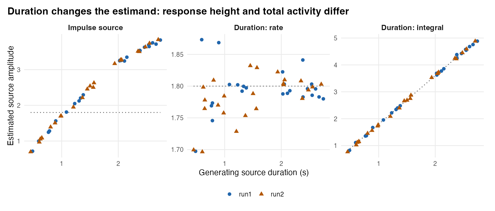

```{r}
#| include: false
d3 <- readRDS("step3_examples.rds")
pol <- read.csv("policy_metrics.csv")
dur_tbl <- read.csv("duration_metrics.csv")
```

## Overview

Step 2 produces a continuous deconvolved time series $\widehat{a}_r(t)$ on the acquisition grid, whereas cognitive hypotheses typically concern **event-locked trial responses**—for example, neural activity across lags $-2\text{ s}$ to $+4\text{ s}$ around feedback onset, or sustained deliberation activity across variable reaction times. Because regularized deconvolution smooths slightly across time, simply slicing $\widehat{a}_r(t)$ at event timestamps yields readouts that combine the target trial's signal with regularization attenuation and spillover from nearby cues or adjacent trials.

Step 3 (`decon_epoch_regression()`) converts continuous deconvolved activity into **conditionally unbiased, additive-error trial readouts** accompanied by exact propagated measurement uncertainties. Passing the forward event schedule through Step 2's frozen linear operator $D_r$, it samples requested peri-event lags via smooth local time-averaging (symmetric kernel quadrature), subtracts spillover from non-target events, inverts target-to-target mixing to restore amplitude gain, and propagates $\text{AR}(p)$ observation noise through the composite operator to deliver per-trial standard errors (`se_demixed`), Empirical-Bayes precision weights, and optional within-run decorrelated (`*_whitened`) variables.

```{r}
#| eval: false
#| code-fold: false
library(medusa)

epochs <- decon_epoch_regression(
  deconvolution       = decon,
  covariates          = covariates,
  events              = events,
  target_condition    = "feedback",
  lags                = seq(-2, 4, by = 1),
  restore_scale       = TRUE,
  whiten_panel        = TRUE,
  return_panel        = TRUE
)
```

::: {.callout-note}
### Position in the MEDuSA Pipeline
**Step 2 `decon` object + `events` + optional `covariates` / `trial_durations`** $\longrightarrow$ **Step 3 (`decon_epoch_regression`)** $\longrightarrow$ Within-subject `coefficients` + event-aligned trial `panel` (or combined directly with Step 4 parcel aggregation via `parcel_groups`)
:::

Following the same measurement-model progression used in two-step multilevel inference (Vig & Hallquist, 2026), the four substeps below move from defining the event source and readout kernel (`3.1`), to writing the epoch measurement model and removing non-target bleed (`3.2`), inverting target mixing onto an additive-error scale (`3.3`), and propagating trial error covariances and precision weights (`3.4`).

---

## Goals, Inputs, and Outputs

### Goals of Step 3

1. **Sample peri-event lag trajectories with explicit duration semantics:** Read out continuous activity around each target event across requested `lags`, supporting brief impulses, fixed windows, and RT-matched sustained intervals (`"rate"` vs. `"integral"`).
2. **Remove non-target spillover and target-to-target mixing:** Use the Step 2 operator $D_r H_r$ to subtract interfering event bleed (`demix_other_events`) and invert target cross-talk (`demix_target_trials`) while matching centered predictors through the post-demixing operator $M_{\text{post}}$.
3. **Propagate observation-noise covariance analytically to every trial:** Compute per-trial measurement standard errors (`se_demixed`) and lag-1 trial error correlations (`error_ac1`) directly from the composite linear operator without resampling.
4. **Construct stabilized trial precision weights and optional decorrelated panels:** Combine propagated measurement error with Empirical-Bayes biological trial variance ($\hat{\tau}_{\text{bio}}^2$, stabilized across functionally concordant cortical neighbors on NIfTI maps via `"graph_eb"`) to form cohort-ready weights and decorrelated trial columns.

### Inputs: What Step 3 Receives and Why

| Input | Structure | Why It Is Set Up That Way |
|---|---|---|
| `deconvolution` | `"crossrun_decon"` S3 object from `deconvolve_crossrun_hrf()` | Carries `activity` together with `hrf_fit`, `scaling`, `noise_innovations`, and `frame_weights` so Step 3 reconstructs the exact stratum inverse operator $D_r$ and noise covariance $\Sigma_r$. |
| `events` & `target_condition` | Run-named list of event `data.frame`s (inherited from `hrf_fit` by default); character scalar naming target events | Retaining *all* task events in `events` while naming `target_condition` identifies both the target trials to read out and the non-target events (cues, motor responses) whose spillover into target windows should be subtracted. |
| `covariates` | `NULL` (covariate-agnostic panel mode), or numeric matrix/`data.frame`/formula/column names matching target events | Passing `covariates = NULL` produces a general-purpose de-mixed `panel` reusable across many downstream Step 5–6 models; supplying `covariates` adds within-participant regression tables (`coefficients`) and paired `*_whitened` predictor columns. |
| `lags` & `readout_kernel` | Numeric vector of lag offsets in seconds (e.g., `seq(-2, 4, by = 1)`); `"triangle"`, `"linear"`, `"boxcar"`, or `"gaussian"` | Evaluates event-locked readouts at arbitrary offsets without resampling BOLD, shifting both the readout window and modeled target source to $t_i + \tau$. |
| `source_model`, `trial_durations`, & `duration_scale` | `"impulse"`, `"window"`, or `"duration"`; optional target durations (s); `"rate"` or `"integral"` | Specifies the latent neural waveform represented by each trial amplitude so variable reaction times can be modeled either as firing height (`"rate"`) or time-integrated activity (`"integral"`). |
| `demix_other_events`, `other_event_model`, `demix_target_trials`, & `demix_within_trial` | Logical flags + `other_event_model = c("auto", "trial", "condition")`, `demix_ridge` (`0.05`), & `within_trial_ridge` (`0.06`) | Separately control collateral non-target subtraction (`"auto"` switches cleanly to GCV-stabilized joint `(T, O)` trial-level subtraction whenever non-target events overlap within the HRF horizon), trial-to-trial target de-mixing, and optional single-subject cross-lag sharpening. |
| `tau2_shrinkage` & `spatial_graph` | `tau2_shrinkage = c("auto", "graph_eb", "eb", "none")`; optional `"medusa_spatial_graph"` | Stabilizes biological trial variance $\hat{\tau}_{\text{bio}}^2$ and sandwich residual scales without smoothing trial slopes (`"auto"` selects bilateral `"graph_eb"` automatically on voxelwise NIfTI maps). |
| `shared_error_method` & `variance_confounds` | `"poet_covreg"` (default), `"legacy"`, or `"none"`; optional `"medusa_confounds"` / `"medusa_nifti_ts"` / run-list envelopes | Fits subspace-debiased Adaptive-POET + multi-lag Toeplitz and LTZ-gated dynamic covariance regression (switching automatically above 512 units to voxel-safe `lowrank_voxel` factor mode) for Step 6 connectivity and post-hoc `aggregate_decon_panel()`. |

### Outputs: What Step 3 Produces and Why It Is Set Up That Way

| Output Component | Structure | Why It Is Set Up That Way |
|---|---|---|
| `panel` | Tidy `data.table` keyed by `run`, `trial`, `event_index`, `onset`, `evt_time`, and `voxel`/`parcel` | **Primary trial table for Steps 5–6.** Stores both `trial` (1..$m$ target counter) and `event_index` (row in `events[[r]]`) alongside `decon_raw`, `decon_demixed`, `se_demixed`, `precision_weight`, `precision_weight_cohort`, `error_ac1`, `tau2_bio`, `decon_eb`, Block-PAF list-columns (`shared_noise_vec`, `lag_noise_vec`, `trial_cor_vec`), and optional `*_whitened` columns. |
| `coefficients` & `summary` | Per-unit × lag × term `data.frame` (`beta_raw`, `beta_corrected`, `beta_unweighted`, `beta_weighted`, `beta_gls`, SEs, moderated `df`, $t$, $p$); lag summary | Places uncorrected (`beta_raw`) and de-mixed/GLS slopes side by side under the same Step 2 inverse so the impact of operator de-mixing and precision weighting is transparent. |
| `lag_resolution` & `lag_error_cor` | Per-unit $L \times L$ cross-lag resolution and trial error correlation matrices | Carried forward so `medusa_multilag_infer()` (Step 5) can apply group-level spectral deblurring, P-spline smoothing, and simultaneous bands across lags. |
| `shared_error_model`, `unit_error_cor`, & `parcel_weights` | POET + covariance-regression shared-error model (`v3`), unit-by-unit error correlation matrix, and voxel weights | Supplies stationary and dynamic cross-region error covariances (`shared_noise_vec` / `shared_noise_loading` in `panel`) for Step 6 connectivity disattenuation and post-hoc `aggregate_decon_panel()`. |

---

## Step-by-Step Walkthrough: Substeps and Choice Points

### 3.1 Define the event-locked neural source and kernel readout

Consider reading out continuous deconvolved activity $\widehat{a}_r$ around target event $i$ at timestamp $t_i + \tau$. Because $t_i + \tau$ rarely lands on an exact integer TR, Step 3 forms a row-normalized weight vector $S_\tau[i, :]$ over nearby acquisition samples (@fig-step3-readout). While `"linear"` uses 2-point bracket interpolation, `"triangle"` (width $1.5 \times \text{TR}$) averages 9 symmetrically weighted sub-interval points across adjacent samples (symmetric kernel quadrature)—respecting sub-TR jitter while attenuating high-frequency inverse noise.

{#fig-step3-readout width="92%" fig-alt="Four-panel bar plot of acquisition-grid weights for linear, boxcar, triangle, and gaussian readout kernels."}

Alongside the readout window, Step 3 asks a substantive question about **source duration**: what neural time course does trial $i$'s amplitude $\theta_i$ multiply? Suppose deliberation neural activity stays at a constant firing rate (`1.8` units/s) across trials whose reaction times vary from `0.4` to `2.8 s`. Because longer deliberation produces larger integrated BOLD deflections, different source models estimate distinct quantities (@fig-step3-duration):

- **`source_model = "impulse"`** treats every trial as a brief unit impulse, attributing longer-duration BOLD accumulation to higher amplitude and producing a positive slope against RT (`beta = 1.392`).
- **`source_model = "duration", duration_scale = "rate"`** matches both the forward boxcar and midpoint readout window to each trial's duration `[onset + lag, onset + lag + RT]`, recovering a flat firing-rate slope invariant to RT (`beta = 0.015`, near true `0.00`).
- **`source_model = "duration", duration_scale = "integral"`** normalizes each forward boxcar to unit area, explicitly estimating **time-integrated neural activity** (`1.8 × duration`, recovering slope `1.806` vs. true `1.800`).

{#fig-step3-duration width="98%" fig-alt="Three-panel plot of estimated trial amplitude versus duration under impulse, duration-rate, and duration-integral models."}

**Choice point — Source model (`source_model` & `duration_scale`) and `readout_kernel`:** Pair `readout_kernel = "triangle"` (`readout_width = 1.5 * tr`) with `source_model = "impulse"` for brief phasic events (e.g., feedback delivery). For variable-duration epochs (e.g., choice deliberation), pass `source_model = "duration"` with `trial_durations = rt` and choose `duration_scale = "rate"` to test neural intensity per unit time or `"integral"` to test cumulative activity.

---

### 3.2 Write the epoch measurement model and subtract non-target spillover

Now consider a cue–feedback paradigm where each `Cue` precedes `Feedback` by 1–3 seconds. Let $\theta_T \in \mathbb{R}^m$ denote true target (`Feedback`) trial amplitudes with convolved forward BOLD design $G_\tau \in \mathbb{R}^{m_r \times m}$, and let $\theta_O$ denote non-target (`Cue`) amplitudes with forward BOLD design $G_O$. Applying readout $S_\tau$ to deconvolved activity $\widehat{a}_r = D_r \tilde{y}_{r,o}$ yields a raw trial readout whose conditional expectation contains two distinct terms:

$$
\mathbb{E}\bigl[\widehat{z}_{\text{raw},\tau} \mid \theta_T, \theta_O\bigr]
= \underbrace{(S_\tau D_r G_\tau)\,\theta_T}_{\text{attenuated \& mixed targets}}
\;+\;
\underbrace{(S_\tau D_r G_O)\,\theta_O}_{\text{non-target spillover}},
$$

where $S_\tau D_r G_\tau \in \mathbb{R}^{m \times m}$ maps true target amplitudes onto raw readouts and $S_\tau D_r G_O$ maps non-target events into the target window. In `simulate_step3.R`, a `Cue_only` voxel responds to cues but has **zero** true feedback slope ($\beta = 0$), while reaction time links cue–feedback spacing to covariate `x`. Because of the second term above, raw feedback readouts in `Cue_only` pick up spurious cue spillover (`beta_raw = -0.115`; @tbl-step3-policies).

Enabling `demix_other_events = TRUE` forms a linear estimator $L_{\text{other}}$ of the non-target amplitudes and subtracts their operator-predicted bleed directly from the readout rows:

$$
S_{\text{clean},\tau} = S_\tau - (S_\tau D_r G_O) L_{\text{other}},
$$

so that $S_{\text{clean},\tau} \widehat{a}_r$ cancels non-target spillover *before* target amplitudes are evaluated (@fig-step3-other-events).

{#fig-step3-other-events width="95%" fig-alt="Lag profiles comparing default 0.05 and joint 0.02 demix_ridge policies."}

**Choice point — Non-target subtraction (`demix_other_events`, `other_event_model`, & `demix_ridge`):** Keep `demix_other_events = TRUE` and **`other_event_model = "auto"`** (default). Earlier prototypes gated trial-varying collateral subtraction on a numeric `demix_ridge < 0.03` threshold, which left `demix_ridge = 0.05` vulnerable to trial-by-trial cue bleed when upstream cues covaried with target predictors (e.g., expected value covarying with feedback RPE). `other_event_model = "auto"` decouples model structure from `demix_ridge`: whenever non-target events overlap target windows within the hemodynamic horizon, `"auto"` fits a GCV/block-ridge-stabilized joint `(T, O)` trial operator that removes both mean and trial-varying collateral spillover automatically (@fig-step3-other-events, right), while collapsing to low-variance `"condition"` subtraction when phases are well separated. Furthermore, for variable-duration epochs (`source_model = "duration"`), post-subtraction target rows $S_{\text{clean},\tau}$ pass directly into duration gain calibration so adjacent encode/probe subtraction never under-restores sustained delay gain.

---

### 3.3 Invert target-to-target mixing to recover an additive-error readout

After removing non-target spillover, the cleaned readout still reflects Step 2's regularization blur across target trials, $K_{\text{clean},\tau} = S_{\text{clean},\tau} D_r G_\tau$. Writing this in the exact measurement-model form of Vig & Hallquist (2026) by adding and subtracting $\theta_T$:

$$
S_{\text{clean},\tau}\widehat{a}_r
= \theta_T - (I - K_{\text{clean},\tau})\theta_T + S_{\text{clean},\tau} D_r \varepsilon_{r,o}.
$$

Without inverting $K_{\text{clean},\tau}$, diagonal shrinkage ($[K_{\text{clean},\tau}]_{ii} < 1$) and neighbor overlap attenuate the true `0.70` feedback slope in `Target` down to `beta_raw = 0.088` (@tbl-step3-policies). Enabling `demix_target_trials = TRUE` applies a ridge-stabilized inverse $W_\tau$ on run-centered trials (Tikhonov regularization with penalty $\lambda_{\text{demix}}$) followed by diagonal gain restoration $\tilde{G}_\tau$ to form the composite de-mixed trial operator $B_{r,\tau}$:

$$
\widehat{z}_{r,\tau} = B_{r,\tau}\tilde{y}_{r,o},
\qquad
B_{r,\tau} = \tilde{G}_\tau W_\tau S_{\text{clean},\tau} D_r,
\qquad
M_{\text{post}} = Q_m (B_{r,\tau} G_\tau) Q_m,
$$

where:

- $\widehat{z}_{r,\tau} \in \mathbb{R}^m$ is the de-mixed trial vector (`decon_demixed`),
- $W_\tau$ approximately inverts $K_{\text{clean},\tau}$ across target trials while preventing variance explosion at sub-2-second ISIs,
- $\tilde{G}_\tau$ is a diagonal matrix restoring unit self-gain on each trial after ridge damping,
- $Q_m = I_m - \frac{1}{m}\mathbf{1}_m\mathbf{1}_m^\top$ centers vectors within run $r$, and
- $M_{\text{post}} \in \mathbb{R}^{m \times m}$ is the **post-demixing target resolution matrix** (close to $Q_m$ once $K_{\text{clean},\tau}$ is inverted; @fig-step3-resolution). Multiplying centered covariates by $M_{\text{post}}$ ensures that even when a small ridge $\lambda_{\text{demix}} > 0$ is retained for stability, both predictor and response live in identical coordinates, recovering the true `0.70` slope cleanly (`Target = 0.705`, `Noisy_target = 0.673`; @fig-step3-target-readout, @tbl-step3-policies).

{#fig-step3-target-readout width="95%" fig-alt="Scatter plots of estimated versus true centered trial amplitudes under three de-mixing policies."}

{#fig-step3-resolution width="92%" fig-alt="20x20 heatmaps of raw versus de-mixed target trial resolution matrices."}

```{r}
#| label: tbl-step3-policies
#| tbl-cap: "Lag-0 feedback slope recovery (true Target slope = 0.70, Cue_only = 0.00) and conditional trial SE across Step 3 de-mixing policies (`policy_metrics.csv`)."
knitr::kable(pol, digits = 3, row.names = FALSE,
  col.names = c("Voxel", "Raw Slope", "Corrected Slope", "Mean Trial SE", "Policy"))
```

When multiple peri-event lags are requested, adjacent lags within the same trial also share deconvolution smoothness. Setting `demix_within_trial = TRUE` applies an additional ridge-stabilized cross-lag inverse within each participant, narrowing single-subject lag curves at the cost of larger per-lag SEs (@fig-step3-cross-lag).

{#fig-step3-cross-lag width="92%" fig-alt="Comparison of lag slope profiles and conditional SEs with and without cross-lag de-mixing."}

**Choice point — Target and cross-lag de-mixing (`demix_target_trials`, `demix_ridge`, & `demix_within_trial`):** Keep `demix_target_trials = TRUE` in all operator analyses. For single-trial readout fidelity or rapid-ITI designs with strong biological trial fluctuations (e.g., estimating individual working-memory capacity plateaus $K_s$), set **`demix_ridge = "auto"`** (`tune_demix_ridge_sure()`), which selects $\lambda_{\text{demix}} \in [0.006, 0.10]$ per run and stratum by minimizing analytical post-gain-restoration trial MSE using propagated Stage-2 readout noise covariance (without peeking at `covariates`), opening to lighter ridge (`~0.006–0.016`) at high trial SNR while retaining conservative stabilization (`0.05–0.10`) on noisy units. Leave `demix_within_trial = FALSE` when passing outputs to `medusa_multilag_infer()` in Step 5 (which sharpens cross-lag blurring at the group level via spectral deblurring, where SNR is $\sqrt{N}$ higher), and enable `demix_within_trial = TRUE` when inspecting descriptive single-subject curves or fitting single-lag models where sharper lag localization is desired.

---

### 3.4 Propagate observation-noise covariance and construct trial precision weights

Because every operation from centered run BOLD to `decon_demixed` is captured in the composite linear map $B_{r,\tau} = \tilde{G}_\tau W_\tau S_{\text{clean},\tau} D_r$, the run-centered conditional sampling covariance of the de-mixed trial vector follows analytically from the linear covariance law:

$$
\widehat{\Omega}_{r,\tau} = \operatorname{Cov}(e_{r,\tau} \mid B_{r,\tau})
= \frac{\sigma_{\text{eff}}^2}{1 - 1/m}\, Q_m B_{r,\tau} \Sigma_{\text{cor}}[I_r, I_r] B_{r,\tau}^\top Q_m,
\qquad
s_{ri} = \texttt{se\_demixed}_{ri} = \sqrt{[\widehat{\Omega}_{r,\tau}]_{ii}},
$$

where:

- $\sigma_{\text{eff}}^2$ is the effective run marginal observation-noise variance (equal to $1$ on noise-SD units or $\widehat{\sigma}_{\text{obs}}^2$ after `restore_scale = TRUE`),
- $\Sigma_{\text{cor}}[I_r, I_r]$ is Step 1's stationary $\text{AR}(p)$ correlation matrix restricted to unmasked frames $I_r$, and
- $Q_m = I_m - \frac{1}{m}\mathbf{1}_m\mathbf{1}_m^\top$ centers across the $m$ target trials in run $r$, with Bessel's $(1 - 1/m)^{-1}$ finite-sample factor accounting for the 1 degree of freedom lost by run-centering (see [Propagating BOLD Noise into Trial Standard Errors](../medusa_standard_errors_mmom.qmd) for the complete derivation).

MEDuSA evaluates $\widehat{\Omega}_{r,\tau}$ in fast factored form without forming dense $T \times T$ covariance matrices, matching dense matrix multiplication to `r format(d3$cov_error, digits = 3)` and reproducing 2,500-draw Monte Carlo noise SDs trial by trial (`se_demixed`; @fig-step3-se-check).

{#fig-step3-se-check width="90%" fig-alt="Dot plot of simulated SD divided by analytical SE near 1.0 across 20 trials."}

Trials near run boundaries, scrub gaps, or rapid event clusters naturally have larger measurement error $s_{ri}^2 = \texttt{se\_demixed}_{ri}^2$. However, trials also vary due to genuine biological trial-to-trial variability $\tau_{\text{bio}}^2$. Just as composite weights in multilevel moment estimation combine structural disturbance variance with measurement-error variance (Vig & Hallquist, 2026), Step 3 estimates $\hat{\tau}_{\text{bio}}^2$ and forms **Empirical-Bayes composite precision weights**:

$$
w_{ri} = \frac{1}{\widehat{\tau}_{\text{eff}}^2 + s_{ri}^2},
$$

exported both normalized to mean 1 within each unit (`precision_weight`) and unnormalized for cross-run and cross-participant comparability (`precision_weight_cohort`), downweighting high-SE trials smoothly without letting a single low-SE trial dominate (@fig-step3-weights).

When requested (`whiten_panel = TRUE`), Step 3 also removes off-diagonal within-run trial error correlations from $\Sigma_{\text{tot}} = \widehat{\tau}_{\text{eff}}^2 I_m + \widehat{\Omega}_{r,\tau}$ using **regularized zero-phase component analysis (ZCA) whitening**:

$$
T_{\text{ZCA}} = \Sigma_{\text{tot}}^{-1/2} = U \Lambda^{-1/2} U^\top,
\qquad
\text{where } \Sigma_{\text{tot}} = U \Lambda U^\top,
$$

with $U$ and $\Lambda$ the eigenvectors and (regularized) eigenvalues of $\Sigma_{\text{tot}}$. Why ZCA rather than Cholesky or PCA whitening? Among all matrices satisfying $T \Sigma_{\text{tot}} T^\top = I$, the symmetric inverse square root $T_{\text{ZCA}}$ is the unique transform minimizing $\mathbb{E}\|Tz - z\|_2^2$—so row $i$ of `decon_demixed_whitened` remains maximally aligned with original trial $i$ while decorrelating neighboring overlapping trials (@fig-step3-zca).

{#fig-step3-weights width="90%" fig-alt="Scatter plot of normalized precision weights against trial measurement SE."}

{#fig-step3-zca width="92%" fig-alt="20x20 correlation heatmaps before and after regularized ZCA whitening."}

**Choice point — Variance shrinkage (`tau2_shrinkage`), physical units (`restore_scale`), and trial decorrelation (`whiten_panel`):**

- **Variance stabilization (`tau2_shrinkage = "auto"`):** In single-voxel NIfTI analyses (`aggregate_by_parcel = FALSE`), raw per-voxel $\hat{\tau}_{\text{raw}}^2 = \hat{\sigma}_{\text{tot}}^2 - s_{\text{obs}}^2$ has wide sampling variance over 40–80 trials and frequently truncates to zero. `"auto"` automatically activates **edge-preserving neighborhood variance pooling (`"graph_eb"`)**, which stabilizes the dimensionless ratio $\hat{\tau}_{\text{raw}}^2 / s_{\text{obs}}^2$ across functionally concordant cortical neighbors *before* zero-truncation. To keep neighborhood pooling calibrated, it discounts shared scanner noise between neighbors (via Isserlis' squared-correlation identity), caps how far isolated focal hotspots can be pulled toward quiet surround voxels (at $2.5$ standard errors via Efron–Morris limited translation), and borrows residual scale precision across concordant neighbors (Empirical-Bayes variance moderation; Smyth, 2004)—without ever smoothing trial slopes $\hat{\beta}$ (see [Spatial Graph Pooling](../medusa_spatial_parcel_pooling/medusa_spatial_parcel_pooling.qmd#sec-step3-grapheb)). In parcel mode (`aggregate_by_parcel = TRUE`), `"auto"` defaults to `"none"`, while setting `"graph_eb"` explicitly builds a 3D parcel-centroid graph for fine parcellations (e.g., Schaefer-400/1000).
- **Scale restoration & trial decorrelation:** Set `restore_scale = TRUE` whenever pooling runs or participants so `decon_demixed` and `se_demixed` return to physical BOLD units, and set `whiten_panel = TRUE` alongside `return_panel = TRUE` to export paired `*_whitened` columns (via regularized ZCA) for rapid-ISI designs.

---

## Recommended Settings

```{r}
#| eval: false
#| code-fold: false
epochs <- decon_epoch_regression(
  deconvolution       = decon,
  covariates          = covariates,      # or NULL for a covariate-agnostic panel
  events              = events,
  target_condition    = "feedback",
  lags                = seq(-2, 4, by = 1),
  source_model        = "impulse",       # or "duration" + trial_durations for RT intervals
  duration_scale      = "rate",
  readout_kernel      = "triangle",
  readout_width       = 1.5 * tr,
  demix_other_events  = TRUE,
  other_event_model   = "auto",          # joint (T, O) trial subtraction when phases overlap
  demix_target_trials = TRUE,
  demix_within_trial  = FALSE,           # FALSE before medusa_multilag_infer(); TRUE for 1-subject curves
  demix_ridge         = "auto",          # SURE-tuned trial ridge (or fixed 0.05)
  restore_scale       = TRUE,
  weighting           = "gls",
  tau2_mode           = "auto",
  tau2_shrinkage      = "auto",          # automatic bilateral "graph_eb" on voxelwise NIfTI maps
  parcel_groups       = parcel_ids,      # omit for voxelwise maps; supply to run Step 4 parcel pooling
  whiten_panel        = TRUE,
  return_panel        = TRUE
)
```

| Argument | Recommended | Package Default | Summary of Role & When to Adjust |
|---|---|---|---|
| `source_model` & `duration_scale` | `"impulse"` (brief) or `"duration"` + `"rate"` (RTs) | `"impulse"`, `"rate"` | Matches the forward neural boxcar to brief events vs. variable reaction-time intervals (`Substep 3.1`). |
| `demix_other_events`, `other_event_model`, & `demix_ridge` | `TRUE`, `"auto"`, `"auto"` (or `0.05`) | `TRUE`, `"auto"`, `0.05` | Removes condition-mean and overlapping trial-varying non-target spillover (`Substep 3.2`), while `demix_ridge = "auto"` tunes per-stratum target trial ridge via analytical Stage-2 error-covariance SURE/MMSE (`Substep 3.3`). |
| `demix_target_trials` & `demix_within_trial` | `TRUE` & `FALSE` | `TRUE` & `FALSE` | Inverts target cross-talk (`Substep 3.3`) while leaving cross-lag deblurring to Step 5's `medusa_multilag_infer()`. |
| `restore_scale` | `TRUE` | `FALSE` | Multiplies run readouts and SEs back onto physical BOLD units for cross-run and cohort pooling (`Substep 3.4`). |
| `tau2_shrinkage` | `"auto"` | `"auto"` | Activates bilateral `"graph_eb"` automatically on voxelwise NIfTI maps (`Substep 3.4`); set `"graph_eb"` explicitly in parcel mode for dense 400–1000-parcel atlases. |
| `whiten_panel` & `return_panel` | `TRUE` & `TRUE` | `FALSE` (`TRUE` if `covariates = NULL`) | Exports the tidy `panel` along with paired within-run ZCA-decorrelated columns (`Substep 3.4`). |

---

## Practical Considerations: Descriptive Alignment, Censoring Support, and Scope

1. **When to use descriptive `align_medusa_ts()` vs. inferential `decon_epoch_regression()`:** When you want descriptive peri-event waveform interpolation without a forward de-mixing model—for example, plotting raw peri-event BOLD averages, inspecting blind `deconvolve_nlreg()` / `deconvolve_reglin()` trajectories, or auditing explicit collision rules (`overlap_policy = "allow" | "truncate" | "exclude"`)—use **`align_medusa_ts()`** (or `evt_align_decon_files()` for disk-backed `.csv.gz` archives). For primary inferential modeling on `deconvolve_crossrun_hrf()` outputs, use **`decon_epoch_regression()`**, which removes neighbor mixing and propagates analytical `se_demixed`. (Because `epochs$panel` is already event-aligned, it goes directly to Steps 5–6 without calling `align_medusa_ts()`.)
2. **Causal BOLD observability gating (`obs_frac_tau >= 0.20`):** If at least 80% of the forward HRF energy evoked by a target event at $t_i + \tau$ falls inside censored frames (`valid_rows == FALSE`) or past the end of the run, Step 3 records that trial-lag as `NA` rather than extrapolating from the smoothness penalty (while partial scrubbing inside the HRF window elevates `se_demixed`; see the [Visual QC Gallery](../medusa_qc_gallery/medusa_qc_gallery.qmd)). Always inspect retained trial counts across runs and conditions before group modeling.
3. **Scope handoff:** Step 3 operates within a single participant. Aggregating voxels into anatomical parcels with spatial noise propagation is covered next in [Step 4](../medusa_step4_parcel_panels/medusa_step4_parcel_panels.qmd) (executed inside the same `decon_epoch_regression(..., parcel_groups = ...)` call), followed by population modeling in [Step 5](../medusa_step5_group_models/medusa_step5_group_models.qmd) and connectivity disattenuation in [Step 6](../medusa_step6_connectivity/medusa_step6_connectivity.qmd).

<details>
<summary>Mathematical Reference & Reproduction</summary>

For run $r$, lag $\tau$, valid observation frames $I_r$ ($m_r$ of $T_r$ volumes), and frozen Step 2 inverse $D_r \in \mathbb{R}^{T_r \times m_r}$:

1. **Non-target subtraction (`other_event_model = "auto"`):** Let $S_{r,0}$ (`build_epoch_readout_matrix()`) read out all events at lag 0 and $G_{r,0}$ be their column-centered forward HRF design. `build_other_demix_operator()` forms $L_{\text{other}}$ via GCV/block-ridge-stabilized joint `(T, O)` trial inversion whenever non-target events overlap within the HRF horizon under `other_event_model = "auto"` (or `"trial"`), collapsing to condition-mean least squares under `"condition"`, yielding cleaned target readout rows $S_{\text{clean},\tau} = S_\tau - (S_\tau D_r G_{r,0,\text{other}}) L_{\text{other}}$. On multi-lag sweeps (`length(lags) > 1`), target demixing applies a uniform lag-wise operator across all requested lags (`n_lags == 1L` guard on single-lag `L_target_0` shortcuts) so `lag = 0` never incurs a discontinuous gain notch prior to Step 5 spectral deblurring (`medusa_build_deblur_operator(..., alpha1 = 0.05, alpha0_sq = 0.020)`).
2. **Target cross-talk & post-subtraction duration gain calibration:** Given uncentered and column-centered target forward designs $(G_{\tau,\text{unc}}, G_\tau)$, `solve_duration_demix_operator()` evaluates post-subtraction target matrices $S_{\text{clean},\tau} D_r G_{\tau,\text{unc}}$ and $S_{\text{clean},\tau} D_r G_\tau$, row-normalizes $R_{\text{unc}} = \operatorname{diag}(g_{\text{safe}})^{-1} S_{\text{clean},\tau} D_r G_{\tau,\text{unc}}$, solves $(R_{\text{unc}}^\top R_{\text{unc}} + \lambda_{\text{demix}} Q_m + 10^{-8} I) W_{\text{unc}} = R_{\text{unc}}^\top \operatorname{diag}(g_{\text{safe}})^{-1}$ (penalizing centered fluctuations $Q_m = I_m - \frac{1}{m}\mathbf{1}\mathbf{1}^\top$), applies a Sherman–Morrison rank-1 centering update to obtain $W_\tau$, and restores exact post-subtraction centered diagonal gain $\tilde{G}_\tau$.
3. **Exact noise propagation & $M_{\text{post}}$ alignment:** The composite linear map from centered run BOLD to de-mixed target trials is $B_{r,\tau} = \tilde{G}_\tau W_\tau S_{\text{clean},\tau} D_r$, with centered trial error covariance $\Omega_{r,\tau} = \frac{\sigma_{\text{eff}}^2}{1 - 1/m} Q_m B_{r,\tau} C_{\text{obs}} \Sigma_{\text{AR}}[I_r, I_r] C_{\text{obs}}^\top B_{r,\tau}^\top Q_m$ evaluated via `compute_ar1_operator_factor()`. Centered covariates $X_{r,c}$ are multiplied by $M_{\text{post}} = Q_m (\tilde{G}_\tau W_\tau S_{\text{clean},\tau} D_r G_\tau) Q_m$ prior to regression and ZCA whitening.
4. **Bilateral Graph-EB variance & scale moderation (`tau2_shrinkage = "graph_eb"`):** Defining untruncated $\hat{\theta}_u = \hat{\tau}_{\text{raw}, u}^2 / s_{\text{obs}, u}^2$ with sampling variance $v_u \approx \frac{2}{\nu_u}(1 + \max(0, \tilde{\theta}_u))^2$, bilateral weights $\alpha_{uv}$ combine geodesic distance, Cauchy pilot-jump stopping, and orthogonalized residual sign concordance. Discounting neighbor squared-error correlation $\rho_{ab}^2$ yields local prior $(\mu_{\text{loc}, u}, \tau_{\text{prior}, u}^2)$, shrinkage $B_u = v_u / (v_u + \tau_{\text{prior}, u}^2)$, limited-translation posterior $\theta_u^{\text{EM}} = \hat{\theta}_u + \operatorname{clip}(B_u(\mu_{\text{loc}, u} - \hat{\theta}_u), -2.5\sqrt{v_u}, +2.5\sqrt{v_u})$, and $\hat{\tau}_{\text{bio}, u}^2 = s_{\text{obs}, u}^2 \max(0, \theta_u^{\text{EM}})$, paired with bilateral Smyth (2004) moderation of sandwich residual scales.

[Step 3 simulation script](simulate_step3.R) · [Figure script](figures_step3.R) · [Verification output](verification.txt)

</details>
