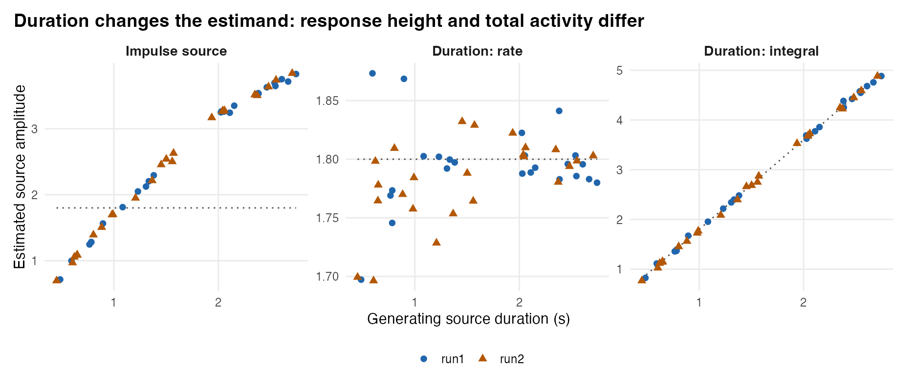

## Overview

Deconvolving a BOLD run in Step 2 produces a continuous time series $\hat{s}_r$ on the acquisition clock—not isolated single-trial numbers. Simply slicing or linearly interpolating $\hat{s}_r$ around each event onset (the legacy alignment route) leaves two systematic distortions: **(1) regularization shrinkage**, which attenuates true trial amplitudes ($g_i < 1$), and **(2) cross-event mixing**, where preceding cues, motor responses, or rapid neighboring trials bleed through the regularized inverse operator $D_r H_r$ into the target readout. Moreover, when an event represents a variable-duration deliberation interval (such as reaction time), a fixed-point readout conflates firing *rate* with time-on-task.

Step 3 (`decon_epoch_regression()`) bridges continuous deconvolution and trial-level modeling by **passing the forward event schedule through the exact frozen Step 2 inverse operator**. For every requested lag $\tau$ around `target_condition`, it integrates local continuous activity via symmetric kernel quadrature, subtracts operator-predicted bleed from non-target events (`demix_other_events = TRUE`), inverts the target-by-target resolution matrix to remove neighbor cross-talk and restore amplitude gain (`demix_target_trials = TRUE`), aligns centered trial covariates through the matched post-demixing operator ($M_{\text{post}}$), and propagates Step 1–2's $\text{AR}(p)$ observation-noise covariance through the entire composite linear map $B_{r,\tau}$ to deliver exact conditional per-trial standard errors (`se_demixed`), Empirical-Bayes precision weights, and within-run ZCA-whitened variables.

::: {.callout-note}
### Position in the MEDuSA Pipeline
**Step 2 `decon` object + `events` + optional `covariates` / `trial_durations`** $\longrightarrow$ **Step 3 (`decon_epoch_regression`)** $\longrightarrow$ Within-subject `coefficients` + event-aligned trial `panel` (or combined directly with Step 4 parcel aggregation via `parcel_groups`)
:::

---

## Goals of Step 3

Step 3 accomplishes five core objectives:

1. **Read out event-locked lag trajectories without mutating the acquisition clock:** Sample continuous activity around each target onset $t_i + \tau$ using jitter-tolerant quadrature (`readout_kernel`) while gating out trial-lags that lack causal unmasked BOLD support (`obs_frac_tau < 0.20`).
2. **De-mix interfering events and adjacent target trials:** Use the stratum resolution operator $D_r H_r$ to subtract preceding/succeeding non-target event bleed (e.g., cues) and invert target-to-target cross-talk while restoring regularization-attenuated amplitude gain.
3. **Define duration-explicit neural estimands when intervals vary:** Support impulse (`"impulse"`), fixed-window (`"window"`), and RT-matched sustained boxcar (`"duration"`) forward models, distinguishing constant firing **rate** (`duration_scale = "rate"`, baseline-deconfounded from RT) from integrated neural **mass** (`"integral"`).
4. **Keep predictors and responses in matched operator coordinates:** Transform centered within-run predictors by the post-demixing resolution operator $M_{\text{post}}$ so residual ridge shrinkage at short ISIs never biases trial regression slopes.
5. **Propagate observation-noise covariance analytically to the trial level:** Compute conditional per-trial measurement SEs (`se_demixed`), lag-1 trial error autocorrelation (`error_ac1`), Empirical-Bayes trial precision weights, and regularized within-run ZCA whitening matrices without Monte Carlo resampling.

**What Step 3 deliberately leaves to Steps 4–6:** Step 3 operates within a single participant's multi-run fit. Combining voxels into parcels is covered in [Step 4]( ../medusa_step4_parcel_panels/medusa_step4_parcel_panels.qmd ) (which runs inside the same `decon_epoch_regression()` call via `parcel_groups`), population inference across participants is handled in [Step 5](../medusa_step5_group_models/medusa_step5_group_models.qmd), and disattenuating noisy seed predictors is handled in [Step 6](../medusa_step6_connectivity/medusa_step6_connectivity.qmd).

---

## Inputs: What Step 3 Receives and Why

| Input | Structure | Why It Is Set Up That Way |
|---|---|---|
| `deconvolution` | Full `"crossrun_decon"` S3 object from `deconvolve_crossrun_hrf()` | **Never pass a plain `activity` matrix or saved CSV.** Step 3 needs `deconvolution$hrf_fit`, `scaling`, `settings`, `noise_innovations`, and `frame_weights` to rebuild the exact stratum inverse operator $D_r$ and noise covariance $\Sigma_r$. |
| `events` & `target_condition` | Optional run-named list of event `data.frame`s (defaults to `hrf_fit`'s events); character scalar naming target events | Keeping *all* task events (cues, decisions, motor responses, feedback) in `events` while naming `target_condition = "feedback"` tells Step 3 which events are targets to read out and which are interfering non-target events whose bleed into target epochs must be subtracted! |
| `covariates` | `NULL` (covariate-agnostic panel mode), or numeric matrix/`data.frame`/run-named list matching **target event rows** | Supplying `covariates = NULL` builds a reusable, covariate-agnostic de-mixed trial panel (`tau2_mode = "marginal"`) ready for multiple downstream `mixed_by()` formulas or connectivity models. Supplying `covariates` adds within-person precision-weighted and GLS slope tables (`coefficients`) and ZCA-whitened predictor columns. |
| `lags` & `readout_kernel` | Numeric vector of lag offsets in seconds (e.g., `seq(-2, 4, by = 1)`); `"triangle"`, `"linear"`, `"boxcar"`, or `"gaussian"` | Evaluates event-locked readouts at arbitrary lag offsets without resampling BOLD. Note that in Step 3, evaluating lag $\tau$ shifts *both* the readout window and the assumed target forward source to $t_i + \tau$. |
| `source_model`, `trial_durations`, `duration_scale` | `"impulse"`, `"window"`, or `"duration"`; optional target duration vector/list (s); `"rate"` or `"integral"` | Explicitly encodes what latent neural shape each trial amplitude multiplies—preventing reaction-time variability from masquerading as amplitude modulation when neural firing rate is constant. |
| `demix_other_events`, `demix_target_trials`, `demix_within_trial` | Logical flags + `demix_ridge` (`0.05`) & `within_trial_ridge` (`0.06`) | Separates three distinct sources of blur: non-target event bleed, trial-to-trial target overlap, and within-trial cross-lag spread. |

---

## Outputs: What Step 3 Produces and Why It Is Set Up That Way

`decon_epoch_regression()` returns a named list designed to serve both immediate single-subject inspection (`coefficients`, `summary`) and lossless multi-subject handoffs (`panel` + operator summaries):

| Output Component | Structure | Why It Is Set Up That Way |
|---|---|---|
| `panel` | Tidy `data.table` keyed by `run`, `trial`, `event_index`, `onset`, `evt_time`, and `voxel`/`parcel` | **The primary analysis table for Steps 5–6.** Includes both `trial` (1..$m$ target counter within run) *and* `event_index` (exact row index in `events[[r]]`) so behavioral joins never misalign when non-target events are interleaved. Carries `decon_raw`, `decon_demixed`, `se_raw`, `se_demixed`, `precision_weight`, `precision_weight_cohort`, `error_ac1`, `tau2_bio`, `reliability_trial`, `decon_eb`, and optional `*_whitened` columns. |
| `coefficients` & `summary` | Per-unit × lag × term `data.frame` (`beta_raw`, `beta_corrected`, `beta_unweighted`, `beta_weighted`, `beta_gls`, sandwich SEs, $t$, $p$); lag-averaged summary | Reporting `beta_raw` alongside `beta_unweighted`, `beta_weighted`, and `beta_gls` under the *same* Step 2 inverse makes it immediately transparent how much of an effect comes from operator de-mixing versus trial precision weighting or ZCA decorrelation. |
| `lag_resolution` & `lag_error_cor` | Per-unit $L \times L$ symmetric cross-lag point-spread ($C_{\text{sym}}$) and trial error correlation matrices | Stored on the fit object so `medusa_multilag_infer()` (Step 5) can perform group-level spectral deblurring, correlated-SURE P-spline smoothing, and simultaneous Max-$|T|$/TFCE inference across lags without re-running Step 3. |
| `unit_error_cor` & `parcel_weights` | Empirical-Bayes shrunk unit-by-unit error correlation matrix; normalized voxel weight vectors (when `aggregate_by_parcel = TRUE`) | Preserves cross-region observation-noise correlation for `decon_connectivity_repair(..., shared_error = "auto")` (also embedded per row as `shared_noise_loading` in `panel` so it survives `rbindlist()` and CSV export). |

---

## Recommended Settings

```{r}
#| eval: false
#| code-fold: false
epochs <- decon_epoch_regression(
  deconvolution       = decon,
  covariates          = covariates,      # or NULL for a covariate-agnostic panel
  events              = events,
  target_condition    = "feedback",
  lags                = seq(-2, 4, by = 1),
  source_model        = "impulse",       # use "duration" + trial_durations for RT intervals
  duration_scale      = "rate",
  readout_kernel      = "triangle",
  readout_width       = 1.5 * tr,
  demix_other_events  = TRUE,
  demix_target_trials = TRUE,
  demix_within_trial  = FALSE,           # FALSE before medusa_multilag_infer(); TRUE for 1-subject curves
  demix_ridge         = 0.05,            # lower to 0.02 if non-target cues vary strongly with covariates
  restore_scale       = TRUE,
  weighting           = "gls",
  tau2_mode           = "auto",
  parcel_groups       = parcel_ids,      # pre-aggregates parcels (Step 4) in one pass
  whiten_panel        = TRUE,
  return_panel        = TRUE
)
```

| Argument | Recommended | Package Default | Why Recommended & When to Adjust |
|---|---|---|---|
| `restore_scale` | `TRUE` | `FALSE` | **Critical override for multi-run/group studies:** Step 2 divides each run by its own `noise_sd`. Setting `restore_scale = TRUE` multiplies `activity` back by `scaling[[r]]$scale` so all runs within a participant share physical BOLD units (under Step 1's HRF normalization) while keeping exact `se_demixed` and `precision_weight_cohort` scaling! |
| `whiten_panel` & `return_panel` | `TRUE` & `TRUE` | `FALSE` (`return_panel = TRUE` when `covariates = NULL`) | Exports `decon_demixed_whitened` and `<var>_whitened` alongside `precision_weight_cohort`, allowing `mixed_by()` in Step 5 to account for both heteroskedastic trial precision and within-run serial trial error correlations. |
| `demix_other_events` & `demix_ridge` | `TRUE`, `0.05` (`0.02` for trial-varying confounds) | `TRUE`, `0.05` | At `demix_ridge >= 0.03`, non-target subtraction uses a low-variance **condition-mean** operator—ideal when cues have roughly constant amplitude. If an upstream cue varies trial-by-trial with the *same* behavioral predictor as your target event, lower `demix_ridge` to `0.02` to activate joint 2nd-order Tikhonov `(T, O)` de-mixing! |
| `demix_within_trial` | `FALSE` for Step 5 trajectory pooling; `TRUE` for descriptive curves | `FALSE` | Leave `FALSE` when passing results to `medusa_multilag_infer()`, which performs spectral de-blurring at the group level where SNR is $\sqrt{N}$ higher. Enable `TRUE` (with lags spaced at $\approx 1\times\text{TR}$) when inspecting single-subject lag waveforms. |
| `source_model` & `duration_scale` | `"impulse"` for brief events; `"duration"` + `"rate"` for RT epochs | `"impulse"`, `"rate"` | Match the source model to the cognitive process: `"duration"` with `duration_scale = "rate"` centers the readout over `[onset + lag, onset + lag + RT]` and de-confounds constant baseline firing rates from trial duration. |

---

## Step 3 Mechanisms Illustrated

```{r}
#| include: false
d3 <- readRDS("step3_examples.rds")
pol <- read.csv("policy_metrics.csv")
dur_tbl <- read.csv("duration_metrics.csv")
```

### 1. Kernel Quadrature Readouts and Causal BOLD Support Gating

At each target onset $t_i$ and lag $\tau$, `build_epoch_readout_matrix()` constructs a row-normalized weight vector $S_\tau[i, :]$ over the discrete acquisition grid (@fig-step3-readout). `"linear"` uses 2-point bracket interpolation, whereas `"triangle"` (default, width $1.5 \times \text{TR}$), `"boxcar"`, and `"gaussian"` integrate 9-point symmetric quadrature nodes across adjacent TRs—attenuating high-frequency deconvolution noise while honoring exact sub-TR event jitter.

Crucially, MEDuSA checks **causal BOLD observability** (`obs_frac_tau >= 0.20`): if at least 80% of the forward HRF energy evoked by a source at $t_i + \tau$ falls inside censored frames (`valid_rows == FALSE`) or past the end of the run, `decon_epoch_regression()` marks that trial-lag `NA` rather than fabricating a number from smoothness prior extrapolation!

{#fig-step3-readout width="92%" fig-alt="Four-panel bar plot of acquisition-grid weights for linear, boxcar, triangle, and gaussian readout kernels."}

### 2. Non-Target Subtraction (`demix_other_events`) & Target De-Mixing (`demix_target_trials`)

Consider a cue–feedback paradigm (`Cue` followed 1–3 s later by `Feedback`) with three simulated voxels (`simulate_step3.R`): `Cue_only` (responds to cues with zero feedback effect), `Target` (true feedback slope `0.70` on `x`), and `Noisy_target` (true slope `0.70`, higher noise). Because RT links cue-to-feedback delay with `x`, uncorrected feedback readouts in `Cue_only` pick up spurious cue bleed (`beta_raw = -0.115`), while `Target` is severely attenuated (`beta_raw = 0.088` vs. truth `0.700`; @tbl-step3-policies, @fig-step3-target-readout).

- **Target de-mixing alone (`target_only`)** restores gain on target overlap (`0.307`) but magnifies unsubtracted cue bleed in `Cue_only` (`-0.401`).
- **Cue + target de-mixing (`default`, `demix_ridge = 0.05`)** removes constant-amplitude cue bleed (`Cue_only` slope `-0.006`) and recovers the true `0.70` slope cleanly (`Target` = `0.705`, `Noisy_target` = `0.673`), sharpening the 20×20 target resolution matrix toward the identity (@fig-step3-resolution).
- **What if cues themselves vary trial-by-trial with `x` (`stress_bold`)?** Under strong cue modulation (`1.8 + 0.9 x`), condition-mean subtraction (`demix_ridge = 0.05`) leaves residual cue variation (`Cue_only` = `0.488`), whereas lowering `demix_ridge = 0.02` activates joint 2nd-order Tikhonov `(T, O)` de-mixing—cutting `Cue_only` bleed to `0.074` (`Target` = `0.773`) at the expected cost of ~45% larger trial SEs (`0.101` vs. `0.070`; @fig-step3-other-events).

{#fig-step3-other-events width="95%" fig-alt="Lag profiles comparing default 0.05 and joint 0.02 demix_ridge policies."}

{#fig-step3-target-readout width="95%" fig-alt="Scatter plots of estimated versus true centered trial amplitudes under three de-mixing policies."}

{#fig-step3-resolution width="92%" fig-alt="20x20 heatmaps of raw versus de-mixed target trial resolution matrices."}

```{r}
#| label: tbl-step3-policies
#| tbl-cap: "Lag-0 feedback slope recovery (true Target slope = 0.70, Cue_only = 0.00) and conditional trial SE across Step 3 de-mixing policies (`policy_metrics.csv`)."
knitr::kable(pol, digits = 3, row.names = FALSE,
  col.names = c("Voxel", "Raw Slope", "Corrected Slope", "Mean Trial SE", "Policy"))
```

### 3. Variable-Duration Epochs: Rate vs. Time-Integrated Activity

When neural activity is sustained at a **constant firing rate** (`1.8` units/s) across variable decision durations (`0.4–2.8 s`), total evoked BOLD scales roughly linearly with duration. How Step 3 parameterizes `source_model` determines what scientific question is answered (@fig-step3-duration):

- **`source_model = "impulse"`** misinterprets longer-duration BOLD accumulation as larger impulse height, creating a strong artificial positive slope against RT (`beta = 1.392`).
- **`source_model = "duration", duration_scale = "rate"`** matches both the forward boxcar and midpoint readout window to each trial's duration *and* uses a centered-subspace penalty plus Sherman–Morrison rank-1 baseline adjustment so constant firing rate remains invariant to RT (`beta = 0.015`, near true `0.00`!).
- **`source_model = "duration", duration_scale = "integral"`** normalizes each forward boxcar to unit area, explicitly estimating **time-integrated neural mass** (`1.8 × duration`, recovering slope `1.806` vs. true `1.800`).

{#fig-step3-duration width="98%" fig-alt="Three-panel plot of estimated trial amplitude versus duration under impulse, duration-rate, and duration-integral models."}

### 4. Optional Cross-Lag De-Mixing, Exact Analytical SEs, Precision Weights, and ZCA

Enabling `demix_within_trial = TRUE` applies a symmetric 2nd-order Tikhonov inverse across lags, sharpening single-subject lag specificity while increasing conditional lag SEs (@fig-step3-cross-lag). Across all configurations, MEDuSA's $O(m_{\text{obs}} p M)$ AR operator factor `compute_ar1_operator_factor()` reproduces dense matrix covariance $B \Sigma B^\top$ to `r format(d3$cov_error, digits = 3)` and matches 2,500-draw Monte Carlo noise SDs trial by trial (@fig-step3-se-check).

Finally, Step 3 combines per-trial measurement variance $s_{ri}^2 = \text{se\_demixed}_{ri}^2$ with an Empirical-Bayes biological trial variance estimate $\hat{\tau}_{\text{bio}}^2$ so `precision_weight` ($w_{ri} \propto (\hat{\tau}_{\text{eff}}^2 + s_{ri}^2)^{-1}$) downweights noisy edge/overlap trials smoothly without letting a single low-SE trial dominate when genuine biological trial variability is large (@fig-step3-weights), while regularized ZCA (`whiten_panel = TRUE`) suppresses off-diagonal within-run trial error correlations (@fig-step3-zca).

{#fig-step3-cross-lag width="92%" fig-alt="Comparison of lag slope profiles and conditional SEs with and without cross-lag de-mixing."}

{#fig-step3-se-check width="90%" fig-alt="Dot plot of simulated SD divided by analytical SE near 1.0 across 20 trials."}

{#fig-step3-weights width="90%" fig-alt="Scatter plot of normalized precision weights against trial measurement SE."}

{#fig-step3-zca width="92%" fig-alt="20x20 correlation heatmaps before and after regularized ZCA whitening."}

<details>
<summary>Mathematical Reference: Composite Epoch Operator & Covariate Matching</summary>

For run $r$, lag $\tau$, valid observation rows $I_r$, and frozen Step 2 inverse $D_r \in \mathbb{R}^{n_r \times m_r}$:

1. **Non-target subtraction:** Let $S_{r,0}$ read out all events at lag 0 and $G_{r,0}$ be their column-centered forward HRF design. `build_other_demix_operator()` forms $L_{\text{other}}$ (condition-mean least squares for `demix_ridge >= 0.03`, or 2nd-order iterated Tikhonov joint inversion for `< 0.03`), yielding cleaned target readout rows $S_{\text{clean},\tau} = S_\tau - (S_\tau D_r G_{r,0,\text{other}}) L_{\text{other}}$.
2. **Target cross-talk & duration baseline invariance:** Given uncentered and column-centered target forward designs $(G_{\tau,\text{unc}}, G_\tau)$, `solve_duration_demix_operator()` row-normalizes $R_{\text{unc}} = \operatorname{diag}(g_{\text{safe}})^{-1} S_\tau D_r G_{\tau,\text{unc}}$, solves $(R_{\text{unc}}^\top R_{\text{unc}} + \lambda_{\text{demix}} Q_m + 10^{-8} I) W_{\text{unc}} = R_{\text{unc}}^\top \operatorname{diag}(g_{\text{safe}})^{-1}$ (penalizing only centered fluctuations $Q_m = I_m - \frac{1}{m}\mathbf{1}\mathbf{1}^\top$), applies a Sherman–Morrison rank-1 centering update to obtain $W_\tau$, and restores centered diagonal gain $\tilde{G}_\tau$.
3. **Exact noise propagation & $M_{\text{post}}$ alignment:** The complete linear map from centered run BOLD to de-mixed target trials is $B_{r,\tau} = \tilde{G}_\tau W_\tau S_{\text{clean},\tau} D_r$, with calibrated centered trial error covariance $\Omega_{r,\tau} = \frac{\sigma_{\text{eff}}^2}{1 - 1/m} Q_m B_{r,\tau} C_{\text{obs}} \Sigma_{\text{AR}}[I_r, I_r] C_{\text{obs}}^\top B_{r,\tau}^\top Q_m$. Centered covariates $X_{r,c}$ are multiplied by $M_{\text{post}} = Q_m (\tilde{G}_\tau W_\tau S_{\text{clean},\tau} D_r G_\tau) Q_m$ prior to regression and ZCA whitening so predictor and response undergo identical off-diagonal target shrinkage.

[Step 3 simulation script](simulate_step3.R) · [Figure script](figures_step3.R) · [Verification output](verification.txt)

</details>
