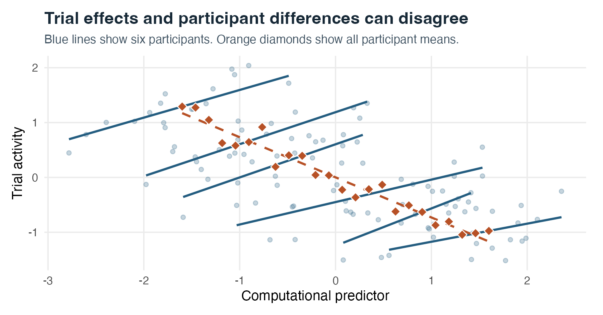
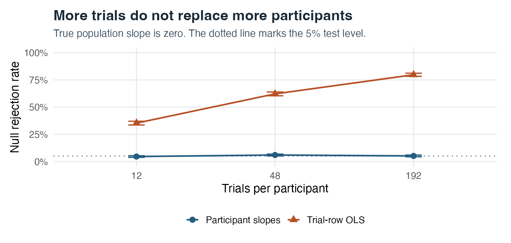
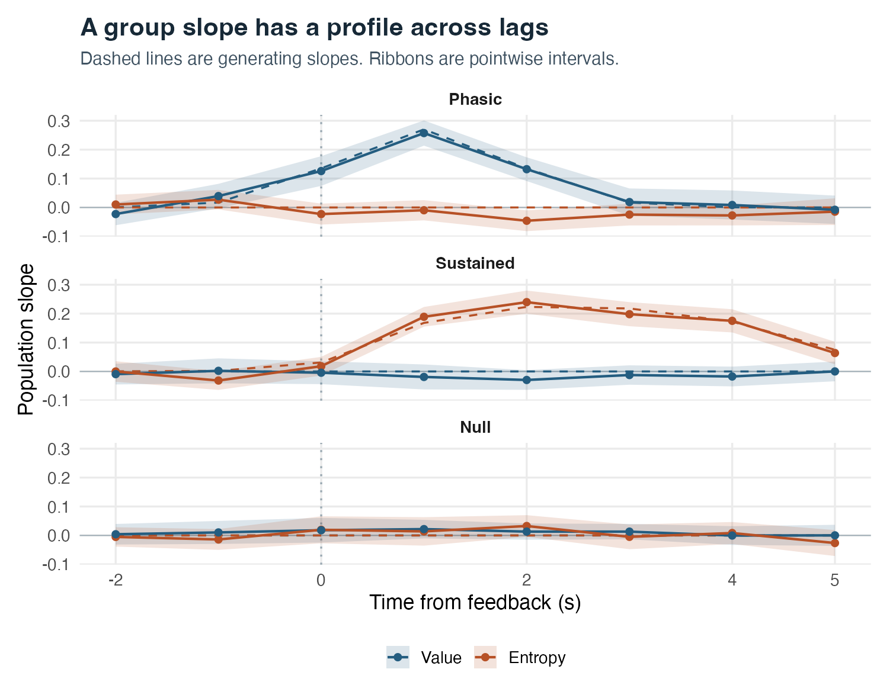
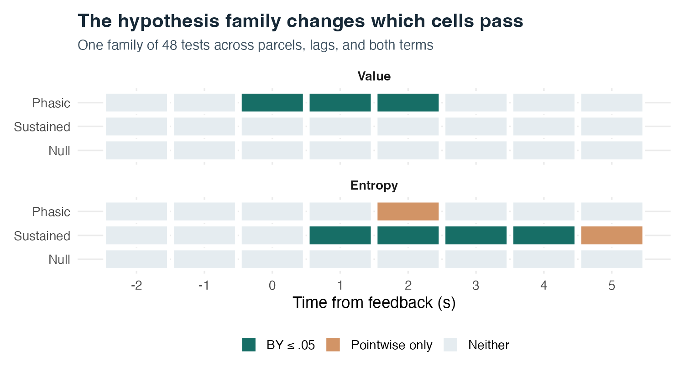
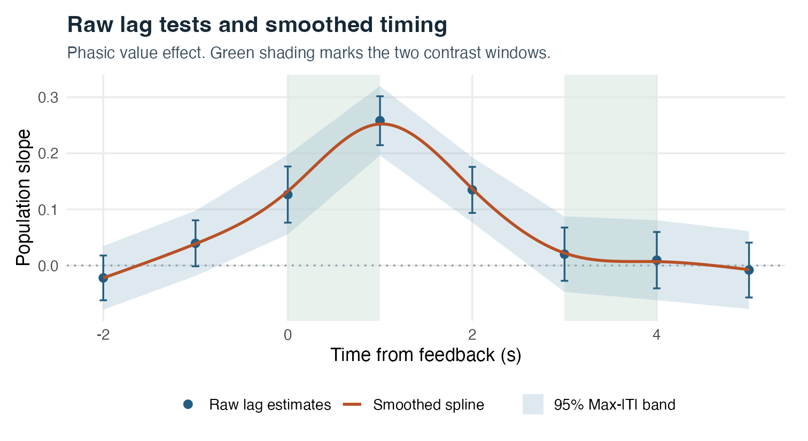
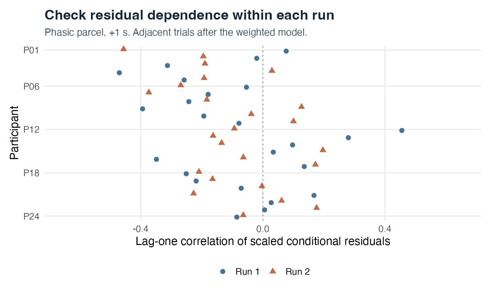

```{r setup, include=FALSE}
d <- readRDS("step5_examples.rds")
pr62 <- readRDS("pr62_examples.rds")$result
pr62_null <- subset(pr62$latency, parcel == "Null" & term == "entropy_within")
pr62_phasic <- subset(pr62$latency, parcel == "Phasic" & term == "value_within")
pr62_sustained <- subset(pr62$latency, parcel == "Sustained" & term == "entropy_within")
pr62_phasic_contrast <- subset(pr62$contrasts, parcel == "Phasic" & term == "value_within")
pr62_sustained_contrast <- subset(pr62$contrasts, parcel == "Sustained" & term == "entropy_within")
fmt <- function(x, digits = 3) formatC(x, digits = digits, format = "f")
pct <- function(x) paste0(fmt(100 * x, 1), "%")
long_null <- subset(d$null, n_trial == 192)
n_point <- sum(d$fixed$p.value <= .05)
n_by <- sum(d$fixed$p_by <= .05)
```

## Overview

Once participant trial panels are assembled in Step 4, **Step 5 tests how behavioral or experimental variables relate to deconvolved neural activity across the participant population—and characterizes how those effects unfold over peri-event time.** Because neural activity `decon_demixed` sits on the *left-hand side* as the outcome (`Neural ~ Behavior`) on an additive-error scale, conditionally mean-zero measurement noise enters the residual without attenuating fixed-effect slopes, while composite precision weights account for varying reliability across trials, runs, and participants (Skrondal & Laake, 2001; Vig & Hallquist, 2026).

Step 5 provides two complementary modeling pathways plus direct volumetric brain-map export:

1. **Split-wise linear mixed-effects models (`mixed_by()`):** Fits a multilevel formula independently at each `(parcel, evt_time)` split—in memory or streamed from disk-backed Parquet/`.rds` datasets—accommodating participant random slopes, nested run intercepts, and rich cross-level interactions.
2. **Joint multi-lag trajectory inference (`medusa_multilag_infer()`):** Models the full lag vector of a `(parcel, term)` profile jointly using cross-lag resolution and covariance matrices to sharpen blurred lag profiles (spectral deblurring), fit smooth penalized-spline (P-spline) trajectories, and compute simultaneous `Max-|T|` confidence bands, cluster-enhanced (`1D TFCE`) tests, planned window contrasts, and peak/latency summaries.
3. **Volumetric NIfTI backprojection (`backproject_medusa()`):** Maps parcel-level group statistics directly onto 3D/4D NIfTI brain volumes for visualization in `ggbrain`.

```{r}
#| eval: false
#| code-fold: false
library(medusa)

# Pathway A: Split-wise multilevel model across parcels and lags
group_models <- mixed_by(
  group_panel,
  outcomes           = "decon_demixed",
  rhs_model_formulae = ~ value_within + value_mean + (1 + value_within || id) + (1 | id:run),
  split_on           = c("parcel", "evt_time"),
  weights            = "precision_weight_cohort"
)
```

::: {.callout-note}
### Position in the MEDuSA Pipeline
[**Step 4 (`subject_epochs` / `group_panel`)**](../medusa_step4_parcel_panels/medusa_step4_parcel_panels.qmd) $\longrightarrow$ **Step 5 (`mixed_by` / `medusa_multilag_infer`)** $\longrightarrow$ Population slopes, simultaneous lag trajectories, window contrasts, & NIfTI maps (`backproject_medusa`)
:::

| Scientific question | Recommended Step 5 pathway | Primary inferential output |
|:---|:---|:---|
| Conditional trial association in a multilevel design with random slopes, nested runs, or cross-level interactions | `mixed_by()` (`lmerTest::lmer()`, `rstanarm::stan_lmer()`, or `jlmer()`) | `coef_df_reml` + familywise (`"holm"`) or FDR (`"BY"`) adjustment |
| Lag-specific localization across an epoch with epoch-wide familywise error control | `medusa_multilag_infer()` | Raw `estimate`, `p_maxT`, and simultaneous band `conf.low.sim` / `conf.high.sim` |
| Temporally extended same-sign deflection or overall departure from a flat trajectory | `medusa_multilag_infer()` | `p_tfce` (1D TFCE) and `omnibus_p` (Mahalanobis epoch test) |
| Early-vs.-late window difference or continuous curve peak/width | `medusa_multilag_infer()` | `contrasts` (`contrast_source = "unsmoothed"`) and `latency` (`peak_lag`, `com_lag`, `fwhm`) |
| 3D/4D volumetric brain maps of parcel or voxelwise group statistics | `backproject_medusa()` or `write_nifti_ts()` | Compressed `.nii.gz` effect and statistic volumes |

The four substeps below walk from centering predictors (`5.1`), through split-wise mixed modeling (`5.2`), joint multi-lag trajectory inference (`5.3`), and window contrasts, latency estimation, and brain-map export (`5.4`).

---

## Goals, Inputs, and Outputs

### Goals of Step 5

1. **Separate within-person trial fluctuations from between-person trait differences:** Decompose predictors into person/run-centered deviations and person means so cross-sectional differences do not confound phasic trial slopes.
2. **Anchor population inference to participants via random slopes:** Model inter-individual slope heterogeneity across independent participants rather than treating repeated trials as independent population draws.
3. **Incorporate heterogeneous trial and scan precision:** Weight observations by composite inverse total variance (`precision_weight_cohort`) across trials, runs, and participants.
4. **Leverage cross-lag covariance for trajectory inference and contrasts:** Combine Step 3/4 lag operators with empirical cross-lag slope covariance to compute simultaneous confidence bands, 1D TFCE, window contrasts, and latency intervals.

### Inputs: What Step 5 Receives and Why

| Input | Structure | Why Step 5 Uses It |
|:---|:---|:---|
| **`subject_epochs` (for `medusa_multilag_infer()`)** | Named `list` of per-participant `decon_epoch_regression()` S3 objects | Retains each participant's `$panel` alongside parcel-level `$lag_resolution` and `$lag_error_cor` matrices for automatic operator pooling. |
| **`group_panel` or disk dataset paths (for `mixed_by()`; `group_panel` also accepted by `medusa_multilag_infer()`)** | Stacked `data.table` keyed by `(id, run, event_index, evt_time, parcel)`—or `.parquet` / Hive-partitioned Parquet directory / `.rds` / `.csv(.gz)` paths | Provides rectangular `(parcel, evt_time)` splits; disk paths stream splits sequentially while projecting only model columns and pushing `split_filter` predicates down to Arrow. |
| **`external_df` & `external_merge_by` (optional in `mixed_by()`)** | `data.table` or `.parquet`/`.rds`/`.csv` path + `c("id", "run", "event_index")` | Joins centered behavioral trial tables on the fly without duplicating behavioral columns across neural parcel archives on disk. |
| **`subject_slopes` (optional in `medusa_multilag_infer()`)** | Long table with `(id, parcel, term, lag, estimate, std.error, df)` | Brings custom first-stage participant slope fits into `medusa_multilag_infer()` alongside `lag_resolution` and `lag_error_cor`. |
| **`contrasts`, `tr`, & `brain_mask`** | Named list of lag windows; acquisition TR (s); `decon` / `ts` object or 3D NIfTI atlas | Specify planned window comparisons, operator timing, and NIfTI geometry for `backproject_medusa()`. |

### Outputs: What Step 5 Produces and Why It Is Set Up That Way

#### From `mixed_by()`

| Output component | Structure & key columns | Role |
|:---|:---|:---|
| **`$coef_df_reml`** | `data.table` (`parcel`, `evt_time`, `term`, `estimate`, `std.error`, `df`, `statistic`, `p.value`) | Collects Satterthwaite REML fixed-effect estimates across splits for planned multiplicity adjustment. |
| **`$models`** | `data.table` of fitted model objects (when `return_models = TRUE`) | Supports split-by-split participant counts, singularity checks, and residual diagnostics. |

#### From `medusa_multilag_infer()` & `backproject_medusa()`

| Output component | Structure & key columns | Role |
|:---|:---|:---|
| **`$coefficients`** | `data.table` per `(unit, term, lag)` with raw (`estimate`, `p_maxT`, `p_tfce`, `conf.low.sim`) and processed (`estimate_multilag`, `conf.low.multilag.sim`) columns | Places unsmoothed lag localization tests side by side with deblurred/P-spline trajectory estimates incorporating smoothing-penalty uncertainty (Marra–Wood posterior covariance). |
| **`$contrasts` & `$latency`** | Window contrast table (`estimate`, `std.error`, `df`, `p.value`) and trajectory timing table (`peak_lag`, `com_lag`, `fwhm`, `omnibus_p`) | Summarize planned early-vs.-late window tests and continuous spline-interpolated timing with covariance-propagated uncertainty. |
| **`$subjects` & `$covariance`** | Participant-by-lag slope table (`estimate_raw`, `estimate_eb`) and nested `Sigma_raw` / `Sigma_deblur` / `Sigma_multilag` matrices | Expose lag-specific participant support counts and exact cross-lag covariance matrices. |
| **Written `.nii.gz` paths (`backproject_medusa()`)** | Character vector of 3D or 4D NIfTI files per `<plot_col>_<term>.nii.gz` | Writes parcel statistics directly to compressed NIfTI volumes, auto-detecting `parcel`, `evt_time` / `lag`, and `term`. |

---

## Step-by-Step Walkthrough: Substeps and Choice Points

### 5.1 Decompose behavioral predictors into within-person and between-person components

A raw trial predictor $x_{sri}$ (participant $s$, run $r$, trial $i$) combines phasic trial-to-trial variation around a participant's mean with stable differences across participants:
$$
x_{sri} = \underbrace{(x_{sri} - \bar{x}_s)}_{\text{within-person state } x^W_{sri}} + \underbrace{\bar{x}_s}_{\text{between-person mean}}.
$$
Testing whether high-value trials evoke stronger activity than low-value trials *within* the same person is distinct from comparing participants who experience higher average value overall. In @fig-within, the true within-person slope is $+0.55$ while the between-person slope is $-0.72$; entering uncentered $x_{sri}$ estimates a confounded pooled slope of **`r fmt(d$wb_coefs["pooled"])`**, whereas decomposing `x_within` and `x_mean` recovers **`r fmt(d$wb_coefs["x_within"])`** and **`r fmt(d$wb_coefs["x_mean"])`** cleanly.

{#fig-within fig-alt="Blue trial-level slopes are positive for six individuals. Orange participant means fall as the predictor rises."}

Compute centered predictors on the behavioral table *before* merging on `(id, run, event_index)` so censored fMRI frames in one parcel never alter a participant's behavioral mean in another:

```{r join-trials}
#| eval: false
#| code-summary: "Show behavioral centering and keyed trial merge"
key <- c("id", "run", "event_index")
stopifnot(!anyDuplicated(trial_behavior[, ..key]))

trial_behavior[, `:=`(
  value_mean     = mean(value, na.rm = TRUE),
  value_within   = value - mean(value, na.rm = TRUE),
  entropy_within = entropy - mean(entropy, na.rm = TRUE)
), by = id]

group_panel <- merge(
  activity_panel,
  trial_behavior[, .(id, run, event_index, value_mean, value_within, entropy_within)],
  by = key, all.x = TRUE
)
```

**Choice point — Centering grain (`by = id` vs. `by = .(id, run)`):** Center within participant (`by = id`) when predictor distributions are stationary across runs, or center within each participant-run (`by = .(id, run)`) when contingencies or block drifts shift across runs and pure within-run trial contrasts are desired.

---

### 5.2 Fit participant random-slope mixed models with cohort precision weights

At a single `(parcel, evt_time)` split, the standard multilevel model expresses de-mixed trial readout $\widehat{z}_{sri}$ (`decon_demixed`) as

$$
\widehat{z}_{sri} = \beta_0 + \beta_W x^W_{sri} + \beta_B \bar{x}_s + b_{0s} + b_{Ws} x^W_{sri} + a_{sr} + \varepsilon_{sri},
$$

where:

- $\beta_0$ is the population average event-locked deflection,
- $\beta_W$ is the population **within-person slope** relating trial-to-trial state fluctuations $x^W_{sri}$ to neural activity, while $\beta_B$ captures the **between-person** association across participant means $\bar{x}_s$,
- $(b_{0s}, b_{Ws})$ are participant-specific random intercepts and slopes (`(1 + x_within || id)`) capturing true individual differences across participants ($s = 1, \dots, S$),
- $a_{sr}$ is a participant-nested run random intercept (`(1 | id:run)`) absorbing run-level mean shifts, and
- $\varepsilon_{sri}$ is the composite trial residual combining biological trial variance and Step 3–4 measurement error, $\operatorname{Var}(\varepsilon_{sri}) = \tau_{\text{latent}}^2 + s_{sri}^2$.

For a simple balanced case, suppose the $S$ participants have independent random slopes of variance $\sigma_b^2$. Each has $m$ trials, with the same within-person predictor sum of squares $S_{xx}=\sum_i(x_i-\bar x)^2$ and independent trial residuals of variance $\sigma_\varepsilon^2$. The sampling variance of the mean participant slope is

$$
\operatorname{Var}(\widehat{\beta}_W)=
\frac{\sigma_b^2}{S}+\frac{\sigma_\varepsilon^2}{S\,S_{xx}} .
$$

If the centered predictor has mean square one, $S_{xx}=m$. More trials then reduce the second term. Recruiting more independent participants reduces both terms.

Including the random slope $b_{Ws}$ reflects that structure: in @fig-null (12 participants, $\beta_W = 0$, $\sigma_b > 0$), random-slope/participant-slope inference holds nominal Type I error at **`r pct(long_null$rejection[long_null$method == "Participant slopes"])`** at 192 trials per person, whereas trial-row OLS without random slopes reaches **`r pct(long_null$rejection[long_null$method == "Trial-row OLS"])`**.

{#fig-null fig-alt="With 12 people, the trial-row test rejects about 80 percent of the time at 192 trials per person. The participant-slope test remains around 5 percent."}

Simultaneously, conditional residual variance varies across trials and scans because $\operatorname{Var}(\varepsilon_{sri}) = \tau_{\text{latent}}^2 + s_{sri}^2$. Passing `weights = "precision_weight_cohort"` supplies $(\hat{\tau}_{\text{eff}}^2 + s_{sri}^2)^{-1}$ normalized across the full cohort split, allowing noisier runs and participants to carry appropriately wider conditional residual spread (`0.191` and `0.396` vs. true `0.194` and `0.403` in @fig-weights, compared with `0.313` unweighted). Moreover, when upstream Step 3 panels were exported covariate-agnostically (`covariates = NULL`), panel `tau2_bio` reflects *marginal* trial variance ($\beta_s^2 \operatorname{Var}(x) + \tau_{\text{resid},s}^2$), which would otherwise downweight participants with the largest true neural slopes $|\beta_s|$; under `reweight_conditional_tau2 = "auto"` (default), `mixed_by()` automatically re-estimates each participant's conditional residual biological variance $\hat{\tau}_{\text{resid},s}^2$ (shrunk across participants via Empirical Bayes) after projecting out the within-participant fixed-effect predictors in `model_formula` before forming cohort weights.

{#fig-weights fig-alt="Weighted model residual SDs closely match known SDs of 0.19 and 0.40. The unweighted model estimates 0.31 for both runs."}

Across 3 simulated parcels (`Phasic`, `Sustained`, `Null`) × 8 lags × 2 focal predictors ($48$ planned tests; @fig-profiles, @fig-family), Benjamini–Yekutieli (`"BY"`) adjustment isolates **`r n_by`** true discoveries around the phasic `value_within` peak ($+1\text{ s}$) and sustained `entropy_within` plateau ($+1$ to $+4\text{ s}$) while filtering out isolated pointwise fluctuations (`r n_point` unadjusted hits).

{#fig-profiles fig-alt="The value slope peaks near one second in the phasic parcel. The entropy slope persists for several seconds in the sustained parcel. Both slopes fluctuate around zero in the null parcel."}

{#fig-family fig-alt="Most discoveries are near the simulated phasic value peak and the sustained entropy response. Two cells pass only the unadjusted threshold."}

**Choice point — Split-wise `mixed_by()` vs. joint `medusa_multilag_infer()`, and disk streaming:** Choose `mixed_by()` when testing specific planned lags, complex random-effects structures, or trial-by-trait interactions; for large whole-cortex cohorts, pass a Hive-partitioned Parquet directory directly to `mixed_by(data = ..., split_filter = ...)` so Arrow streams one split at a time with minimal RAM. Choose `medusa_multilag_infer()` (`Substep 5.3`) when your primary question concerns the full peri-event waveform, simultaneous epoch bands, or window contrasts.

---

### 5.3 Model multi-lag trajectories jointly with `medusa_multilag_infer()` {#sec-multilag-infer}

Because neighboring lags share both deconvolution smoothness ($R_{\text{lag}} \in \mathbb{R}^{L \times L}$) and correlated observation noise ($C_{\text{lag}} \in \mathbb{R}^{L \times L}$), modeling the group lag slope vector $\widehat{b}_{\text{raw}} = (\widehat{b}_1, \dots, \widehat{b}_L)^\top$ jointly is substantially more informative than treating lags as unrelated splits:

1. **Joint within-run regression and available-case lag pooling:** `medusa_multilag_infer()` fits all supplied time-varying `covariates` together within each run (routing any participant-constant trait covariates to between-participant weighted least squares with leverage-adjusted HC2 standard errors) and pools participant slopes across lags using available cases—retaining participants at interior lags even if boundary censoring removed an edge lag.
2. **Spectral cross-lag deblurring & uncertainty-aware P-spline smoothing:** Under `trajectory_mode = "auto"` (with upstream `demix_within_trial = FALSE`), `medusa_multilag_infer()` sharpens the group curve against the symmetrized cross-lag blurring matrix $C_{\text{sym}} = \frac{1}{2}(R_{\text{lag}} + R_{\text{lag}}^\top) = V \operatorname{diag}(\mu) V^\top$ before applying a 2nd-order penalized spline smoother $S_{\text{spline}}$:
   $$
   \widehat{b}_{\text{deblur}} = W_{\text{deblur}} \widehat{b}_{\text{raw}},
   \qquad
   W_{\text{deblur}} = \operatorname{diag}(g_{\text{lobe}})^{-1} V \operatorname{diag}\!\left(\frac{\mu}{\mu^2 + \alpha_1 \mu + \alpha_0^2}\right) V^\top,
   \qquad
   \widehat{b}_{\text{multilag}} = S_{\text{spline}} \widehat{b}_{\text{deblur}},
   $$
   where:
   - $\mu$ and $V$ are the eigenvalues and eigenvectors of the pooled cross-lag resolution matrix $C_{\text{sym}}$,
   - the spectral filter $\mu / (\mu^2 + \alpha_1 \mu + \alpha_0^2)$ ($\alpha_1 = 0.05$, $\alpha_0^2 = 0.020$) inverts well-resolved low-frequency lag modes ($\mu$ large) while gently damping noisy high-frequency oscillations ($\mu \to 0$) and restoring main-lobe amplitude via $g_{\text{lobe}}$ (@fig-pr62-deblur),
   - $S_{\text{spline}}$ fits a smooth P-spline across lags tuned by correlated Stein's unbiased risk estimate (SURE), and
   - uncertainty from both sampling variance ($W_{\text{deblur}} \widehat{\Sigma}_{\text{raw}} W_{\text{deblur}}^\top$) and spline smoothing bias is folded into $\widehat{\Sigma}_{\text{multilag}}$ via the **Marra–Wood (2012) posterior covariance**, preventing artificially narrow smooth bands.
3. **Finite-sample cross-lag inference (`n_perm` studentized Wishart draws):** Because the $L \times L$ cross-lag covariance $\widehat{\Sigma}$ is estimated from a finite cohort of $S$ participants, `medusa_multilag_infer()` draws null trajectories from a studentized Wishart distribution that propagates both cross-lag correlation and finite-$S$ covariance uncertainty. Letting $T_\ell = \widehat{b}_\ell / \text{SE}_\ell$ denote the lag-$\ell$ test statistic, those joint draws calibrate three complementary inferential summaries (@fig-pr62-trajectory, @fig-pr62-tests):
   $$
   \text{Simultaneous band:}\;\; \widehat{b}_\ell \pm c_{1-\alpha}^{\max}\,\text{SE}_\ell,
   \qquad
   \text{1D TFCE:}\;\; \operatorname{TFCE}(\ell) = \int_0^{|T_\ell|} e(h)^E\, h^H\, dh,
   \qquad
   \text{Omnibus:}\;\; T^2 = \widehat{b}^\top \widehat{\Sigma}^{-1} \widehat{b},
   $$
   where $c_{1-\alpha}^{\max}$ is the $(1-\alpha)$ quantile of $\max_\ell |T_\ell^{\text{null}}|$ (controlling familywise error across all $L$ lags simultaneously via `p_maxT`), $e(h)$ is the contiguous lag extent exceeding threshold $h$ in threshold-free cluster enhancement (`p_tfce`, $E = 0.5, H = 2.0$, sensitive to sustained same-sign deflections without an arbitrary cluster cutoff), and $T^2$ is the multivariate Mahalanobis epoch departure test (`omnibus_p`).

{#fig-pr62-deblur fig-alt="The blurred effect is wider than the known target. The deblurred curve is closer to the target in this controlled example."}

{#fig-pr62-trajectory fig-alt="The simultaneous band is wider than the pointwise intervals. A smoothed curve peaks around one second, near the raw peak."}

{#fig-pr62-tests fig-alt="The two generated signals pass all three tests. The null entropy trajectory stays well above 0.05 on all three tests."}

In @fig-pr62-tests, both generated effects hit the 4,000-draw floor (`min_p_maxT =` `r fmt(pr62_phasic$min_p_maxT, 4)`, `omnibus_p =` `r fmt(pr62_phasic$omnibus_p, 4)`), while the null trajectory stays well above `.05` (`omnibus_p =` `r fmt(pr62_null$omnibus_p, 3)`). Custom first-stage participant slope tables can also enter directly via the coefficient-table interface:

```{r coefficient-input}
#| eval: false
#| code-summary: "Show optional custom participant slope-table call"
partial_trajectory <- medusa_multilag_infer(
  subject_slopes,
  lag_resolution  = resolution_by_parcel,
  lag_error_cor   = error_cor_by_parcel,
  trajectory_mode = "deblur",
  n_perm          = 4000L,
  seed            = 6205L
)
```

**Choice point — Trajectory mode (`trajectory_mode`) and multiplicity:** Use `trajectory_mode = "auto"` as the standard setting (or `"none"` when inspecting raw unsmoothed lag averages). Within one `(parcel, term)` curve, `p_maxT` and `p_tfce` already control familywise error across lags; when testing multiple parcels or covariates, adjust `latency$omnibus_p` across the planned parcel–term family using Holm or BY.

---

### 5.4 Evaluate planned window contrasts, continuous latency, and volumetric NIfTI maps

To compare early vs. late epoch activity (`contrasts = list(late_minus_early = list(early = c(0, 1), late = c(3, 4)))`), `medusa_multilag_infer()` evaluates $c^\top \widehat{b}_*$ with cross-lag SE $\sqrt{c^\top \Sigma_* c}$:

| `contrast_source` | Curve evaluated | Recommended use |
|:---|:---|:---|
| **`"unsmoothed"` (default)** | Spectrally deblurred curve prior to P-spline smoothing | Standard inferential choice: retains resolution recovery without spline curvature shrinkage between windows. |
| **`"raw"`** | Raw group lag estimates | Direct test of raw lag window averages without cross-lag deblurring. |
| **`"multilag"`** | Deblurred + P-spline smoothed curve | Descriptive contrast matching the plotted smooth curve ([worked comparison](../worked-example.qmd#sec-worked-contrasts)). |

On our simulated panel, `late_minus_early` distinguishes the decaying phasic value response (`estimate =` `r fmt(pr62_phasic_contrast$estimate, 3)`, $t_{23} = `r fmt(pr62_phasic_contrast$statistic, 2)`$, $p = `r format(pr62_phasic_contrast$p.value, scientific = TRUE, digits = 2)`$) from the sustained entropy response (`estimate =` `r fmt(pr62_sustained_contrast$estimate, 3)`, $t_{23} = `r fmt(pr62_sustained_contrast$statistic, 2)`$, $p = `r fmt(pr62_sustained_contrast$p.value, 4)`$), while `$latency` summarizes natural-spline `peak_lag` (`r fmt(pr62_phasic$peak_lag, 2)` s, 95% CI `[`r fmt(pr62_phasic$peak_lag_conf.low, 2)`, `r fmt(pr62_phasic$peak_lag_conf.high, 2)`]` s for `Phasic`) and center-of-mass / FWHM (`com_lag =` `r fmt(pr62_sustained$com_lag, 2)` s, `fwhm =` `r fmt(pr62_sustained$fwhm, 2)` s for `Sustained`) on trajectories that pass omnibus gating.

Finally, parcel-level group tables from either `mixed_by()` or `medusa_multilag_infer()` map directly onto 3D or 4D NIfTI volumes via `backproject_medusa(..., brain_mask = decon, fill = NA_real_)` (see recipe below and [Spatial Graph Pooling](../medusa_spatial_parcel_pooling/medusa_spatial_parcel_pooling.qmd#sec-spatial-recipes)).

---

## Recommended Settings

### Pathway A: Split-wise mixed models (`mixed_by()`) & NIfTI backprojection

```{r applied-batch}
#| eval: false
#| code-fold: false
library(medusa)

group_formula <- decon_demixed ~ value_within + value_mean + entropy_within +
  (1 + value_within + entropy_within || id) + (1 | id:run)

group_models <- mixed_by(
  group_panel,
  model_formulae = list(trial_effects = group_formula),
  split_on       = c("parcel", "evt_time"),
  weights        = "precision_weight_cohort",
  calculate      = "parameter_estimates_reml",
  padjust_by     = NULL,
  tidy_args      = list(effects = "fixed", conf.int = TRUE),
  return_models  = TRUE
)

focal_tests <- subset(
  group_models$coef_df_reml,
  term %in% c("value_within", "entropy_within")
)
focal_tests$p_by <- p.adjust(focal_tests$p.value, method = "BY")

# Large-cohort alternative: stream directly from partitioned Parquet on disk
# group_models_disk <- mixed_by(
#   data              = "/study/medusa_panels_parquet/",
#   external_df       = "/study/trial_behavior_centered.parquet",
#   external_merge_by = c("id", "run", "event_index"),
#   model_formulae    = list(trial_effects = group_formula),
#   split_on          = c("parcel", "evt_time"),
#   split_filter      = list(evt_time = -1:4),
#   weights           = "precision_weight_cohort",
#   calculate         = "parameter_estimates_reml",
#   ncores            = 8L
# )

# Optional: export parcel estimates & t-statistics to 3D/4D NIfTI volumes
# nii_files <- backproject_medusa(
#   coef_df    = focal_tests,
#   brain_mask = decon,
#   plot_cols  = c("estimate", "statistic"),
#   output_dir = "group_maps",
#   fill       = NA_real_
# )
```

### Pathway B: Joint multi-lag trajectory inference (`medusa_multilag_infer()`)

```{r applied-multilag}
#| eval: false
#| code-fold: false
trajectory <- medusa_multilag_infer(
  subject_epochs,
  covariates      = c("value_within", "entropy_within"),
  trajectory_mode = "auto",
  contrast_source = "unsmoothed",
  use_whitened    = FALSE,
  tr              = acquisition_tr,
  contrasts       = list(late_minus_early = list(early = c(0, 1), late = c(3, 4))),
  n_perm          = 4000L,
  n_boot_latency  = 400L,
  seed            = 6205L
)
```

| Parameter / Choice | Package default | Recommended setting | Summary of Role & When to Adjust |
|:---|:---|:---|:---|
| **`weights` (`mixed_by`)** | `NULL` | `"precision_weight_cohort"` | Weights observations by $(\hat{\tau}_{\text{eff}}^2 + s_i^2)^{-1}$ normalized across the cohort split (`Substep 5.2`). Use `"precision_weight"` only when forcing equal total weight per person. |
| **Random-effects grouping** | User formula | `(1 + x_within || id) + (1 | id:run)` | Models participant slope heterogeneity and nested participant–run intercepts (`Substep 5.2`). |
| **Upstream `demix_within_trial`** | `FALSE` (Step 3) | `FALSE` for `medusa_multilag_infer()`; optional `TRUE` for single-lag `mixed_by()` | Leaves cross-lag resolution deblurring to `medusa_multilag_infer(..., trajectory_mode = "auto")` (`Substep 5.3`). |
| **`covariates` (`medusa_multilag_infer`)** | Required | Enter correlated predictors jointly (`c("value_within", "entropy_within")`) | Fits time-varying predictors together in within-run multiple regression and routes person-level traits to Level-2 WLS + HC2 (`Substep 5.3`). |
| **`trajectory_mode` & `contrast_source`** | `"auto"`, `"unsmoothed"` | `"auto"`, `"unsmoothed"` | Applies spectral deblurring + P-spline smoothing while evaluating window contrasts prior to spline smoothing (`Substeps 5.3–5.4`). |
| **Disk scaling & NIfTI export** | In-memory; `fill = 0` | Parquet + `split_filter`; `backproject_medusa(..., fill = NA_real_)` | Streams large cohorts with Arrow predicate pushdown and writes `NA`-masked `.nii.gz` maps (`Substeps 5.2 & 5.4`). |

---

## Practical Diagnostics, Interpretation Conventions, and Scope

1. **Auditing split-level convergence and residual dependence:** Inspect participant counts, `lme4::isSingular()` flags, and within-run lag-1 conditional residual correlations across splits (@fig-residuals):

```{r inspect-fits}
#| eval: false
#| code-summary: "Show split-level model audit code"
fits <- lapply(group_models$models$model, function(entry) entry$reml)
group_models$models[, .(
  parcel, evt_time,
  trials       = vapply(fits, nobs, numeric(1)),
  participants = vapply(fits, function(fit) nlevels(model.frame(fit)$id), integer(1)),
  singular     = vapply(fits, lme4::isSingular, logical(1))
)]
```

{#fig-residuals fig-alt="Participant-run residual correlations scatter on both sides of zero, with no obvious consistent direction across the two runs."}

2. **Matched coordinates when using ZCA-whitened panels (`use_whitened = TRUE`):** In rapid-ISI designs where conditional residuals retain serial correlation, set `whiten_panel = TRUE` in Step 4 and pair `decon_demixed_whitened` with `*_whitened` predictors from the same `(parcel, evt_time)` split (forming any within-run interaction columns *before* Step 4 whitening, since $T(x \odot z) \neq (Tx) \odot (Tz)$).
3. **Interpreting between-person effects:** Because Step 2 centers BOLD within each run, tonic run-constant baselines are removed; person-mean predictors (`x_mean`) test differences in average *event-locked phasic deflections* across people (or cross-level `x_within * trait` moderation), scaled in physical BOLD units under Step 1's HRF normalization (`normalize = "positive_lobe"`).
4. **Scope transition to Step 6:** Step 5 treats neural activity as the dependent outcome predicted by error-free task or behavioral covariates (for visual diagnostics of uncentered predictors and omitted random slopes, see the [Visual QC Gallery](../medusa_qc_gallery/medusa_qc_gallery.qmd)). Whenever a deconvolved neural readout moves to the **right-hand side** to predict another brain region (`Target ~ Seed * Task`) or behavior (`Behavior ~ Seed`), proceed to [Step 6 (`decon_connectivity_repair()`)](../medusa_step6_connectivity/medusa_step6_connectivity.qmd) to correct predictor measurement error and shared regional noise.

---

## Reproduce the Step 5 Demonstrations

```{bash}
#| eval: false
#| code-summary: "Show reproduction commands"
Rscript simulate_step5.R
Rscript figures_step5.R
Rscript simulate_pr62.R
Rscript figures_pr62.R
quarto render medusa_step5_group_models.qmd
```

[Mixed-model simulation](simulate_step5.R) · [Mixed-model figures](figures_step5.R) · [Group estimates](group_coefficients.csv) · [Null calibration](null_calibration.csv) · [Fit diagnostics](model_diagnostics.csv) · [Trajectory simulation](simulate_pr62.R) · [Trajectory figures](figures_pr62.R) · [Trajectory coefficients](pr62_coefficients.csv) · [Window contrasts](pr62_contrasts.csv) · [Latency estimates](pr62_latency.csv)
