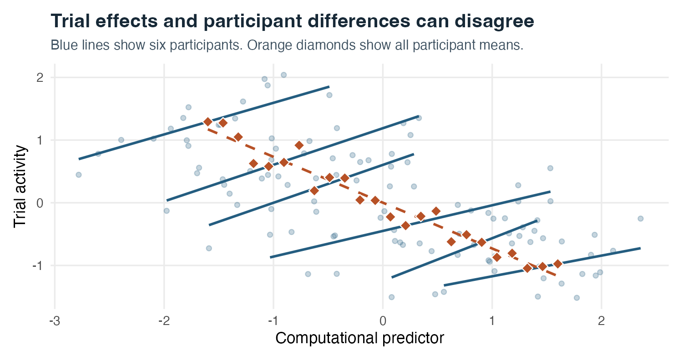
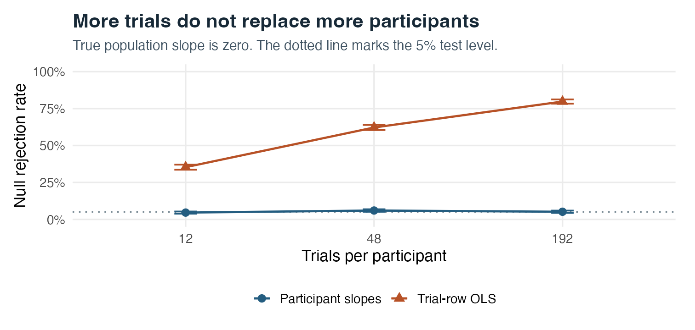
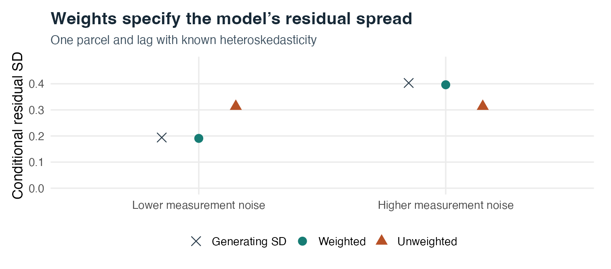
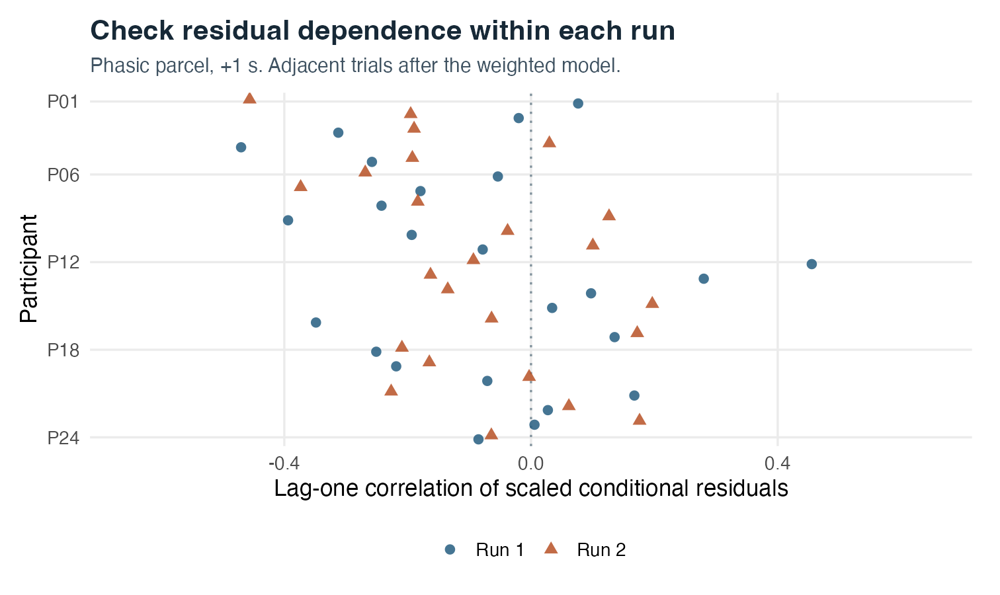
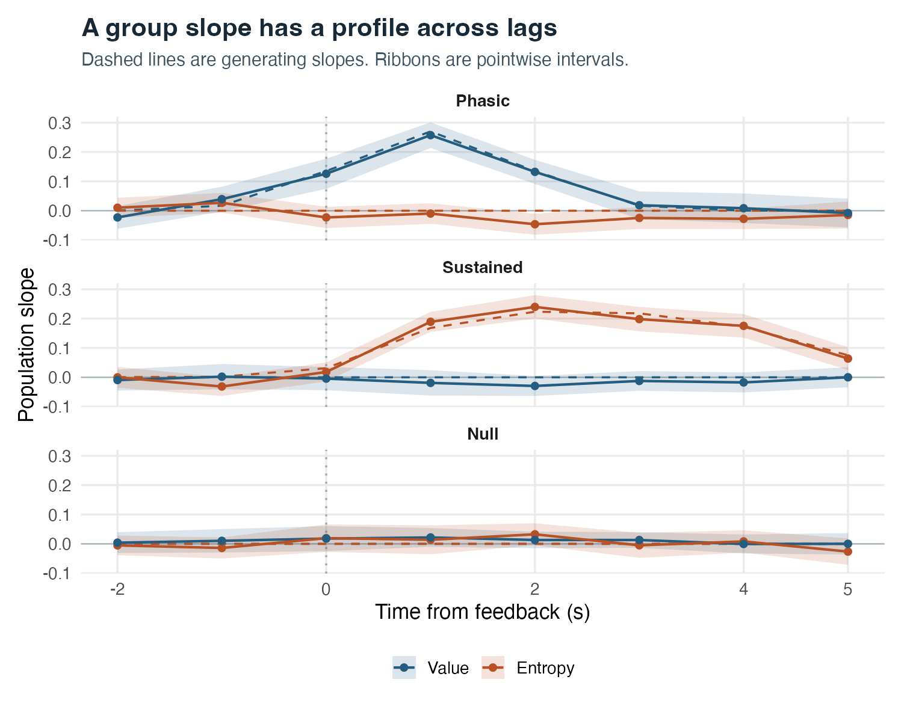
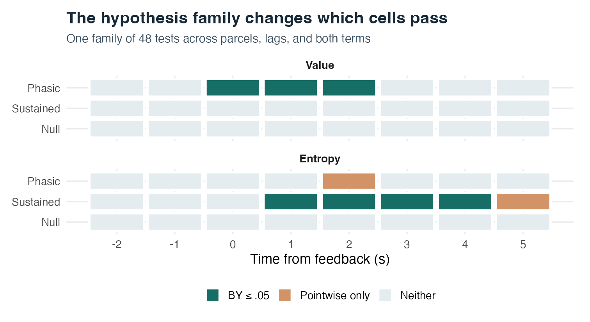
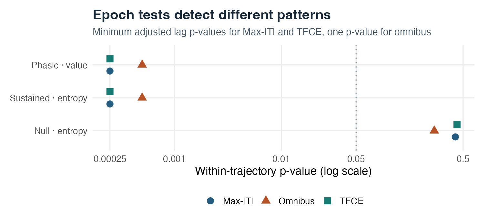

# Step 5 · Group and trajectory inference {#sec-step5}

```{r setup, include=FALSE}
d <- readRDS("step5_examples.rds")
pr62 <- readRDS("pr62_examples.rds")$result
pr62_null <- subset(pr62$latency, parcel == "Null" & term == "entropy_within")
pr62_phasic <- subset(pr62$latency, parcel == "Phasic" & term == "value_within")
pr62_sustained <- subset(pr62$latency, parcel == "Sustained" & term == "entropy_within")
pr62_phasic_contrast <- subset(pr62$contrasts, parcel == "Phasic" & term == "value_within")
pr62_sustained_contrast <- subset(pr62$contrasts, parcel == "Sustained" & term == "entropy_within")
fmt <- function(x, digits = 3) formatC(x, digits = digits, format = "f")
pct <- function(x) paste0(fmt(100 * x, 1), "%")
long_null <- subset(d$null, n_trial == 192)
n_point <- sum(d$fixed$p.value <= .05)
n_by <- sum(d$fixed$p_by <= .05)
```

## Overview

Step 4 produces a participant-level trial panel in which each parcel, trial, and peri-event lag carries a deconvolved neural readout alongside propagated measurement-error and precision metadata. **Step 5 tests whether trial-level behavioral associations generalize across the participant population—and characterizes how those effects unfold over peri-event time.**

MEDuSA provides two complementary group-inference pathways in Step 5, matched to two distinct scientific targets:

1. **Split-wise linear mixed-effects models via `mixed_by()`:** Fits a prespecified multilevel regression formula independently at each `(parcel, evt_time)` readout. This pathway is designed for rich within-trial factorial designs, cross-level interactions, random participant slopes, nested run intercepts, and precision-weighted single-readout inference, followed by explicit multiplicity correction across the planned `(parcel, lag, term)` family.
2. **Joint multi-lag trajectory inference via `medusa_multilag_infer()`:** Models all peri-event lags of a `(parcel, term)` profile *jointly*, combining participant-level within-run multiple regressions with available-case cross-lag covariance pooling, optional spectral resolution deblurring and P-spline smoothing, studentized Wishart null calibration (`Max-|T|`, 1D TFCE, omnibus Mahalanobis), simultaneous confidence bands, planned time-window contrasts, and peak/latency summaries.

| Scientific question | Recommended Step 5 pathway | Primary inferential output |
|:---|:---|:---|
| What is the conditional trial association in a multilevel model with explicit random slopes, nested runs, or cross-level interactions? | `mixed_by()` (wrapping `lmerTest::lmer()`) | `coef_df_reml` + explicit familywise (`"holm"`) or arbitrary-dependence FDR (`"BY"`) adjustment |
| Which individual peri-event lags show an effect while controlling familywise error across the epoch? | `medusa_multilag_infer()` | Raw `estimate`, `p_maxT`, and simultaneous band `conf.low.sim` / `conf.high.sim` |
| Is there a temporally extended, same-sign deflection across neighboring lags? | `medusa_multilag_infer()` | `p_tfce` (1D threshold-free cluster enhancement across lag) |
| Is there any evidence against a flat zero trajectory across the entire epoch? | `medusa_multilag_infer()` | `omnibus_p` (regularized Mahalanobis epoch test) |
| How much stronger is activity in a late window vs. an early window, or when does the curve peak? | `medusa_multilag_infer()` | `contrasts` (on `contrast_source = "unsmoothed"`) and `latency` (`peak_lag`, `com_lag`, `fwhm`) |

---

## Goals of Step 5

Step 5 is designed to accomplish five methodological goals:

1. **Separate within-person state fluctuations from between-person trait differences:** Decompose trial predictors into within-participant (or within-run) deviations and participant means so cross-sectional baseline differences cannot confound or reverse phasic trial slopes.
2. **Treat participants—not trials—as the unit of population replication:** Account for inter-individual slope heterogeneity via participant random slopes in `mixed_by()` or precision-weighted random-effects slope pooling in `medusa_multilag_infer()`, preventing the severe Type I error inflation of naive trial-row regressions.
3. **Propagate trial- and cohort-level reliability without discarding biological variance:** Weight observations using total inverse variance $(\widehat\tau_{\mathrm{eff}}^2 + s_i^2)^{-1}$ (`precision_weight_cohort`) rather than raw measurement inverse variance $1/s_i^2$, and preserve exact linear design correspondence when analyzing ZCA-whitened panels (`*_whitened`).
4. **Exploit cross-lag covariance for trajectory estimation and inference:** Use the Step 3/4 lag resolution ($R_{\mathrm{lag}}$) and lag error correlation ($C_{\mathrm{lag}}$) operators alongside empirical cross-lag slope covariance to construct calibrated simultaneous bands, 1D TFCE statistics, omnibus epoch tests, and covariance-aware window contrasts.
5. **Enforce transparent multiplicity control:** Distinguish clearly between pointwise uncertainty at a single prespecified readout, trajectory-level familywise error across lags of one `(parcel, term)` curve, and study-wide multiplicity across multiple parcels, covariates, and contrasts.

**What Step 5 leaves outside scope:** Step 5 treats neural activity as the **dependent outcome** predicted by behavioral or experimental variables treated as known without measurement error. When deconvolved neural activity is moved to the **right-hand side** to predict another brain region (`Target ~ Seed * Task`) or behavioral response, ordinary mixed models and `medusa_multilag_infer()` do not correct predictor attenuation bias or shared seed–target measurement noise; those questions belong to [Step 6](../medusa_step6_connectivity/medusa_step6_connectivity.qmd). In addition, Step 5 conditions on the HRF, inverse, and parcel operators learned in Steps 1–4.

---

## Inputs: What Step 5 Receives and Why

Step 5 accepts three structured input representations depending on which modeling pathway you choose and how upstream participant results were stored:

| Input | Structure | Why Step 5 needs it and why it is shaped that way |
|:---|:---|:---|
| **`subject_epochs` (recommended for `medusa_multilag_infer()`)** | Named `list` of per-participant `decon_epoch_regression()` S3 objects | Preserves **both** each participant's `$panel` and their exact parcel-level `$lag_resolution`, `$lag_error_cor`, and `$demix_within_trial` metadata. Passing the full list avoids losing operator matrices when panels are stacked or saved to CSV, and allows `medusa_multilag_infer()` to pool participant-specific lag operators automatically. |
| **`group_panel` (required for `mixed_by()`, also accepted by `medusa_multilag_infer()`)** | Stacked long `data.table` keyed uniquely by `(id, run, event_index, evt_time, parcel)` | Gives `mixed_by()` a single rectangular table that can be split cleanly by `(parcel, evt_time)` while retaining behavioral covariates, run identifiers, `precision_weight_cohort`, and paired `*_whitened` columns. Keying behavioral merges on `(id, run, event_index)`—never `trial` alone—guarantees exact alignment when trials are dropped or runs are numbered per person. |
| **`subject_slopes` (optional route for `medusa_multilag_infer()`)** | Long `data.frame` / `data.table` with `(id, parcel, term, lag, estimate, std.error, df)` | Allows users who fit custom within-participant first-stage models (e.g., generalized linear models, nonlinear computational fits, or custom nuisance designs) to bring per-participant lag slopes and SEs into `medusa_multilag_infer()` alongside explicit `lag_resolution` and `lag_error_cor` matrices. |
| **Centered behavioral predictors** | Within-person / within-run deviations (`x_within`) + person means (`x_mean`) | Computed on the behavioral trial table **before** merging with parcel activity so censored or missing fMRI frames in one parcel cannot shift the definition of a participant's behavioral mean in another parcel. |
| **`contrasts` & `tr`** | Named list of early/late lag windows + acquisition TR (seconds) | Defines planned scientific window comparisons before inspecting trajectories and supplies reference operator timing if standalone tables lack operator attributes. |

Before fitting any group model, verify that `(id, run, event_index)` is unique in the behavioral table and `(id, run, event_index, evt_time, parcel)` is unique in the merged panel:

```{r join-trials}
#| eval: false
#| code-summary: "Show trial-key verification and behavioral centering"
key <- c("id", "run", "event_index")
stopifnot(!anyDuplicated(trial_behavior[, ..key]))

trial_behavior[, `:=`(
  value_mean = mean(value, na.rm = TRUE),
  value_within = value - mean(value, na.rm = TRUE),
  entropy_within = entropy - mean(entropy, na.rm = TRUE)
), by = id]

group_panel <- merge(
  activity_panel,
  trial_behavior[, .(id, run, event_index, value_mean, value_within, entropy_within)],
  by = key, all.x = TRUE
)
stopifnot(!anyDuplicated(group_panel[, .(id, run, event_index, evt_time, parcel)]))
```

---

## Outputs: What Step 5 Produces and Why It Is Set Up That Way

### From `mixed_by()`

| Output component | Structure & key columns | Why it is set up that way |
|:---|:---|:---|
| **`$coef_df_reml`** | `data.table` of fixed-effect estimates (`parcel`, `evt_time`, `term`, `estimate`, `std.error`, `df`, `statistic`, `p.value`) | Collects Satterthwaite REML parameter estimates across every `(parcel, evt_time)` split into one tidy table so planned terms can be filtered and adjusted across the exact scientific family without counting nuisance intercepts. |
| **`$models`** | `data.table` storing fitted `lmerModLmerTest` objects (when `return_models = TRUE`) | Preserves per-split participant counts, observation counts, `isSingular()` boundary flags, random-effects variance components, and conditional residuals so model health can be audited systematically across lags. |

### From `medusa_multilag_infer()`

| Output component | Structure & key columns | Why it is set up that way |
|:---|:---|:---|
| **`$coefficients`** | `data.table` per `(unit, term, lag)` with `estimate`, `std.error`, `conf.low.sim` / `conf.high.sim`, `p_maxT`, `p_tfce`, `omnibus_p`, and `estimate_multilag` / `conf.low.multilag.sim` | Keeps the **raw unsmoothed group trajectory** (`estimate`, `p_maxT`, `conf.low.sim`) side-by-side with the **deblurred/P-spline processed trajectory** (`estimate_multilag`, `std.error_multilag`, `conf.low.multilag.sim`). Raw columns answer lag-localization hypothesis tests without smoothing leakage; processed columns summarize smooth waveform shape with Marra–Wood posterior smoothing covariance included. |
| **`$contrasts`** | `data.table` per `(unit, term, contrast)` with `estimate`, `std.error`, `statistic`, `df`, `p.value`, `conf.low`, `conf.high` | Evaluates linear window contrasts $c^\top \widehat b_*$ with full cross-lag covariance $\sqrt{c^\top \Sigma_* c}$ on the selected `contrast_source` curve, giving a single well-powered, interpretable test for early-vs.-late dynamics. |
| **`$latency`** | `data.table` per `(unit, term)` with `peak_lag`, `peak_lag_grid`, `peak_lag_se`, `peak_lag_conf.low` / `high`, `com_lag`, `fwhm`, `omnibus_p`, `min_p_maxT`, `min_p_tfce` | Summarizes continuous spline-interpolated timing (`peak_lag`, center of mass `com_lag`, full width at half maximum `fwhm`) alongside parametric covariance-draw SEs and epoch-level significance summaries—one row per trajectory for study-wide Holm/BY adjustment. |
| **`$subjects`** | Participant-by-lag `data.table` containing raw slopes, processed curves, and multivariate empirical-Bayes (`estimate_eb`) trajectories | Retains finite per-participant support counts at every lag (for auditing available-case edge censoring) and provides cross-lag-shrunken individual curves for visualization without conflating EB shrinkage with independent group observations. |
| **`$covariance`** | Nested list of raw (`Sigma_raw`), deblurred (`Sigma_deblur`), and final (`Sigma_multilag`) cross-lag covariance matrices | Exposes the exact covariance operators used by every band, contrast, and latency draw so custom linear combinations or between-window comparisons can be verified algebraically. |

---

## Recommended Settings

### Pathway A: Split-wise mixed models (`mixed_by()`)

```{r applied-batch}
#| eval: false
#| code-fold: false
library(medusa)

group_formula <- decon_demixed ~ value_within + value_mean + entropy_within +
  (1 + value_within + entropy_within || id) + (1 | id:run)

group_models <- mixed_by(
  group_panel,
  model_formulae = list(trial_effects = group_formula),
  split_on = c("parcel", "evt_time"),
  weights = "precision_weight_cohort",
  calculate = "parameter_estimates_reml",
  padjust_by = NULL,
  tidy_args = list(effects = "fixed", conf.int = TRUE),
  return_models = TRUE
)

# Apply multiplicity correction across the exact planned family of focal terms
focal_tests <- subset(
  group_models$coef_df_reml,
  term %in% c("value_within", "entropy_within")
)
focal_tests$p_by <- p.adjust(focal_tests$p.value, method = "BY")
```

### Pathway B: Joint multi-lag trajectory inference (`medusa_multilag_infer()`)

```{r applied-multilag}
#| eval: false
#| code-fold: false
# Upstream in Step 3/4: set demix_within_trial = FALSE when feeding medusa_multilag_infer()
# so cross-lag resolution R_lag is handled once at the group trajectory stage.
trajectory <- medusa_multilag_infer(
  subject_epochs,
  covariates = c("value_within", "entropy_within"),
  trajectory_mode = "auto",
  contrast_source = "unsmoothed",
  use_whitened = FALSE,
  tr = acquisition_tr,
  contrasts = list(late_minus_early = list(early = c(0, 1), late = c(3, 4))),
  n_perm = 4000L,
  n_boot_latency = 400L,
  seed = 6205L
)
```

| Parameter / Choice | Package default | Recommended setting | Why and when to adjust |
|:---|:---|:---|:---|
| **`weights` (in `mixed_by()`)** | `NULL` | `"precision_weight_cohort"` | Normalizes $(\widehat\tau_{\mathrm{eff}}^2 + s_i^2)^{-1}$ once across the entire `(parcel, evt_time)` split rather than per person, preserving both within-run trial heteroskedasticity and between-participant SNR differences. Use `"precision_weight"` only if you intentionally want every participant weighted equally regardless of scan noise. Never pass `1 / se_demixed^2` directly (ignores biological trial variance). |
| **Random-effects grouping** | User formula | `(1 + x_within || id) + (1 | id:run)` | Includes random participant slopes for within-person focal predictors (preventing trial-row pseudoreplication) and nested participant–run intercepts `(1 | id:run)`. Never write `(1 | run)` when run labels like `"run1"` repeat across participants. |
| **Upstream `demix_within_trial`** | `TRUE` (in Step 3) | `TRUE` for `mixed_by()`; `FALSE` for `medusa_multilag_infer()` | `mixed_by()` visits one lag at a time and relies on Step 3's ridge demixing; `medusa_multilag_infer()` sees the entire lag profile and performs regularized spectral deblurring (`trajectory_mode = "auto"`) with full cross-lag covariance propagation, avoiding double-regularization. |
| **`covariates` (in `medusa_multilag_infer()`)** | Required | Pass correlated trial predictors jointly (`c("value_within", "entropy_within")`) | Time-varying covariates supplied together are fit jointly in a single within-run multiple regression (controlling shared variance), while participant-constant covariates (e.g., `value_mean`, age) are automatically routed to Level-2 precision-weighted WLS with HC2 SEs. |
| **`trajectory_mode`** | `"auto"` | `"auto"` | Automatically applies regularized spectral deblurring when `demix_within_trial = FALSE` (skipping deblurring if already demixed upstream) followed by cross-lag covariance-aware P-spline smoothing. Use `"none"` when evaluating raw lag readouts without spectral or spline post-processing. |
| **`contrast_source`** | `"unsmoothed"` | `"unsmoothed"` | Evaluates planned window contrasts on the deblurred trajectory *prior* to P-spline smoothing, retaining resolution recovery without introducing smoothing shrinkage bias into linear window averages. |
| **`use_whitened`** | `FALSE` | `FALSE` (or `TRUE` with all covariates pre-whitened in Step 4) | Unwhitened `decon_demixed` works out of the box with arbitrary formulas; if serial residual autocorrelation is strong in rapid designs, set `whiten_panel = TRUE` in Step 4 (passing all covariates so `*_whitened` columns exist) and match `decon_demixed_whitened` to `*_whitened` predictors. |
| **Study-wide multiplicity** | Within-term (`mixed_by`) / within-trajectory (`multilag`) | Explicit `"BY"` or `"holm"` across planned family | Built-in `p_maxT` and `p_tfce` control familywise error across lags *within one `(parcel, term)` trajectory*. When testing multiple parcels or terms, apply Holm or Benjamini–Yekutieli across the planned epoch `omnibus_p` values or across the planned `(parcel, lag, term)` table. |

---

## Core Mechanisms in Detail

### 1. Separating within-person state slopes from between-person trait slopes

A raw trial-level predictor $x_{sri}$ (participant $s$, run $r$, trial $i$) mixes phasic trial-to-trial variation around a person's average with cross-sectional differences across people: $x_{sri} = (x_{sri} - \bar x_s) + \bar x_s$. Comparing high- vs. low-value trials *within* the same person answers a fundamentally different biological question from comparing people who experience higher average value overall—and the two slopes can even have opposite signs.

{#fig-within fig-alt="Blue trial-level slopes are positive for six individuals. Orange participant means fall as the predictor rises."}

In @fig-within, the true within-person trial slope is $+0.55$ while the between-person trait slope is $-0.72$. Fitting a single uncentered predictor estimates a confounded pooled slope of **`r fmt(d$wb_coefs["pooled"])`**, whereas entering `x_within` and `x_mean` separately recovers **`r fmt(d$wb_coefs["x_within"])`** within participants and **`r fmt(d$wb_coefs["x_mean"])`** between participants.

::: {.callout-important title="Interpreting between-person effects in MEDuSA"}
Keep two upstream conventions in mind whenever interpreting participant intercepts or trait covariates:
1. **Run centering removes tonic run baselines:** Step 2 scaling (`"noise_sd"`, `"demean"`, `"zscore"`) centers BOLD within each run, so tonic run-constant neural baselines are not identifiable; between-person predictors (`x_mean`) explain differences in average *event-locked phasic deflections* across people, or cross-level interactions (`x_within * trait`) modulating within-person slopes.
2. **HRF normalization conventions:** Step 1 normalizes candidate HRFs to unit positive-lobe integral (`normalize = "area"`), so restored BOLD-unit amplitudes reflect the product of phasic neural amplitude and local neurovascular gain.
:::

When a predictor drifts across runs (e.g., fatigue or block-level contingencies), centering within each `(id, run)` isolates pure within-run trial contrasts, while run-mean and person-mean terms can capture run- and person-level shifts separately.

### 2. Why participants—not trials—are the unit of population inference

For a single decomposed predictor, the canonical split-wise mixed model at one `(parcel, evt_time)` readout is:

$$
Y_{sri} = \beta_0 + \beta_W x^W_{sri} + \beta_B \bar x_s + b_{0s} + b_{Ws} x^W_{sri} + a_{sr} + \varepsilon_{sri}.
$$

Here $b_{0s}$ captures persistent participant baseline deflection, $a_{sr}$ captures participant-specific run shifts (`(1 | id:run)`), and $b_{Ws}$ captures inter-individual heterogeneity in the within-person slope (`(1 + x_within || id)`). In a balanced design with $S$ participants, $m$ independent trials per participant, unit-variance centered predictor, slope heterogeneity $\sigma_b^2$, and trial residual variance $\sigma_\varepsilon^2$, the variance of the population slope estimate is:

$$
\operatorname{Var}(\widehat\beta_W) = \frac{\sigma_b^2}{S} + \frac{\sigma_\varepsilon^2}{Sm}.
$$

Collecting more trials $m$ shrinks the second term toward zero, sharpening each person's slope estimate, **but leaves $\sigma_b^2 / S$ untouched**. Omitting random participant slopes—or running trial-row OLS—treats $Sm$ trials as independent draws of the population slope and mistakes stable individual differences $\sigma_b^2$ for population certainty.

{#fig-null fig-alt="With 12 people, the trial-row test rejects about 80 percent of the time at 192 trials per person. The participant-slope test remains around 5 percent."}

In @fig-null (12 participants, true population mean slope $\beta_W = 0$, nonzero $\sigma_b^2$), naive trial-row OLS false-positive rates escalate with trial count—reaching **`r pct(long_null$rejection[long_null$method == "Trial-row OLS"])`** at 192 trials per person—whereas testing participant slopes holds nominal Type I error at **`r pct(long_null$rejection[long_null$method == "Participant slopes"])`**.

### 3. Propagating trial precision and matched trial-space whitening

Conditional on participant and run random effects, the observed trial response combines true biological trial-to-trial variability $\varepsilon^{\mathrm{latent}}_{sr}$ and propagated Step 1–4 BOLD measurement error:

$$
R_{sr} = \operatorname{Cov}(\varepsilon^{\mathrm{latent}}_{sr}) + \Omega_{sr}.
$$

In `lme4::lmer()`, prior weights $w_i$ scale the conditional residual variance as $\sigma^2 / w_i$. Step 4's `precision_weight_cohort` sets $w_i \propto (\widehat\tau_{\mathrm{eff}}^2 + s_i^2)^{-1}$ across all runs and participants, and `mixed_by()` normalizes finite positive weights once over the complete-case split to mean 1.

{#fig-weights fig-alt="Weighted model residual SDs closely match known SDs of 0.19 and 0.40. The unweighted model estimates 0.31 for both runs."}

As @fig-weights shows, when Run 2 has higher measurement noise than Run 1 (true combined conditional SDs $0.194$ and $0.403$), precision-weighted `lmer()` recovers conditional residual scales matching both runs ($0.191$ and $0.396$), downweighting noisy trials and noisy scans appropriately instead of forcing a single pooled residual SD ($0.313$).

<details>
<summary>Matched linear transformations when using ZCA-whitened panels (`*_whitened`)</summary>

When trial-to-trial measurement errors remain serially correlated across closely spaced events, Step 4's `whiten_panel = TRUE` applies a run-mean-preserving regularized ZCA map $T = P + \Phi Q$ (where $P$ projects onto the run mean and $Q = I - P$ centers within run) identically to the response (`decon_demixed_whitened`) and to every covariate supplied to Step 4 (`*_whitened`). Because $T \mathbf{1} = \mathbf{1}$, run intercepts remain intact, while both fixed and random slopes for within-run predictors operate on the exact transformed design columns $T x$.

Two rules are essential whenever `use_whitened = TRUE` or `decon_demixed_whitened` is modeled:
1. **Never mix coordinates:** Always pair `decon_demixed_whitened` with `*_whitened` predictors from the same `(parcel, evt_time)` split; regressing whitened activity on unwhitened time-varying covariates estimates a mismatched slope.
2. **Form interactions before whitening:** Because $T(x \odot z) \neq (Tx) \odot (Tz)$, construct any within-run product or polynomial columns *before* calling `decon_epoch_regression(..., whiten_panel = TRUE)` so Step 4 transforms the interaction column directly.

</details>

Always audit fitted models across splits—checking participant support, `lme4::isSingular()` flags, and within-run conditional lag-1 residual correlations (@fig-residuals):

```{r inspect-fits}
#| eval: false
#| code-summary: "Show split-level model audit code"
fits <- lapply(group_models$models$model, function(entry) entry$reml)
group_models$models[, .(
  parcel, evt_time,
  trials = vapply(fits, nobs, numeric(1)),
  participants = vapply(fits, function(fit) nlevels(model.frame(fit)$id), integer(1)),
  singular = vapply(fits, lme4::isSingular, logical(1))
)]
```

{#fig-residuals fig-alt="Participant-run residual correlations scatter on both sides of zero, with no obvious consistent direction across the two runs."}

### 4. Split-wise profiles and defining the multiplicity family

Fitting `mixed_by()` across 3 simulated parcels (`Phasic`, `Sustained`, `Null`) and 8 peri-event lags ($-2\text{ s}$ to $+5\text{ s}$) for 24 participants yields 24 REML fits (0 singular) and $3 \times 8 \times 2 = 48$ planned focal tests across `value_within` and `entropy_within`.

{#fig-profiles fig-alt="The value slope peaks near one second in the phasic parcel. The entropy slope persists for several seconds in the sustained parcel. Both slopes fluctuate around zero in the null parcel."}

{#fig-family fig-alt="Most discoveries are near the simulated phasic value peak and the sustained entropy response. Two cells pass only the unadjusted threshold."}

In @fig-profiles and @fig-family, `r n_point` cells pass the unadjusted $p \le .05$ threshold—including isolated false positives on zero-truth lags—whereas **`r n_by`** cells survive Benjamini–Yekutieli (`"BY"`) FDR control across the full 48-test family, cleanly isolating the phasic `value_within` peak around $+1\text{ s}$ and the sustained `entropy_within` plateau across $+1\text{ to }+4\text{ s}$. Because adjacent lags are positively correlated, `"BY"` guarantees FDR control under arbitrary dependence, though its harmonic-sum penalty makes it conservative when lag grids are dense—motivating the joint trajectory estimator below.

---

## Joint Trajectory Inference (`medusa_multilag_infer()`) {#sec-pr62}

Rather than treating the 8 lags of a parcel profile as unrelated split-wise regressions, `medusa_multilag_infer()` estimates and tests the entire lag vector $\widehat b = (\widehat b_1, \dots, \widehat b_L)^\top$ jointly using its cross-lag covariance $\Sigma_b$.

### 1. Within-subject joint regression, available-case pooling, and spectral deblurring

1. **Joint within-run multiple regression & Level-2 trait routing:** When given `subject_epochs` or `group_panel`, `medusa_multilag_infer()` fits all supplied time-varying `covariates` jointly in a precision-weighted within-run multiple regression at each lag (applying matched $M_{\text{post}}$ predictor projection if Step 3 target demixing was active), blending model-based and heteroskedasticity-robust slope SEs. Any between-participant constant predictors are automatically fit at Level 2 via precision-weighted WLS with HC2 leverage-adjusted SEs.
2. **Available-case cross-lag pooling:** Participants who miss edge lags (for instance, due to run-boundary clipping or Step 3's `obs_frac_tau < 0.20` censoring gate) are **retained at all supported interior lags** rather than dropped listwise. At each lag $\ell$, participant slopes $b_{s\ell}$ are pooled with random-effects precision weights $(\widehat\tau_\ell^2 + s_{s\ell}^2)^{-1}$, and pairwise cross-lag correlations shrink empirical slope correlations toward the working operator correlation before eigenvalue flooring.
3. **Spectral resolution deblurring and P-spline smoothing:** Under `trajectory_mode = "auto"`, when upstream `demix_within_trial = FALSE`, `medusa_multilag_infer()` applies a regularized spectral inverse of the Step 3/4 cross-lag resolution matrix $R_{\mathrm{lag}}$ (`"deblur"`, normalized to preserve local lobe gain) followed by covariance-aware boosted P-spline smoothing (`"deblur_pspline"`). Its processed trajectory covariance $\Sigma_{\mathrm{multilag}}$ incorporates a Marra–Wood posterior smoothing-bias variance component rather than naive plug-in sandwich shrinkage.

{#fig-pr62-deblur fig-alt="The blurred effect is wider than the known target. The deblurred curve is closer to the target in this controlled example."}

```{r coefficient-input}
#| eval: false
#| code-summary: "Show the custom subject coefficient-table route"
partial_trajectory <- medusa_multilag_infer(
  subject_slopes,
  lag_resolution = resolution_by_parcel,
  lag_error_cor = error_cor_by_parcel,
  trajectory_mode = "deblur",
  n_perm = 4000L,
  n_boot_latency = 0L,
  seed = 6205L
)
```

### 2. Studentized Wishart calibration: `Max-|T|`, 1D TFCE, and Omnibus tests

To account for finite-sample uncertainty in the estimated $L \times L$ cross-lag covariance across participants, `medusa_multilag_infer()` calibrates trajectory statistics using `n_perm` **studentized Wishart covariance draws** (with plus-one Monte Carlo $p$-values):

- **`Max-|T|` and simultaneous bands (`p_maxT`, `conf.low.sim`, `conf.high.sim`):** Compares each lag's absolute studentized statistic against the distribution of $\max_\ell |T_\ell|$ across the epoch. The resulting simultaneous 95% band covers the **entire true trajectory across all lags jointly** with 95% probability, unlike narrower pointwise ribbons.
- **1D TFCE (`p_tfce`):** Integrates statistic height and contiguous same-sign cluster extent across thresholds along the ordered lag grid, boosting sensitivity to sustained deflections (`Sustained` parcel) without arbitrary cluster-forming cutoffs. Because TFCE borrows support across neighboring lags, a small `p_tfce` establishes presence of an extended cluster rather than exact lag onset.
- **Epoch Omnibus (`omnibus_p`):** Evaluates a regularized Mahalanobis quadratic form across the full raw lag vector to test whether the epoch departs from zero anywhere.

{#fig-pr62-trajectory fig-alt="The simultaneous band is wider than the pointwise intervals. A smoothed curve peaks around one second, near the raw peak."}

{#fig-pr62-tests fig-alt="The two generated signals pass all three tests. The null entropy trajectory stays well above 0.05 on all three tests."}

In the live demonstration (@fig-pr62-trajectory and @fig-pr62-tests), both true signals—`Phasic` `value_within` and `Sustained` `entropy_within`—hit the 4,000-draw Monte Carlo floor (`min_p_maxT = ` `r fmt(pr62_phasic$min_p_maxT, 4)`, `min_p_tfce = ` `r fmt(pr62_phasic$min_p_tfce, 4)`, `omnibus_p = ` `r fmt(pr62_phasic$omnibus_p, 4)`), while every null parcel–term trajectory remains well above `.05` (`Null` `entropy_within`: `omnibus_p = ` `r fmt(pr62_null$omnibus_p, 3)`, `min_p_maxT = ` `r fmt(pr62_null$min_p_maxT, 3)`, `min_p_tfce = ` `r fmt(pr62_null$min_p_tfce, 3)`). See the [Multi-lag trajectory calibration chapter](../medusa_pr62_calibration/medusa_pr62_calibration.qmd) for 180-replicate empirical Type I error and simultaneous-band coverage results across complete and gapped/serially correlated panels.

### 3. Planned window contrasts and continuous timing summaries

When a hypothesis compares early vs. late epoch phases (`contrasts = list(late_minus_early = list(early = c(0, 1), late = c(3, 4)))`), `medusa_multilag_infer()` evaluates $c^\top \widehat b_*$ with SE $\sqrt{c^\top \Sigma_* c}$ on the curve selected by `contrast_source`:

| `contrast_source` | Trajectory evaluated | When to use |
|:---|:---|:---|
| **`"unsmoothed"` (recommended default)** | After spectral deblurring (if active), **before** P-spline smoothing | Preserves resolution deblurring gains without letting P-spline curvature shrinkage pull early and late window means toward each other. |
| **`"raw"`** | Original group lag estimates before cross-lag operators | Purest test of raw lag averages when no spectral deblurring is desired. |
| **`"multilag"`** | Final processed curve after deblurring + P-spline smoothing | Descriptive contrast of the plotted smooth curve itself (see [worked contrast comparison](../worked-example.qmd#sec-worked-contrasts)). |

In our simulated panel, the `late_minus_early` (`[3, 4] s` minus `[0, 1] s`) contrast cleanly separates the decaying phasic value response (`estimate = ` `r fmt(pr62_phasic_contrast$estimate, 3)`, $t_{23} = `r fmt(pr62_phasic_contrast$statistic, 2)`$, $p = `r format(pr62_phasic_contrast$p.value, scientific = TRUE, digits = 2)`$) from the rising sustained entropy response (`estimate = ` `r fmt(pr62_sustained_contrast$estimate, 3)`, $t_{23} = `r fmt(pr62_sustained_contrast$statistic, 2)`$, $p = `r fmt(pr62_sustained_contrast$p.value, 4)`$).

Finally, `$latency` interpolates the processed trajectory on a natural cubic spline (`fine_dt = 0.01` s) to estimate continuous `peak_lag`, squared-amplitude center of mass (`com_lag`), and contiguous half-height width (`fwhm`), propagating uncertainty via `n_boot_latency` parametric draws from the trajectory covariance. For `Phasic` `value_within`, the grid maximum sits at `r fmt(pr62_phasic$peak_lag_grid, 2)` s and the spline peak at **`r fmt(pr62_phasic$peak_lag, 2)` s** (95% CI `[`r fmt(pr62_phasic$peak_lag_conf.low, 2)`, `r fmt(pr62_phasic$peak_lag_conf.high, 2)`]` s, FWHM `r fmt(pr62_phasic$fwhm, 2)` s), whereas `Sustained` `entropy_within` exhibits a broader center of mass at **`r fmt(pr62_sustained$com_lag, 2)` s** and FWHM **`r fmt(pr62_sustained$fwhm, 2)` s**. Always treat sub-TR decimal timing as smooth curve interpolation bounded by upstream HRF and inverse resolution, and require a well-defined signal (`omnibus_p` / `p_maxT`) before interpreting peak latency; on flat null curves, peak location spans the entire epoch window.

---

## Reproduce the Step 5 Demonstrations

All Step 5 mixed-model and multi-lag trajectory simulations run directly against the installed `medusa` package:

```{bash}
#| eval: false
#| code-summary: "Show reproduction commands"
Rscript simulate_step5.R
Rscript figures_step5.R
Rscript simulate_pr62.R
Rscript figures_pr62.R
quarto render medusa_step5_group_models.qmd
```

[Mixed-model simulation](simulate_step5.R) · [Mixed-model figures](figures_step5.R) · [Group estimates](group_coefficients.csv) · [Null calibration](null_calibration.csv) · [Fit diagnostics](model_diagnostics.csv) · [Trajectory simulation](simulate_pr62.R) · [Trajectory figures](figures_pr62.R) · [Trajectory coefficients](pr62_coefficients.csv) · [Window contrasts](pr62_contrasts.csv) · [Latency estimates](pr62_latency.csv)
