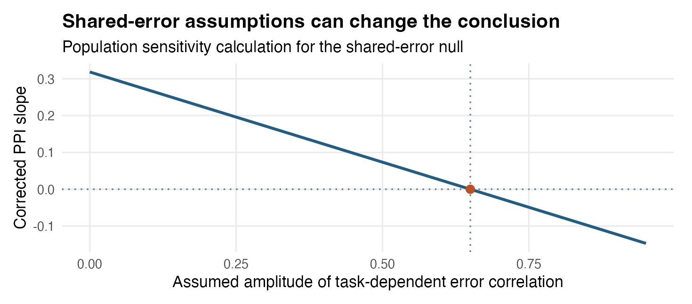

```{r setup, include=FALSE}
d <- read.csv("ppi_summary.csv")
d_poet <- read.csv("poet_covreg_step6_summary.csv")
p <- function(s, m, col = "mean") d[d$scenario == s & d$method == m, col]
pp <- function(tm, m, col = "mean") d_poet[d_poet$term == tm & d_poet$method == m, col]
fmt <- function(x, digits = 3) formatC(x, format = "f", digits = digits)
pct <- function(x) paste0(fmt(100 * x, 1), "%")
```

## Overview

Whereas Step 5 places deconvolved neural activity on the left-hand side as an outcome (`Neural ~ Behavior`), **Step 6 moves a deconvolved parcel readout onto the right-hand side (`Target ~ Seed + Task + Seed:Task` or `Behavior ~ Seed`) to test trial-to-trial functional connectivity and psychophysiological interaction (PPI).**

When an estimated quantity with trial-level sampling error is used as a regression predictor, two measurement properties directly affect structural slopes (Fuller, 1987; Vig & Hallquist, 2026): predictor measurement error inflates the observed design variance $X^\top X$ (attenuating both main connectivity and PPI interaction slopes toward zero), and any shared scanner or physiological noise between seed and target shifts the cross-product $X^\top Y$. Step 6 (`decon_connectivity_repair()`, backed by `medusa_fit_mmom()`) subtracts Step 4's analytical per-trial error variances (`se_demixed^2`) alongside stationary and dynamic cross-parcel error covariances from the **Adaptive-POET + covariance-regression engine** (`shared_error_model` / `shared_noise_vec`) while guarding against unstable small denominators in noisy scans (**Modified Method of Moments with Step-up Regularization, M-MOMS**), computes cross-trial sandwich standard errors and Satterthwaite degrees of freedom (`crosstrial_se = TRUE`, supporting calibrated single-subject $N = 1$ inference), and aggregates participant slopes across cohorts using **Hartung–Knapp–Sidik–Jonkman (HKSJ)** random-effects $t$-intervals.

```{r}
#| eval: false
#| code-fold: false
library(medusa)

ppi <- decon_connectivity_repair(
  panel_dt             = subject_epochs,
  seed_region          = "Seed",
  target_region        = "Target",
  seed_lag             = 0,
  target_lag           = 0,
  covariates           = "x_within",
  test_ppi             = TRUE,
  orthogonalize_seed_x = TRUE,          # residualizes seed on x_within; set FALSE for total-seed PPI
  shared_error         = "auto",
  crosstrial_se        = TRUE,
  method               = "mmoms"
)
```

::: {.callout-note}
### Position in the MEDuSA Pipeline
[**Step 4 (`subject_epochs` / `group_panel` + `se_demixed` + `shared_error_model` / `shared_noise_vec`)**](../medusa_step4_parcel_panels/medusa_step4_parcel_panels.qmd) $\longrightarrow$ **Step 6 (`decon_connectivity_repair` / `medusa_fit_mmom`)** $\longrightarrow$ Disattenuated participant ($N = 1$ Satterthwaite) & cohort (HKSJ) connectivity / PPI slopes
:::

The walkthrough below develops Step 6 in four substeps directly paralleling the REPAIR two-step moment framework: specifying the latent structural equation (`6.1`), constructing the trial-specific error covariance matrices (`6.2`), estimating participant slopes via regularized M-MOMS (`6.3`), and pooling across participants (`6.4`).

---

## Goals, Inputs, and Outputs

### Goals of Step 6

1. **Disattenuate noisy neural predictors and PPI product terms:** Construct per-trial predictor measurement-error covariance blocks $\Psi_i$—capturing both heteroskedastic interaction error $x_i^2 s_i^2$ and off-diagonal seed–interaction error covariance $x_i s_i^2$—and subtract them from observed design moments.
2. **Account for stationary and dynamic cross-parcel shared measurement error:** Subtract expected per-trial seed–target error covariance $\operatorname{Cov}(u_i, v_i \mid x_i, w_i)$ (`shared_error = "auto"`) estimated by Step 4's subspace-debiased Adaptive-POET + LTZ-gated dynamic covariance-regression engine across task drive, covariates, Step-2 `rwls` bursts, and frame-level `variance_confounds`.
3. **Support clear direct and residualized-seed PPI parameterizations:** Allow analysts to choose explicitly between unresidualized seed coupling (`orthogonalize_seed_x = FALSE`) and task-residualized seed coupling with exact error-covariance projection (`orthogonalize_seed_x = TRUE`).
4. **Deliver calibrated single-subject ($N = 1$) and cohort uncertainty:** Compute cross-trial ($i \neq j$) hybrid operator + gated onset-kernel sandwich SEs and Satterthwaite `df` within each participant (`crosstrial_se = TRUE`), and pool across cohorts ($S \ge 2$) via leverage-guarded HKSJ random-effects inference.

### Inputs: What Step 6 Receives and Why

| Input | Structure | Why Step 6 Uses It |
|:---|:---|:---|
| **`panel_dt`** | Named `subject_epochs` list (preferred), stacked `group_panel`, `.rds` / Parquet, or pipe-delimited CSV/`.csv.gz` from `medusa_write_table()` | Pairs seed and target trial readouts by `(id, run, trial)` while supplying `se_demixed` and Step 4's shared-error model (`$shared_error_model` on `subject_epochs`, or automatically restored Block-PAF list-columns `shared_noise_vec`, `lag_noise_vec`, and `trial_cor_vec` on stacked/CSV panels). |
| **`seed_region`, `target_region`, `seed_lag`, `target_lag`** | Parcel names and peri-event lags (e.g., `seed_lag = 0, target_lag = 0` or lagged `seed_lag = 0, target_lag = 4`) | Select the paired seed readout $\widehat{z}_{S,i}$ and target readout $\widehat{z}_{T,i}$ along with their trial-specific measurement SEs. |
| **`control_target_seed_lag`, `control_seed_lags`, & `multilag_control`** | Logical Granger target control (`FALSE`), optional seed lag vector, and multi-lag partialing flag (`FALSE`) | When testing directed cross-lag grids (e.g., `lags = c(0, 2, 4)`), setting `multilag_control = TRUE` (or `control_seed_lags = c(0, 2, 4)`) enters companion seed lags and pre-target target lags jointly with full cross-lag measurement-error covariance subtraction so deconvolution smoothness across adjacent lags never creates off-diagonal false positives. |
| **`covariates` & `test_ppi`** | Character vector of centered task covariates; logical `test_ppi` | When `test_ppi = TRUE`, the first element of `covariates` defines the error-free psychological modulator $x_i$ forming `seed:x`, while any additional covariates enter as additive controls. |
| **`shared_error`, `crosstrial_se`, & `method`** | `shared_error = c("auto", "supplied", "zero")`; `crosstrial_se = TRUE`; `method = c("mmoms", "mmom", "naive_unweighted")` | Govern stationary + dynamic cross-parcel error subtraction, cross-trial sandwich SE calibration, and moment-matrix conditioning. |

### Outputs: What Step 6 Produces and Why It Is Set Up That Way

| Output component | Structure & key columns | Role |
|:---|:---|:---|
| **`$group`** | `data.table` per modeled term (`seed_c`, task covariates, interaction): `estimate`, `std.error`, `statistic`, `df`, `p.value`, `conf.low`, `conf.high`, `tau2`, `n_subjects` | Reports HKSJ random-effects population slope estimates and 95% $t$-intervals when $S \ge 2$ (or cross-trial Satterthwaite $t$-inference when $N = 1$). |
| **`$subjects`** | `data.table` per `(id, term)`: `estimate`, `std.error`, `df`, `n_trials`, `r_shared_error`, `lambda_prelim`, `lambda_final`, `alpha_prelim`, `alpha_final`, `converged` | Exposes each participant's M-MOMS slope, cross-trial sandwich SE and Satterthwaite `df`, working cross-parcel error correlation (`r_shared_error`), and step-up regularization constants. |
| **`$augmented_panel`** | Optional paired trial `data.table` (`return_augmented_panel = TRUE`) | Provides the exact centered/paired trial columns and error variances for custom plots or sensitivity curves. |

---

## Step-by-Step Walkthrough: Substeps and Choice Points

### 6.1 Specify the latent trial connectivity or PPI structural equation

Within a participant (after centering seed, target, and task covariates within each run), let $\theta_{S,i}$ denote true latent seed amplitude at `seed_lag`, $\theta_{T,i}$ denote latent target amplitude at `target_lag`, and $x_i$ denote an error-free centered task modulator on trial $i$:

$$
\theta_{T,i} = \beta_S \theta_{S,i} + \beta_x x_i + \beta_P (\theta_{S,i} x_i) + \varepsilon_i.
$$

Each coefficient answers a distinct biological question: $\beta_S$ is baseline trial-to-trial seed–target coupling at the mean of $x_i$ ($x_i = 0$), $\beta_x$ absorbs direct task activation in the target parcel so shared main-effect responses are not mistaken for coupling, and $\beta_P$ is the **PPI slope**—how much seed–target coupling changes per unit change in $x_i$ (for $x_i \in \{-1, +1\}$, $2\beta_P$ is the slope difference between task conditions).

**Choice point — Seed parameterization (`orthogonalize_seed_x`), operator resolution matching (`match_resolution`), and multi-lag directed partialing (`control_target_seed_lag` & `multilag_control`):**

- **Task-orthogonalized vs. unresidualized seed (`orthogonalize_seed_x`):** By default (`orthogonalize_seed_x = TRUE`), Step 6 residualizes each run's seed readout against the resolution-matched task covariates (projecting seed error moments symmetrically through $P_s = I - M_s M_s^\top$) prior to forming PPI products—preventing direct linear task drive on the seed ($\beta_{S,x} x_i$) from injecting quadratic $x_i^2$ variance into `seed_c:x_c` and attenuating intrinsic task-modulated coupling. Set `orthogonalize_seed_x = FALSE` when testing a structural equation defined directly on total (task-driven + intrinsic) seed amplitude.
- **Seed–target resolution & PPI product matching (`match_resolution = TRUE`):** Across regions with distinct GCV smoothing parameters or HRF shapes ($M_S \neq M_T$), and even under equal smoothing where post-demixing elementwise multiplication satisfies $(M_S \eta_S) \odot x \neq M_T (\eta_S \odot x)$, uncorrected latent moments shift EIV slopes by $H_{SS}^{-1} H_{ST}$. With `match_resolution = TRUE` (default), `decon_connectivity_repair()` reads exact run-level trial resolution matrices (`run_trial_operators`, or embedded 8-lag `trial_res_vec` bands on `rbindlist()`-stacked and CSV panels) to align predictor and error moments to Target's transfer operator automatically.
- **Concurrent vs. multi-lag partialed directed coupling (`control_target_seed_lag` & `multilag_control`):** When testing a single lagged pair (`target_lag > seed_lag`), setting `control_target_seed_lag = TRUE` includes target activity at `seed_lag` as an error-corrected control so $\beta_S$ and $\beta_P$ test subsequent target change. When sweeping a $K \times K$ grid of `(seed_lag, target_lag)` pairs (for example, `lags = c(0, 2, 4)`), running 9 separate marginal single-lag regressions allows regularized deconvolution autocorrelation to project a true `Seed(0 s) -> Target(4 s)` effect onto `(0 -> 2)`, `(2 -> 4)`, and `(4 -> 4)`. Setting **`multilag_control = TRUE`** (or passing `control_seed_lags`) fits a joint multi-lag EIV equation that partials out companion seed lags and preceding target lags simultaneously while subtracting their full cross-lag measurement-error covariance (`lag_noise_vec` / `lag_error_cor`)—isolating the true directed lag cell cleanly.

---

### 6.2 Construct trial-specific predictor and shared-error covariance matrices

In practice, Step 4 provides de-mixed additive-error readouts $\widehat{z}_{S,i} = \theta_{S,i} + u_i$ and $\widehat{z}_{T,i} = \theta_{T,i} + v_i$ rather than latent $(\theta_{S,i}, \theta_{T,i})$, with known conditional sampling variances $s_{S,i}^2 = \texttt{se\_demixed}_{S,i}^2$ and $s_{T,i}^2 = \texttt{se\_demixed}_{T,i}^2$. Forming the observed predictor row $X_i = [\widehat{z}_{S,i},\, x_i,\, \widehat{z}_{S,i} x_i]^\top$ and observed outcome $Y_i = \widehat{z}_{T,i}$ induces predictor error $e_{X,i} = [u_i,\, 0,\, x_i u_i]^\top$.

Notice that even though $u_i$ is a scalar on trial $i$, both the `seed` column ($\widehat{z}_{S,i}$) and the `ppi` column ($\widehat{z}_{S,i} x_i$) contain the **same** noise draw $u_i$, producing a structured $3 \times 3$ predictor measurement-error covariance block on trial $i$:

$$
\Psi_i = \operatorname{Cov}(e_{X,i} \mid x_i) = s_{S,i}^2 \begin{pmatrix} 1 & 0 & x_i \\ 0 & 0 & 0 \\ x_i & 0 & x_i^2 \end{pmatrix}.
$$

Two properties follow immediately from $\Psi_i$: interaction error variance scales heteroskedastically with $x_i^2 s_{S,i}^2$, and whenever $x_i \neq 0$, the predictor and interaction errors covary with signed entry $x_i s_{S,i}^2$.

At the same time, scanner drift, physiological pulsatility, head micro-movements, and vascular proximity can induce correlated observation error $\operatorname{Cov}(u_i, v_i \mid x_i, w_i) = c_i$ between seed and target parcels—including **trial-varying** error covariance when physiological arousal, sub-scrubbing motion jolts, or respiration fluctuates with task demands—shifting the observed cross-moment $X_i Y_i$ by $\psi_{XY,i} = [c_i,\, 0,\, x_i c_i]^\top$.

Under `shared_error = "auto"`, Step 6 evaluates per-trial $(s_{S,i}^2, s_{T,i}^2, c_i)$ directly from Step 4's **Adaptive-POET + LTZ-gated dynamic covariance-regression engine** ([Step 4 §4.4](../medusa_step4_parcel_panels/medusa_step4_parcel_panels.qmd#sec-step4-poet)):

- When given `subject_epochs`, Step 6 queries `$shared_error_model` directly—including on-the-fly dynamic covariance evaluation against the PPI `modulator` even if Step 3 ran covariate-agnostically (`covariates = NULL`), plus exact Step 2 `rwls` `frame_weights` propagation.
- When given a stacked `data.table`, Parquet, or `medusa_write_table()` CSV panel, Step 6 reconstructs $c_i \approx \langle \texttt{shared\_noise\_vec}_{S,i}, \texttt{shared\_noise\_vec}_{T,i} \rangle$ (plus cross-lag terms from `lag_noise_vec`), projected onto the positive semi-definite cone.

**Choice point — Cross-parcel shared error (`shared_error`):** Use `shared_error = "auto"` (paired with `shared_error_method = "poet_covreg"` and `variance_confounds` in Step 4) as the standard setting, and compare against `shared_error = "zero"` to see how much stationary and dynamic background noise correlation contributed to the raw coupling estimate.

---

### 6.3 Estimate participant slopes via regularized Modified Method of Moments (M-MOMS)

Given observed trial vectors $(X_i, Y_i)$ across $n$ trials and error moments $(\Psi_i, \psi_{XY,i})$ with $\psi_{XY,i} = [c_i,\, 0,\, x_i c_i]^\top$, `medusa_fit_mmom()` estimates each participant's structural coefficients in three non-iterative moment steps (Fuller, 1987; Vig & Hallquist, 2026):

1. **Error-corrected preliminary normal equations:** Subtracts predictor error covariances from $X^\top X$ and shared seed–target error covariances from $X^\top Y$:
   $$
   \left(X^\top X - c(\hat{\lambda}_1, \alpha_1)\sum_{i=1}^n \Psi_i\right) \widehat{\beta}^{(1)}
   = X^\top Y - c(\hat{\lambda}_1, \alpha_1)\sum_{i=1}^n \psi_{XY,i},
   $$
   where **Fuller's generalized-eigenvalue modification factor** is
   $$
   c(\hat{\lambda}, \alpha) = \begin{cases}
   1 - \dfrac{\alpha}{n}, & \hat{\lambda} > 1 + \dfrac{1}{n}, \\[6pt]
   \hat{\lambda} - \dfrac{1 + \alpha}{n}, & \hat{\lambda} \le 1 + \dfrac{1}{n}.
   \end{cases}
   $$
   Here $\hat{\lambda}$ is the smallest generalized eigenvalue of the joint observed moment matrix relative to the error moment matrix (measuring the participant's weakest signal-to-noise direction), $n$ is the trial count, and $\alpha \ge q + 2$ is a small-sample regularization constant. Intuitively: when seed reliability is moderate to high ($\hat{\lambda} > 1 + 1/n$), $c(\hat{\lambda}, \alpha) = 1 - \alpha/n \approx 1$, performing near-full measurement-error subtraction; when reliability is very low ($\hat{\lambda} \le 1 + 1/n$), subtracting full error covariance would drive the denominator singular or negative definite, so $c(\hat{\lambda}, \alpha)$ automatically dials back error subtraction just enough to keep the matrix strictly positive definite.
2. **Structural disturbance variance & composite trial weights:** Uses $\widehat{\beta}^{(1)}$ to estimate measurement-error-corrected structural disturbance variance $\hat{\sigma}_\varepsilon^2$ and forms per-trial composite residual variances
   $$
   \hat{w}_i = \hat{\sigma}_\varepsilon^2 + s_{T,i}^2 - 2\,\widehat{\beta}^{(1)\top}\psi_{XY,i} + \widehat{\beta}^{(1)\top}\Psi_i\widehat{\beta}^{(1)},
   $$
   combining true biological residual variance ($\hat{\sigma}_\varepsilon^2$), target measurement error ($s_{T,i}^2$), propagated seed error ($\widehat{\beta}^{(1)\top}\Psi_i\widehat{\beta}^{(1)}$), and their shared-error cross term ($-2\widehat{\beta}^{(1)\top}\psi_{XY,i}$).
3. **Weighted M-MOMS update & step-up conditioning guard:** Re-estimates $\widehat{\beta}$ and sandwich standard errors using inverse composite weights $\hat{w}_i^{-1}$. Under `method = "mmoms"`, an adaptive step-up search selects the smallest $\alpha \ge q + 2$ that keeps the corrected predictor Gram matrix well-conditioned (minimum eigenvalue $\ge 5\%$ of largest observed eigenvalue, condition number $\le 10^5$)—preventing explosive small-denominator outliers in low-reliability participants while matching unmodified M-MOM whenever reliability is moderate to high.

**Choice point — Moment estimator (`method`):** Use `method = "mmoms"` as the primary estimator, and fit `method = "naive_unweighted"` in the same coordinates (`use_whitened = FALSE`) alongside it so the magnitude of measurement-error disattenuation is directly visible.

---

### 6.4 Pool participant slopes and compare against naive regression

Across $S \ge 2$ independent participants, `decon_connectivity_repair()` pools participant slopes $\widehat{\beta}_s$ and cross-trial sandwich variances $v_s = \text{SE}_s^2$ using random-effects inverse-variance weights $w_s^{\text{RE}} = (v_s + \hat{\tau}_{\text{pop}}^2)^{-1}$ (with leverage protection so no single ultra-precise participant dominates) and **Hartung–Knapp–Sidik–Jonkman (HKSJ)** finite-sample $t$-intervals:

$$
\widehat{\beta}_{\text{pop}} = \frac{\sum_{s=1}^S w_s^{\text{RE}} \widehat{\beta}_s}{\sum_{s=1}^S w_s^{\text{RE}}},
\qquad
\operatorname{SE}_{\text{HKSJ}} = \sqrt{\frac{q_{\text{HKSJ}}}{\sum_{s=1}^S w_s^{\text{RE}}}},
\qquad
q_{\text{HKSJ}} = \max\!\left(1,\; \frac{1}{S - 1}\sum_{s=1}^S w_s^{\text{RE}}\bigl(\widehat{\beta}_s - \widehat{\beta}_{\text{pop}}\bigr)^2\right),
$$

evaluating $p$-values and 95% confidence intervals against a $t_{S-1}$ distribution rather than a normal $z$ distribution. Scaling by $q_{\text{HKSJ}}$ and using $S - 1$ degrees of freedom prevents the anti-conservative coverage seen with asymptotic normal random-effects intervals in typical neuroimaging cohorts ($S = 12\text{--}30$).

To see how M-MOMS behaves when disattenuating genuine trial-level PPI (`Genuine PPI` scenario in `simulate.R`: 120 simulated cohorts of $S = 16$ participants, 2 runs × 60 trials, true population interaction $\beta_P = 0.35$, seed and target measurement error SDs $= 0.70$, independent errors), compare the top three rows of the benchmark table and left panel of @fig-ppi:

- **Naive regression** is attenuated by roughly one-third (**`r fmt(p("Genuine PPI", "Naive"))`** vs. true `0.350`), yielding **0.0%** 95% CI coverage because tight group SEs center around the attenuated value.
- **M-MOMS** removes the attenuation (**`r fmt(p("Genuine PPI", "M-MOMS"))`**), cuts population RMSE more than threefold (from `r fmt(p("Genuine PPI", "Naive", "rmse"))` to **`r fmt(p("Genuine PPI", "M-MOMS", "rmse"))`**), and restores nominal **`r pct(p("Genuine PPI", "M-MOMS", "coverage"))`** confidence-interval coverage.

```{r ppi-table, echo=FALSE}
tab <- data.frame(
  Scenario = d$scenario,
  Estimator = d$method,
  Truth = fmt(d$truth, 2),
  Mean = fmt(d$mean, 3),
  Bias = fmt(d$bias, 3),
  RMSE = fmt(d$rmse, 3),
  `Reject (p <= .05)` = pct(d$reject),
  `95% CI Coverage` = pct(d$coverage),
  check.names = FALSE
)
knitr::kable(tab, align = c("l", "l", "r", "r", "r", "r", "r", "r"))
```

{#fig-ppi fig-alt="M-MOMS centers near 0.35 for genuine PPI and near 0.32 for shared-error null. The known-error correction brings the latter near zero."}

---

## Recommended Settings

```{r applied, eval=FALSE}
#| code-fold: false
library(medusa)

ppi <- decon_connectivity_repair(
  panel_dt                = subject_epochs,
  seed_region             = "Seed",
  target_region           = "Target",
  seed_lag                = 0,
  target_lag              = 0,
  covariates              = "x_within",
  test_ppi                = TRUE,
  use_whitened            = FALSE,
  orthogonalize_seed_x    = TRUE,
  match_resolution        = TRUE,
  shared_error            = "auto",
  crosstrial_se           = TRUE,
  method                  = "mmoms",
  region_col              = "parcel",
  id_col                  = "id"
)

ppi$group
```

| Parameter | Package default | Recommended setting | Summary of Role & When to Adjust |
|:---|:---|:---|:---|
| **`panel_dt`** | Required | Named `subject_epochs` list (or `.rds` / Parquet / `medusa_write_table()` CSV `group_panel`) | Preserves Step 4 POET + covariance-regression metadata (`shared_error_model` or `shared_noise_vec` / `lag_noise_vec` / `trial_cor_vec`; see [worked handoff check](../worked-example.qmd#sec-worked-handoff)). |
| **`orthogonalize_seed_x`** | `TRUE` | `TRUE` (intrinsic coupling) or `FALSE` (direct total-seed model) | Residualizes seed against task covariates before forming PPI products so direct seed task drive does not inject quadratic $x^2$ variance (`Substep 6.1`). |
| **`match_resolution`** | `TRUE` | `TRUE` | Aligns seed and PPI product transfer operators ($H_{SS}^{-1} H_{ST}$) to Target's trial resolution across operator, stacked, and CSV panels (`Substep 6.1`). |
| **`control_target_seed_lag` & `multilag_control`** | `FALSE`, `FALSE` | `multilag_control = TRUE` on multi-lag grids (`control_target_seed_lag = TRUE` for single-pair Granger tests) | Partials out companion seed lags and pre-target lags with full cross-lag error covariance subtraction (`Substep 6.1`). |
| **`shared_error`** | `"auto"` | `"auto"` + `"zero"` comparison | Subtracts stationary and dynamic cross-parcel measurement-error covariance learned by Step 4's `poet_covreg` engine (`Substep 6.2`). |
| **`crosstrial_se`** | `TRUE` | `TRUE` | Computes cross-trial ($i \neq j$) hybrid operator + gated onset-kernel sandwich SEs and Satterthwaite `df` (essential for single-subject $N = 1$ precision neuroimaging). |
| **`method`** | `"mmoms"` | `"mmoms"` (report alongside `"naive_unweighted"`) | Stabilizes error-subtracted predictor matrices in noisy participants while disattenuating slopes (`Substep 6.3`). |
| **`use_whitened`** | `FALSE` | `FALSE` | Keeps seed, target, and `Seed:x` in matched unwhitened run-centered coordinates (separate within-parcel decorrelation/ZCA matrices $T_S \neq T_T$ do not commute with product terms). |

---

## Practical Diagnostics, Dynamic POET Covariance Regression, and Scope

### Resolving dynamic task- & confound-modulated shared noise (`poet_covreg`) vs. unmeasured sensitivity

What happens when physiological or motion noise correlation between two regions *changes magnitude with task condition or respiration*—for instance, condition-locked breath-holding or head motion during high-$x_i$ trials?

Two distinct regimes arise depending on what data are available:

1. **Full MEDuSA pipeline with multi-parcel BOLD & `variance_confounds` (`poet_covreg`):** When `decon_epoch_regression(..., shared_error_method = "poet_covreg", variance_confounds = conf)` has access to multi-parcel whitened residuals ($P = 9$ parcels) and frame-level variance envelopes (`FD`, `DVARS`, `RVT`), Adaptive-POET + LTZ-gated covariance regression ([Step 4 §4.4](../medusa_step4_parcel_panels/medusa_step4_parcel_panels.qmd#sec-step4-poet)) estimates trial-varying cross-parcel error moments $c_i$ directly—and embeds them onto `panel$shared_noise_vec` so even a CSV-exported stacked table retains full parity with operator mode. In @fig-poet-step6 and @tbl-poet-step6 (`Dynamic Shared-Noise Null`: 24 cohorts of $S = 16$ participants, zero true coupling or PPI, pervasive physiological factor plus RVT-modulated bursts and two pure-null confound columns), ignoring shared error (`Zero Shared Error`) yields strong false main coupling (`r fmt(pp("seed_c", "Zero Shared Error"))`, **`r pct(pp("seed_c", "Zero Shared Error", "reject"))`** false positives) and stationary-only shrinkage (`Legacy Stationary (auto)`) still inflates Type I error (`r fmt(pp("seed_c", "Legacy Stationary (auto)"))`, **`r pct(pp("seed_c", "Legacy Stationary (auto)", "reject"))`** false positives). **`POET + CovReg`** eliminates the bias in **both** operator mode and CSV-restored stacked mode (`seed_c` mean **`r fmt(pp("seed_c", "POET + CovReg (Operator)"))`** / **`r fmt(pp("seed_c", "POET + CovReg (CSV Panel)"))`**, **`r pct(pp("seed_c", "POET + CovReg (Operator)", "reject"))`** Type I error, **`r pct(pp("seed_c", "POET + CovReg (Operator)", "coverage"))`** coverage; `seed_c:x_c` **`r pct(pp("seed_c:x_c", "POET + CovReg (Operator)", "coverage"))`** coverage). Likewise, in single-subject ($N = 1$) rapid-ITI scans (`mean ITI = 2.2 s`), enabling `crosstrial_se = TRUE` accounts for serial trial error correlation via Satterthwaite `df` (`r fmt(pp("seed_c", "N=1 Cross-Trial SE (crosstrial_se=TRUE)", "mean_df"), 1)` vs. `Inf`), improving CI coverage from **`r pct(pp("seed_c", "N=1 Diagonal SE (crosstrial_se=FALSE)", "coverage"))`** to **`r pct(pp("seed_c", "N=1 Cross-Trial SE (crosstrial_se=TRUE)", "coverage"))`** (see the [15-Study Validation Suite](../library/medusa_validation_suite.html) Pillar 15 for full multi-regime power and calibration curves).

![End-to-end Step 1–6 dynamic shared-noise null benchmark (`make_poet_step6_fig.R` from `poet_covreg_step6_summary.csv`, $S = 16$ cohorts, true connectivity = 0). **(A)** Mean estimated `seed_c` slope: ignoring shared error yields `+0.161` false coupling and stationary-only shrinkage leaves `+0.041`, whereas `POET + CovReg` centers cleanly at `-0.002` in both operator and CSV-restored panel modes. **(B)** Corresponding false-positive rates (`p <= .05`), collapsing from `75.0%` (zero shared error) and `20.8%` (stationary-only) down to the nominal **`4.2%`** under `POET + CovReg`.](poet_covreg_step6.png){#fig-poet-step6 width="100%" fig-alt="Two-panel horizontal dot and bar plot showing zero bias (-0.002) and nominal 4.2% false-positive rate for POET + CovReg in both operator and CSV panel modes versus +0.041 / 20.8% for legacy stationary and +0.161 / 75.0% for zero shared error."}

```{r}
#| label: tbl-poet-step6
#| tbl-cap: "End-to-end Step 1–6 calibration under dynamic task/RVT-modulated shared noise (S = 16 cohorts, P = 9 parcels, true connectivity = 0, true PPI = 0) and single-subject (N = 1) rapid-ITI serial overlap."
#| echo: false
tab_p <- data.frame(
  Regime = d_poet$regime,
  Term = d_poet$term,
  Estimator = d_poet$method,
  Mean = fmt(d_poet$mean, 3),
  RMSE = fmt(d_poet$rmse, 3),
  `Mean df` = ifelse(d_poet$mean_df > 500, "Inf", fmt(d_poet$mean_df, 1)),
  `Reject (p <= .05)` = pct(d_poet$reject),
  `95% CI Coverage` = pct(d_poet$coverage),
  check.names = FALSE
)
knitr::kable(tab_p, align = c("l", "l", "l", "r", "r", "r", "r", "r"))
```

2. **Bare two-parcel tables or unmeasured pairwise-only confounds (post-hoc sensitivity curve):** If a panel was stripped of shared-error columns—or if a purely local, unmeasured vascular artifact flips correlation exclusively between two adjacent regions (`Shared-error null` in @fig-ppi, right: bare 2-parcel table with $\beta_P = 0$, $\operatorname{Cov}(u_i, v_i \mid x_i) = 0.65 x_i \sigma^2$, zero run-wide average correlation, and no multi-parcel or `variance_confounds` signature)—then $\mathbb{E}[x_i u_i v_i] = r \sigma^2 \neq 0$ produces a positive naive artifact (`r fmt(p("Shared-error null", "Naive"))`) that predictor disattenuation magnifies (`r fmt(p("Shared-error null", "M-MOMS"))`), returning to zero (`r fmt(p("Shared-error null", "Known-error moments"))`) once the condition-specific cross-error moment is supplied. Plotting the implied M-MOMS slope across hypothesized condition-modulated cross-error correlations $r(x)$ (@fig-sensitivity) makes transparent how extreme an unmeasured local artifact would need to be to explain an observed PPI.

{#fig-sensitivity fig-alt="The inferred PPI decreases from about 0.32 at zero assumed shared error to zero at the generating assumption of 0.65."}

### Reporting checklist and scope boundaries

1. **Report circuit, lag, and estimand choices:** Document `seed_region`, `target_region`, `seed_lag`, `target_lag`, `orthogonalize_seed_x`, `control_target_seed_lag`, and multiplicity adjustment across region pairs (see [Appendix A: Reporting MEDuSA in Empirical Papers](../reporting.qmd) for an adaptable *Methods* template).
2. **Present naive and M-MOMS side by side:** Include `"naive_unweighted"` alongside `"mmoms"` and summarize `ppi$subjects` (`r_shared_error`, `alpha_final`, `lambda_final`, participant/trial counts, and convergence; see the [Visual QC Gallery](../medusa_qc_gallery/medusa_qc_gallery.qmd) for side-by-side participant connectivity distributions under intact vs. stripped `shared_error` metadata).
3. **Scope boundaries:** Just as in Vig & Hallquist (2026), Step 6 treats first-stage error variances (`se_demixed^2`) and selected regularization constants as fixed plug-in quantities and requires full-rank within-person predictor designs with adequate seed reliability. While `match_resolution = TRUE` (default) aligns deterministic post-demixing resolution differences ($M_S \neq M_T$) automatically across parcels, severe unmodeled HRF mis-specification or extreme non-commuting smoothing mismatches remain scope limits. For mathematical derivations and full-covariance extensions, see [Propagating BOLD Noise into Trial Standard Errors](../medusa_standard_errors_mmom.qmd) and [Latent Connectivity Beyond Per-Trial Disattenuation](../medusa_connectivity_inference/medusa_connectivity_inference.qmd).

---

## Reproduce the Step 6 Demonstrations

```{bash}
#| eval: false
#| code-summary: "Show reproduction commands"
Rscript simulate.R
Rscript figures.R
quarto render medusa_step6_connectivity.qmd
```

[Simulation source](simulate.R) · [Figure source](figures.R) · [Summary metrics](ppi_summary.csv) · [Replication draws](ppi_draws.csv) · [Simulation log](simulation.log)
