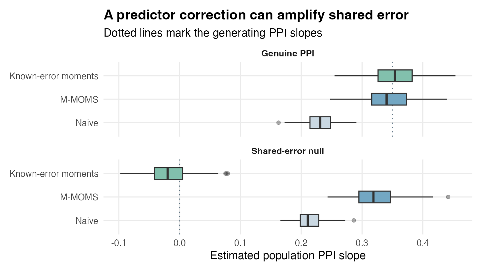
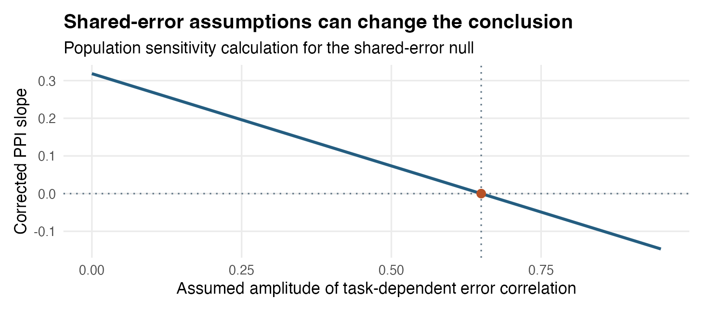

# Step 6 · Trial-level connectivity and PPI {#sec-step6}

```{r setup, include=FALSE}
d <- read.csv("ppi_summary.csv")
p <- function(s, m, col = "mean") d[d$scenario == s & d$method == m, col]
fmt <- function(x, digits = 3) formatC(x, format = "f", digits = digits)
pct <- function(x) paste0(fmt(100 * x, 1), "%")
```

## Overview

In Step 5, deconvolved neural activity sits on the **left-hand side** of the regression (`Neural ~ Behavior`), where zero-mean BOLD measurement noise inflates standard errors without biasing population slope estimates. **Step 6 moves a deconvolved parcel readout onto the right-hand side (`Target ~ Seed + Task + Seed:Task`) to test trial-to-trial functional connectivity and psychophysiological interaction (PPI)—or brain-to-behavior prediction (`Behavior ~ Seed`).**

Placing a noisy deconvolved estimate on the right-hand side creates two immediate statistical hazards that ordinary OLS and `lmer()` cannot fix:

1. **Predictor attenuation bias:** Trial-level measurement error $u_i$ in the seed inflates the observed design variance $X^\top X$, systematically shrinking both the baseline seed connectivity slope and the `Seed:Task` PPI slope toward zero.
2. **Spurious coupling from shared cross-parcel noise:** Scanner drift, physiological pulsatility, head motion, and overlapping vascular noise create correlated measurement errors $\operatorname{Cov}(u_i, v_i) \neq 0$ between seed and target parcels. Disattenuating the denominator without subtracting shared seed–target noise in the numerator *amplifies* false connectivity—and if shared error varies with task condition, it can manufacture a completely spurious PPI.

Step 6 (`decon_connectivity_repair()`, backed by `medusa_fit_mmom()`) addresses these hazards by pairing Step 4's analytical per-trial error variances (`se_demixed^2`) and task-free cross-parcel noise innovation correlations (`shared_noise_loading` / `unit_error_cor`) with **Method-of-Moments with Step-up Regularization (M-MOMS)** inside each participant, followed by leverage-guarded **Hartung–Knapp–Sidik–Jonkman (HKSJ)** random-effects pooling across participants.

---

## Goals of Step 6

Step 6 is designed to accomplish four specific goals:

1. **Disattenuate noisy neural predictors and PPI interactions:** Construct exact per-trial $q \times q$ predictor measurement-error covariance blocks $\Psi_i$—including the off-diagonal error covariance $x_i s_i^2$ between a noisy seed $\widehat S_i$ and its task product $\widehat S_i x_i$—and subtract them from observed design moments via `medusa_fit_mmom()`.
2. **Subtract stationary cross-parcel shared measurement error automatically:** Use Step 4's task-free `unit_error_cor` matrix or `shared_noise_loading` vectors (`shared_error = "auto"`) to estimate per-trial seed–target error covariance $\operatorname{Cov}(u_i, v_i)$ (`err_xy`) without stripping genuine task-evoked neural coupling.
3. **Preserve clear direct vs. reduced-form PPI estimands:** Let the analyst choose explicitly whether the seed retains its linear task response (`orthogonalize_seed_x = FALSE`, isolating direct connectivity and linear modulation) or is residualized against task covariates with exact error-covariance projection (`orthogonalize_seed_x = TRUE`).
4. **Pool participant slopes with finite-sample random-effects calibration:** Aggregate participant-level M-MOMS slopes at the group level using HKSJ / HC2 leverage-adjusted random-effects inference, treating independent participants as the unit of replication while guarding against extreme low-reliability outlier weights.

**What Step 6 leaves outside scope (and requires you to check):** Step 6 corrects **within-trial additive second-moment measurement error** conditional on the operators learned in Steps 1–4. It does *not* undo unequal cross-parcel source resolution biases ($K_S \neq K_T$), model full cross-trial off-diagonal error blocks simultaneously inside M-MOMS, or automatically detect **condition-dependent changes in shared physiological/motion noise** ($\operatorname{Cov}(u_i, v_i \mid x_i)$ varying with $x_i$). Because task-modulated shared error is indistinguishable from latent PPI using marginal trial SEs alone, Step 6 pairs estimation with explicit shared-error sensitivity diagnostics. For deeper theoretical derivations and full-covariance research prototypes, see [From BOLD noise to M-MOM error variances](../medusa_standard_errors_mmom.qmd) and [Measurement-error models and REPAIR](../medusa_connectivity_inference/medusa_connectivity_inference.qmd).

---

## Inputs: What Step 6 Receives and Why

| Input | Structure | Why Step 6 needs it and why it is shaped that way |
|:---|:---|:---|
| **`panel_dt` (`subject_epochs` list recommended, or `group_panel`)** | Named `list` of per-participant `decon_epoch_regression()` objects (preferred) or stacked `data.table` | Pairing seed and target trials requires matching `(id, run, trial)` rows and consistent physical/noise units across regions. Passing the full `subject_epochs` list preserves each participant's full `$unit_error_cor` matrix from Step 4; passing a stacked `data.table` falls back cleanly to the `$panel$shared_noise_loading` list-column (note that plain CSV export drops list-columns unless saved as `.rds` or Parquet). |
| **`seed_region`, `target_region`, `seed_lag`, `target_lag`** | Parcel labels and peri-event lag coordinates (e.g., `seed_lag = 0, target_lag = 0` or lagged `seed_lag = 0, target_lag = 1.3`) | Identifies the exact paired trial readouts $(W_i, Y_i)$ and their matching analytical measurement SEs (`se_demixed`) on each trial. |
| **`covariates` & `test_ppi`** | Character vector of centered task covariates; logical `test_ppi` | When `test_ppi = TRUE`, the **first** column of `covariates` defines the psychological modulator $x_i$ for the `seed:x` interaction, while any additional covariates enter as additive main-effect controls. Task covariates are assumed error-free; centered coding makes the main `seed` slope interpretable at $x_i = 0$. |
| **`shared_error`** | `"auto"`, `"supplied"`, or `"zero"` | Controls how seed–target measurement-error covariance `err_xy` enters the right-hand moment correction $X^\top Y - \sum_i \operatorname{Cov}(e_{X,i}, v_i)$. |

---

## Outputs: What Step 6 Produces and Why It Is Set Up That Way

`decon_connectivity_repair()` returns a structured list separating population inference from participant-level measurement-error diagnostics:

| Output component | Structure & key columns | Why it is set up that way |
|:---|:---|:---|
| **`$group`** | `data.table` with one row per modeled term (`seed`, task covariates, `ppi`, optional lagged target control): `estimate`, `std.error`, `statistic`, `df`, `p.value`, `conf.low`, `conf.high`, `tau2`, `n_subjects` | Reports the HKSJ leverage-adjusted random-effects population mean slope and 95% $t$-interval across independent participants, keeping group degrees of freedom anchored to participant count rather than trial count. |
| **`$subjects`** | `data.table` with one row per `(id, term)`: `estimate`, `std.error`, `n_trials`, `r_shared_error`, `shared_error_source`, `regularization_lambda`, `converged` | Exposes every participant's M-MOMS slope, working cross-parcel innovation correlation (`r_shared_error`), how that correlation was sourced (`"unit_error_cor"`, `"shared_noise_loading"`, or `"zero"`), and whether step-up moment regularization (`"mmoms"`) intervened on weak design matrices. |
| **`$panel_repair`** | Optional paired trial `data.table` (when `return_panel = TRUE`) | Retains exact centered/paired seed, target, modulator, and error-variance columns per `(id, run, trial)` so analysts can run custom sensitivity curves or inspect outlier trials directly. |

---

## Recommended Settings

```{r applied, eval=FALSE}
#| code-fold: false
library(medusa)

ppi <- decon_connectivity_repair(
  panel_dt = subject_epochs,
  seed_region = "Seed",
  target_region = "Target",
  seed_lag = 0,
  target_lag = 0,
  covariates = "x_within",
  test_ppi = TRUE,
  use_whitened = FALSE,
  orthogonalize_seed_x = FALSE,
  shared_error = "auto",
  method = "mmoms",
  region_col = "parcel",
  id_col = "id"
)

ppi$group
```

| Parameter | Package default | Recommended setting | Why and when to adjust |
|:---|:---|:---|:---|
| **`panel_dt`** | Required | Named `subject_epochs` list (or `.rds` `group_panel`) | Retains exact Step 4 cross-parcel noise metadata (`unit_error_cor` and `shared_noise_loading`) that plain-text CSV exports lose; see [worked handoff check](../worked-example.qmd#sec-worked-handoff). |
| **`method`** | `"mmoms"` | `"mmoms"` (also fit `"naive_unweighted"` as a baseline comparison) | `"mmoms"` applies adaptive step-up regularization when subtracting $\sum_i \Psi_i$ approaches a non-positive-definite design matrix in noisy participants, preventing explosive small-denominator outliers. Always report `"naive_unweighted"` alongside `"mmoms"` in the same coordinates so the magnitude of disattenuation is transparent. |
| **`shared_error`** | `"auto"` | `"auto"` + sensitivity check | Automatically estimates stationary cross-parcel measurement-error correlation from Step 1's task-free `noise_innovations` (combining spatial and cross-lag correlation when `seed_lag != target_lag`). Compare against `shared_error = "zero"` and condition-dependent sensitivity curves for PPI claims. |
| **`use_whitened`** | `FALSE` | `FALSE` | Pairs `decon_demixed` with `se_demixed` in original run-centered coordinates. Separate parcel-specific ZCA matrices ($T_S \neq T_T$) mix different neighboring trials into seed and target and do not commute with PPI multiplication ($T(S \odot x) \neq (TS) \odot (Tx)$). |
| **`orthogonalize_seed_x`** | `TRUE` | `FALSE` when testing direct `Seed + x + Seed:x` models; `TRUE` for reduced-form residualized-seed modulation | When `FALSE`, `seed` and `x` enter symmetrically without altering the quadratic task structure. When `TRUE`, the seed is first residualized on `covariates` (projecting `diag(se_demixed^2)` through $P D_u P^\top$); remember that residualizing a task-responsive seed shifts the `Seed:x` product by a term proportional to $x^2$. |
| **`control_target_at_seed_lag`** | `FALSE` | `TRUE` for Granger-style lagged connectivity (`target_lag > seed_lag`) | Adds target activity at `seed_lag` as an additional error-corrected neural covariate (propagating its own `se_demixed^2` and `shared_noise_loading`) when asking whether seed activity predicts *subsequent change* in the target region. |

---

## Core Mechanisms in Detail

### 1. The structural trial model and M-MOMS moment correction

For participant $s$ and trial $i$ (after centering seed, target, and task covariates within each participant and run), let $S_i$ be latent seed activity at `seed_lag`, $T_i$ latent target activity at `target_lag`, and $x_i$ an error-free centered task modulator:

$$
T_i = \beta_S S_i + \beta_x x_i + \beta_P (S_i x_i) + \varepsilon_i.
$$

Here $\beta_S$ is baseline trial-to-trial coupling at $x_i = 0$, and $\beta_P$ is the psychophysiological interaction slope—how much the seed–target slope changes per unit change in $x_i$ (for $x_i \in \{-1, +1\}$, $2\beta_P$ is the slope difference between conditions). Always include both main effects ($\beta_S$ and $\beta_x$) when testing $\beta_P$ so shared main-effect task activation is not absorbed into the interaction.

Because Step 4 observes noisy readouts $W_i = S_i + u_i$ and $Y_i = T_i + v_i$ rather than $(S_i, T_i)$, the observed regressor vector $X_i = [W_i,\, x_i,\, W_i x_i]^\top$ carries measurement error $e_{X,i} = [u_i,\, 0,\, x_i u_i]^\top$. Even when $u_i$ is purely univariate on each trial with variance $s_i^2 = \texttt{se\_demixed}_i^2$, the seed column and the PPI interaction column share the **same** noise realization $u_i$, creating a structured $3 \times 3$ predictor error covariance block on trial $i$:

$$
\Psi_i = \operatorname{Cov}(e_{X,i} \mid x_i) = s_i^2 \begin{pmatrix} 1 & 0 & x_i \\ 0 & 0 & 0 \\ x_i & 0 & x_i^2 \end{pmatrix}.
$$

Notice two essential features of $\Psi_i$:
- **Heteroskedastic interaction error:** Trial measurement variance in the PPI column scales with $x_i^2 s_i^2$, so extreme modulator trials carry amplified measurement noise.
- **Signed predictor–interaction error covariance:** Whenever $x_i \neq 0$, the off-diagonal entry $x_i s_i^2$ is nonzero (and negative when $x_i < 0$). Passing diagonal SEs without this off-diagonal term miscalibrates both main and interaction slopes.

Meanwhile, if seed and target measurement errors correlate ($\operatorname{Cov}(u_i, v_i \mid x_i) = c_i$), the observed cross-product $X^\top Y$ is also biased by $\sum_i [c_i,\, 0,\, x_i c_i]^\top$. M-MOMS solves the bias-corrected normal equations (with step-up eigenvalue regularization when $X^\top X - \sum_i \Psi_i$ nears singularity):

$$
\left(X^\top X - \sum_{i=1}^n \Psi_i\right) \widehat\beta = X^\top Y - \sum_{i=1}^n \begin{pmatrix} \operatorname{Cov}(u_i, v_i \mid x_i) \\ 0 \\ x_i \operatorname{Cov}(u_i, v_i \mid x_i) \end{pmatrix}.
$$

Under `shared_error = "auto"`, `decon_connectivity_repair()` populates $\operatorname{Cov}(u_i, v_i) = \widehat r_{ST} \, s_{S,i} s_{T,i}$ using participant $s$'s task-free innovation correlation $\widehat r_{ST}$ from Step 4 (`unit_error_cor`, or the inner product of `shared_noise_loading` vectors). That automatically removes **stationary** cross-parcel background noise correlation without needing resting-state scans or manual calibration.

### 2. Disattenuation vs. task-dependent shared error: two controlled stress tests

Why isn't stationary `shared_error = "auto"`—or marginal SE disattenuation alone—an automatic guarantee for every PPI claim? Consider two panel-level simulations (120 datasets each; 16 participants, 2 runs, 60 trials/run, balanced $x_i \in \{-1, +1\}$, marginal seed and target measurement error SDs fixed identically at $0.70$ in every condition):

1. **Genuine PPI (independent errors):** True population interaction $\beta_P = 0.35$, independent seed–target errors ($\operatorname{Cov}(u_i, v_i \mid x_i) = 0$).
2. **Task-modulated shared-error null:** True population interaction $\beta_P = 0$, zero average error correlation across the run, **but shared error flips sign with task condition**: $\operatorname{Cov}(u_i, v_i \mid x_i) = 0.65 x_i \sigma^2$ (for example, condition-locked breath-hold, arousal, or head-jerking artifacts affecting both regions during $x_i = +1$ trials). Because average unconditional $\operatorname{Cov}(u, v) = 0$ across balanced $-1/+1$ trials, neither marginal SEs (`se_demixed`) nor a single stationary run-wide correlation (`shared_error = "auto"`) sees the condition-flipped cross-error!

```{r ppi-table, echo=FALSE}
tab <- data.frame(
  Scenario = d$scenario,
  Estimator = d$method,
  Truth = fmt(d$truth, 2),
  Mean = fmt(d$mean, 3),
  Bias = fmt(d$bias, 3),
  RMSE = fmt(d$rmse, 3),
  `Reject (p <= .05)` = pct(d$reject),
  `95% CI Coverage` = pct(d$coverage),
  check.names = FALSE
)
knitr::kable(tab, align = c("l", "l", "r", "r", "r", "r", "r", "r"))
```

{#fig-ppi fig-alt="M-MOMS centers near 0.35 for genuine PPI and near 0.32 for shared-error null. The known-error correction brings the latter near zero."}

The two panels of @fig-ppi illustrate both sides of measurement-error correction:

- **When measurement error is genuinely disattenuated (`Genuine PPI`):** Naive regression is severely attenuated (**`r fmt(p("Genuine PPI", "Naive"))`** vs. truth `0.350`, **0.0%** CI coverage because narrow group SEs center on the biased value). M-MOMS completely removes the attenuation bias (**`r fmt(p("Genuine PPI", "M-MOMS"))`**, RMSE dropping from `r fmt(p("Genuine PPI", "Naive", "rmse"))` to **`r fmt(p("Genuine PPI", "M-MOMS", "rmse"))`**, achieving **`r pct(p("Genuine PPI", "M-MOMS", "coverage"))`** nominal coverage).
- **Why larger M-MOMS slopes do not prove valid recovery (`Shared-error null`):** When $\operatorname{Cov}(u_i, v_i \mid x_i) = r x_i \sigma^2$, multiplying seed error $u_i$ by $x_i$ creates a nonzero numerator bias $\mathbb{E}[x_i u_i v_i] = r \sigma^2$. Naive regression already exhibits a false positive (**`r fmt(p("Shared-error null", "Naive"))`**). Subtracting predictor error variance from the denominator $X^\top X - \sum \Psi_i$ while leaving $r \sigma^2$ in the numerator **magnifies** the artifact to **`r fmt(p("Shared-error null", "M-MOMS"))`** (`r pct(p("Shared-error null", "M-MOMS", "reject"))` false rejection). Only when the condition-specific cross-error moment is explicitly subtracted (`Known-error moments`) does the estimate return to zero (**`r fmt(p("Shared-error null", "Known-error moments"))`**, **`r pct(p("Shared-error null", "Known-error moments", "coverage"))`** coverage).

### 3. Sensitivity analysis and reporting checklist for Step 6

Because stationary background noise correlation (`shared_error = "auto"`) removes baseline cross-parcel shared error $\operatorname{Cov}(u, v) = r_0 \sigma_S \sigma_T$ (which biases main-effect `seed` connectivity) while condition-modulated cross-error $\Delta r \cdot x_i \sigma_S \sigma_T$ threatens `ppi`, every empirical PPI claim should evaluate how sensitive its conclusion is to plausible condition-dependent error correlation:

{#fig-sensitivity fig-alt="The inferred PPI decreases from about 0.32 at zero assumed shared error to zero at the generating assumption of 0.65."}

As @fig-sensitivity shows, plotting the implied M-MOMS interaction slope across a range of hypothetical task-modulated cross-error correlations $r(x)$ immediately reveals how strong condition-locked artifact coupling would have to be to explain away an observed PPI effect. Pair this sensitivity check with physiological/motion nuisance regressors in Step 1/2 (`nuisance_list`), framewise displacement stratified checks, and a negative-control reference parcel that shares vascular/physiological noise proximity without the hypothesized circuit connection.

When reporting a Step 6 connectivity or PPI analysis, always document:

1. **Circuit & lag specification:** Exact `seed_region`, `target_region`, `seed_lag`, `target_lag`, whether `control_target_at_seed_lag` was included, and the prespecified multiplicity family across region pairs and lags.
2. **Covariate centering & orthogonalization:** Coding of the modulator $x_i$, included main effects, and whether `orthogonalize_seed_x` was `FALSE` (direct model) or `TRUE` (residualized-seed model).
3. **Naive vs. M-MOMS comparison:** Side-by-side `naive_unweighted` and `mmoms` estimates in identical coordinates (`use_whitened = FALSE`) so readers see both raw and disattenuated magnitudes.
4. **Shared-error provenance & participant diagnostics:** Summary of `ppi$subjects$r_shared_error`, `shared_error_source`, participant/trial counts, any `mmoms` step-up regularization triggers, and sensitivity to `shared_error = "zero"` vs. `"auto"` (plus condition-specific noise checks for PPI).

---

## Reproduce the Step 6 Demonstrations

```{bash}
#| eval: false
#| code-summary: "Show reproduction commands"
Rscript simulate.R
Rscript figures.R
quarto render medusa_step6_connectivity.qmd
```

[Simulation source](simulate.R) · [Figure source](figures.R) · [Summary metrics](ppi_summary.csv) · [Replication draws](ppi_draws.csv) · [Simulation log](simulation.log)
